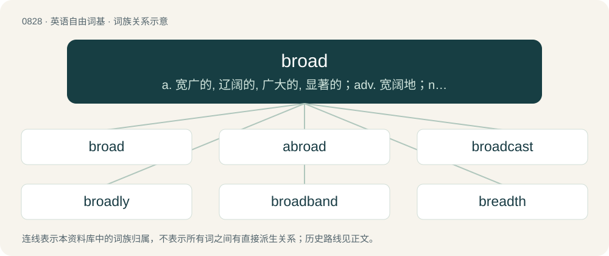

# 0899 · broad — a. 宽广的, 辽阔的, 广大的, 显著的；adv. 宽阔地；n. 宽阔部分

[总目录](../00_总目录_按常用程度.md)

**类型**：英语自由词基　｜　**来源语言**：见词源记录

## 核心含义与来源

- 核心含义：a. 宽广的, 辽阔的, 广大的, 显著的；adv. 宽阔地；n. 宽阔部分
- 英文含义：Wide in extent or scope.
- 词形：broad

**多个词源／构词路径**：同一拼写可能有不同来源；以下按词性和含义分别列出。

**来源记录 1**（形容词；Wide in extent or scope.）

From Middle English brood, brode, from Old English brād (“broad, flat, open, extended, spacious, wide, ample, copious”), from Proto-West Germanic \*braid, from Proto-Germanic \*braidaz (“broad, wide”), of uncertain origin. Cognates Cognate with Yola brode (“broad”), North Frisian bread, breeđ, briad, briid, briidj (“wide”), Saterland Frisian and West Frisian breed (“broad, wide”), Bavarian brad, broad (“broad, wide”), Central Franconian and Luxembourgish breet (“broad, wide”), Dutch breed (“broad, wide”), German breit (“broad, wide”), Vilamovian braat (“broad, wide”), Yiddish ברייט (breyt, “broad, wide”), Danish and Swedish bred (“broad, wide”), Faroese and Icelandic breiður (“broad, wide”), Norwegian Bokmål bred, brei (“broad, wide”), Norwegian Nynorsk brei, breid (“broad, wide”), Gothic 𐌱𐍂𐌰𐌹𐌸𐍃 (braiþs, “broad, wide”).

**来源记录 2**（名词；A prostitute, a woman of loose morals.）

Early 20th century, apparent phono-semantic matching of German Braut (“bride”, also “girlfriend”, and more generally “broad, chick”).

## 词族图

## 单词速览（常用到不常用）

| 单词 | 音标 | 释义 |
|---|---|---|
| [broad](#w-1) | 英 /bɹɔːd/；美 /bɹɔd/ | a. 宽广的, 辽阔的, 广大的, 显著的；adv. 宽阔地；n. 宽阔部分 |
| [abroad](#w-2) | 英 /əˈbɹɔːd/；/əˈbɹɔd/ | adv. 往国外, 到室外, 到处；a. 往国外的, 在室外的, 广泛四散的 |
| [broadcast](#w-3) | 英 /ˈbɹɔːd(ˌ)kɑːst/；/ˈbɹɔd(ˌ)kæst/ | n. 广播, 传播；a. 广播的；v. 广播 |
| [broadly](#w-4) | 英 /ˈbɹɔːdli/；/ˈbɹɔdli/ | adv. 宽广地, 明白地, 无礼貌地 |
| [broadband](#w-5) | 英 /ˈbɹɔːdbænd/；美 /ˈbɹɔdbænd/ | \[计\] 宽带 |
| [breadth](#w-6) | /bɹɛdθ/ | n. 宽度；\[法\] 违背, 违犯, 未遵守 |
| [broaden](#w-7) | /ˈbrɒːdn/ | vi. 变宽, 扩大；vt. 放宽, 使扩大 |
| [broadside](#w-8) | 英 /ˈbrɔːdsaɪd/；美 /ˈbrɔdˌsaɪd/ | n. 猛烈的攻击/谴责, 连珠炮似的攻讦/谴责, 舷侧；adv. 无目标地, 胡乱地 |
| [broadsheet](#w-9) | /ˈbrɒːdʃiːt/ | n. 大幅单(或双)面印刷品 |
| [broadsword](#w-10) | 英 /ˈbɹɔːd.sɔːd/；美 /ˈbɹɔd.sɔɹd/ | n. 大刀, 阔刀 |
| [broadleaf](#w-11) | /ˈbrɒːdliːf/ | n. 阔烟叶 |
| [broadhead](#w-12) |  | \[人名\] \[英格兰人姓氏\] 布罗德黑德绰号, 宽额或大头者, 来源于中世纪英语, 含义是“宽阔的+头”(broad+head) |

## 逐词详解

### 1. broad

**词性**：形容词　｜　**音标**：英 /bɹɔːd/；美 /bɹɔd/

**中文释义**：a. 宽广的, 辽阔的, 广大的, 显著的；adv. 宽阔地；n. 宽阔部分

**英文义项**：Wide in extent or scope. / Extended, in the sense of diffused; open; clear; full.

**词源与演化**：

From Middle English brood, brode, from Old English brād (“broad, flat, open, extended, spacious, wide, ample, copious”), from Proto-West Germanic \*braid, from Proto-Germanic \*braidaz (“broad, wide”), of uncertain origin. Cognates Cognate with Yola brode (“broad”), North Frisian bread, breeđ, briad, briid, briidj (“wide”), Saterland Frisian and West Frisian breed (“broad, wide”), Bavarian brad, broad (“broad, wide”), Central Franconian and Luxembourgish breet (“broad, wide”), Dutch breed (“broad, wide”), German breit (“broad, wide”), Vilamovian braat (“broad, wide”), Yiddish ברייט (breyt, “broad, wide”), Danish and Swedish bred (“broad, wide”), Faroese and Icelandic breiður (“broad, wide”), Norwegian Bokmål bred, brei (“broad, wide”), Norwegian Nynorsk brei, breid (“broad, wide”), Gothic 𐌱𐍂𐌰𐌹𐌸𐍃 (braiþs, “broad, wide”).

**例句**：

> She still has a broad Scottish accent, despite moving to California 20 years ago.

该用例对应义项：Strongly regional.

### 2. abroad

**词性**：副词　｜　**音标**：英 /əˈbɹɔːd/；/əˈbɹɔd/

**中文释义**：adv. 往国外, 到室外, 到处；a. 往国外的, 在室外的, 广泛四散的

**英文义项**：Beyond the bounds of a country; in foreign countries. / At large; widely; broadly; over a wide space.

**构词拆分**：a- + broad

**词源与演化**：

First attested in mid 13th century. From Middle English abrood (“broadly widely scattered”), from a- (“on, in”) + brood (“broad”). Equivalent to a- + broad.

**例句**：

> A tree spreads its branches abroad.

该用例对应义项：At large; widely; broadly; over a wide space.

### 3. broadcast

**词性**：形容词　｜　**音标**：英 /ˈbɹɔːd(ˌ)kɑːst/；/ˈbɹɔd(ˌ)kæst/

**中文释义**：n. 广播, 传播；a. 广播的；v. 广播

**英文义项**：Cast or scattered widely in all directions; cast abroad. / Communicated, signalled, or transmitted to many people, through radio waves or electronic means.

**构词拆分**：broad + cast

**词源与演化**：

From broad + cast. First attested in the mid 18th century, in the agricultural use of spreading seeds.

**例句**：

> The seed was broadcast, not drilled.

该用例对应义项：Cast or scattered widely in all directions; cast abroad.

### 4. broadly

**词性**：副词　｜　**音标**：英 /ˈbɹɔːdli/；/ˈbɹɔdli/

**中文释义**：adv. 宽广地, 明白地, 无礼貌地

**英文义项**：Widely and openly. / Broadly speaking; in a wide manner; liberally; in a loose sense.

**构词拆分**：broad + -ly

**词源与演化**：

From broad + -ly.

**例句**：

> His father smiled broadly when he heard his son’s cheerful laughter nearby.

### 5. broadband

**词性**：名词　｜　**音标**：英 /ˈbɹɔːdbænd/；美 /ˈbɹɔdbænd/

**中文释义**：\[计\] 宽带

**英文义项**：A wideband of electromagnetic frequencies. / An Internet connection provisioned over an existing service using alternate signal frequencies such as ADSL or a cable modem.

**构词拆分**：broad + band

**词源与演化**：

From broad + band.

**例句**：

> "It's very difficult to operate a business without reliable broadband," Allman says.

### 6. breadth

**词性**：名词　｜　**音标**：/bɹɛdθ/

**中文释义**：n. 宽度；\[法\] 违背, 违犯, 未遵守

**英文义项**：The extent or measure of how broad or wide something is; width. / A piece of fabric of standard width.

**构词拆分**：broad + -th (abstract nominal suffix)

**词源与演化**：

From Middle English bredthe, alteration (due to nouns ending in -th: length, strength, wrength, etc.) of brede ("breadth"; see bread). Equivalent to broad + -th (abstract nominal suffix). Cognate with Scots bredth (“breadth”), Saterland Frisian Bratte (“breadth”), West Frisian breedte (“breadth”), Dutch breedte (“breadth”), German Low German Breddte, Breddt (“breadth”), German Breite (“breadth”), Danish bredde (“breadth”), Norwegian Bokmål bredde (“breadth”), Swedish bredd (“breadth”).

**例句**：

> The breadth of the corridor is 4.5 metres.

该用例对应义项：The extent or measure of how broad or wide something is; width.

### 7. broaden

**词性**：动词　｜　**音标**：/ˈbrɒːdn/

**中文释义**：vi. 变宽, 扩大；vt. 放宽, 使扩大

**英文义项**：To make broad or broader. / To become broad or broader.

**构词拆分**：broad + -en

**词源与演化**：

From broad + -en (verbal suffix).

**例句**：

> The roads gradually broadened as we drove into the countryside.

该用例对应义项：To become broad or broader.

### 8. broadside

**词性**：名词　｜　**音标**：英 /ˈbrɔːdsaɪd/；美 /ˈbrɔdˌsaɪd/

**中文释义**：n. 猛烈的攻击/谴责, 连珠炮似的攻讦/谴责, 舷侧；adv. 无目标地, 胡乱地

**英文义项**：One side of a ship above the waterline. / All the guns on one side of a warship.

**构词拆分**：broad + side

**词源与演化**：

From broad + side.

**例句**：

> The ship was broadside to the dock.

该用例对应义项：the whole side of a vessel from stem to stern

### 9. broadsheet

**词性**：名词　｜　**音标**：/ˈbrɒːdʃiːt/

**中文释义**：n. 大幅单(或双)面印刷品

**英文义项**：A newspaper having pages of standard dimensions (as opposed to a tabloid), especially one that carries serious treatment of news.

**构词拆分**：broad + sheet

**词源与演化**：

From broad + sheet.

### 10. broadsword

**词性**：名词　｜　**音标**：英 /ˈbɹɔːd.sɔːd/；美 /ˈbɹɔd.sɔɹd/

**中文释义**：n. 大刀, 阔刀

**英文义项**：A type of early modern sword that has a broad double-edged blade for cutting (as opposed to the more slender thrust-oriented rapier) and typically a basket hilt. / A person armed with such a sword.

**构词拆分**：broad + sword

**词源与演化**：

From broad + sword.

**例句**：

> I can hold my own, both with single rapier, backsword, sword and dagger, broadsword, or case of falchions.

### 11. broadleaf

**词性**：形容词　｜　**音标**：/ˈbrɒːdliːf/

**中文释义**：n. 阔烟叶

**英文义项**：Pertaining to trees with relatively broad, flat leaves as opposed to needles, or woodlands made up of such trees. / Used in the name of a plant or tree: having especially broad leaves.

**构词拆分**：broad + leaf

**词源与演化**：

From broad + leaf.

**例句**：

> As you travel farther south, you begin to see more broadleaf evergreens in the forests.

### 12. broadhead

**词性**：名词

**中文释义**：\[人名\] \[英格兰人姓氏\] 布罗德黑德绰号, 宽额或大头者, 来源于中世纪英语, 含义是“宽阔的+头”(broad+head)

**英文义项**：A flat arrowhead with razor-sharp sides, intended to kill prey by causing severe bleeding.

**构词拆分**：broad + head

**词源与演化**：

From broad + head.

**例句**：

> If you're practicing target archery, you'll be using a narrow, pointed arrowhead rather than a broadhead.
