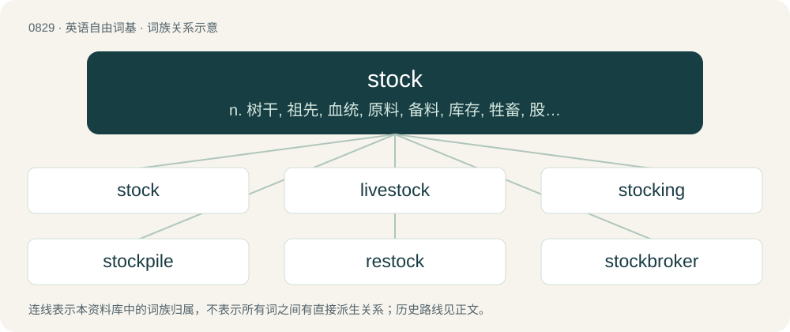

# 0901 · stock — n. 树干, 祖先, 血统, 原料, 备料, 库存, 牲畜, 股票, 股份, 保留剧目；a. 存货的, 常备的, 平凡的, 普通的, 股票的, 保留剧目的, 繁殖用的；vt. 装把手于, 进货, 备有, 放牧

[总目录](../00_总目录_按常用程度.md)

**类型**：英语自由词基　｜　**来源语言**：见词源记录

## 核心含义与来源

- 核心含义：n. 树干, 祖先, 血统, 原料, 备料, 库存, 牲畜, 股票, 股份, 保留剧目；a. 存货的, 常备的, 平凡的, 普通的, 股票的, 保留剧目的, 繁殖用的；vt. 装把手于, 进货, 备有, 放牧
- 英文含义：A store or supply.
- 词形：stock

**多个词源／构词路径**：同一拼写可能有不同来源；以下按词性和含义分别列出。

**来源记录 1**（名词；A store or supply.）

From Middle English stok, from Old English stocc, from Proto-West Germanic \*stokk, from Proto-Germanic \*stukkaz (“tree-trunk”). Modern senses are mostly referring either to the trunk from which the tree grows (figuratively, its origin and/or support/foundation), or to a piece of wood, stick, or rod. The senses of "supply" and "raw material" arose from a probable conflation with steck (“an item of goods, merchandise”) or the use of split tally sticks consisting of foil or counterfoil and stock to capture paid taxes, debts or exchanges. Doublet of chock.

**来源记录 2**（名词；A thrust with a rapier; a stoccado.）

From Italian stoccata.

## 词族图

## 单词速览（常用到不常用）

| 单词 | 音标 | 释义 |
|---|---|---|
| [stock](#w-1) | 英 /stɒk/；美 /stɑk/ | n. 树干, 祖先, 血统, 原料, 备料, 库存, 牲畜, 股票, 股份, 保留剧目；a. 存货的, 常备的, 平凡的, 普通的, 股票的, 保留剧目的, 繁殖用的；vt. 装把手于, 进货, 备有, 放牧 |
| [livestock](#w-2) | 英 /ˈlaɪvstɒk/；美 /ˈlaɪvstɑk/ | n. 家畜；\[经\] 牲畜, 家畜 |
| [stocking](#w-3) | 英 /ˈstɒkɪŋ/；美 /ˈstɑkɪŋ/ | n. 长袜；\[医\] 马足水肿; 长袜 |
| [stockpile](#w-4) | 英 /ˈstɒkpaɪl/；美 /ˈstɑkˌpaɪl/ | n. 储蓄, 积蓄, 库存；vt. 储蓄, 贮存 |
| [restock](#w-5) | /.riːˈstɒk/ | vt. 重新进货, 再储存 |
| [stockbroker](#w-6) | /ˈstɒk.brəukə/ | n. 股票经纪人 |
| [stocky](#w-7) | 英 /ˈstɒki/；美 /ˈstɑki/ | a. 矮胖的, 健壮结实的 |
| [stockman](#w-8) | /ˈstɔkmən/ | n. 牧场主, 牧场工人, 饲养员, 仓库管理员；\[经\] 仓库管理员 |
| [stockade](#w-9) | 英 /ˌstɒˈkeɪd/；美 /ˌstɑˈkeɪd/ | n. 栅栏, 围起的地方；vt. 用栅栏围住 |
| [stockholder](#w-10) | 英 /ˈstɒk.həʊl.də/；美 /ˈstɑk.hoʊl.dɚ/ | n. 股东；\[法\] 股东, 股票持有者, 股票所有人 |
| [feedstock](#w-11) | /ˈfiːdˌstɒk/ | n. 原料 |
| [stocker](#w-12) | 英 /ˈstɒkə/；美 /ˈstɑkɚ/ | n. 碎料工, 装料工, 储料器, 堆料机, 加煤机；\[化\] 堆料机; 堆垛机 |
| [headstock](#w-13) | /ˈhedstɒk/ | n. 头座, 机头座；\[机\] 车头, 主轴台 |
| [rootstock](#w-14) | /ˈruːtstɒk/ | n. 根茎, 根源, 起源；\[医\] 根茎 |
| [overstock](#w-15) | /.əuvəˈstɒk/ | vt. 供给过多, 进货过多, 过剩；n. 供给过多, 库存过剩 |
| [bloodstock](#w-16) | /ˈblʌdstɒk/ | n. 纯种马 |
| [stockroom](#w-17) | /ˈstɔkruːm. -rum/ | n. 商品储藏室；仓库 |

## 逐词详解

### 1. stock

**词性**：名词　｜　**音标**：英 /stɒk/；美 /stɑk/

**中文释义**：n. 树干, 祖先, 血统, 原料, 备料, 库存, 牲畜, 股票, 股份, 保留剧目；a. 存货的, 常备的, 平凡的, 普通的, 股票的, 保留剧目的, 繁殖用的；vt. 装把手于, 进货, 备有, 放牧

**英文义项**：A store or supply. / A store of goods ready for sale; inventory.

**词源与演化**：

From Middle English stok, from Old English stocc, from Proto-West Germanic \*stokk, from Proto-Germanic \*stukkaz (“tree-trunk”). Modern senses are mostly referring either to the trunk from which the tree grows (figuratively, its origin and/or support/foundation), or to a piece of wood, stick, or rod. The senses of "supply" and "raw material" arose from a probable conflation with steck (“an item of goods, merchandise”) or the use of split tally sticks consisting of foil or counterfoil and stock to capture paid taxes, debts or exchanges. Doublet of chock.

**例句**：

> They make beef stock from the butchery scraps that they otherwise might not have used.

该用例对应义项：Broth made from meat (originally bones) or vegetables, used as a basis for stew or soup.

### 2. livestock

**词性**：名词　｜　**音标**：英 /ˈlaɪvstɒk/；美 /ˈlaɪvstɑk/

**中文释义**：n. 家畜；\[经\] 牲畜, 家畜

**英文义项**：Farm animals; animals domesticated for cultivation.

**构词拆分**：live + stock

**词源与演化**：

From live + stock.

**例句**：

> In the West there are local areas with too many livestock.

该用例对应义项：Farm animals; animals domesticated for cultivation.

### 3. stocking

**词性**：名词　｜　**音标**：英 /ˈstɒkɪŋ/；美 /ˈstɑkɪŋ/

**中文释义**：n. 长袜；\[医\] 马足水肿; 长袜

**英文义项**：A soft garment, usually knit or woven, worn on the foot and lower leg under shoes or other footwear. / A broad ring of a different fur colour on the lower part of the leg of a quadruped.

**构词拆分**：stock (“cover with material”) + -ing

**词源与演化**：

From stock (“cover with material”) + -ing. Corruption of old plural -en, i.e. stocken, now singular.

**用法示例／搭配（非完整句）**：

> a pair of stockings

该用例对应义项：A soft garment, usually knit or woven, worn on the foot and lower leg under shoes or other footwear.

### 4. stockpile

**词性**：名词　｜　**音标**：英 /ˈstɒkpaɪl/；美 /ˈstɑkˌpaɪl/

**中文释义**：n. 储蓄, 积蓄, 库存；vt. 储蓄, 贮存

**英文义项**：A supply (especially a large one) of something kept for future use, specifically in case the cost of the item increases or if there a shortage. / A supply of nuclear weapons kept by a country; a nuclear stockpile.

**构词拆分**：stock (“supply of anything ready for use”) + pile (“mass of things heaped together”)

**词源与演化**：

The noun is derived from stock (“supply of anything ready for use”) + pile (“mass of things heaped together”). The verb is derived from the noun.

**例句**：

> You should stockpile necessary supplies in case of a big earthquake.

### 5. restock

**词性**：名词　｜　**音标**：/.riːˈstɒk/

**中文释义**：vt. 重新进货, 再储存

**英文义项**：The act of stocking again.

**构词拆分**：re- + stock

**词源与演化**：

From re- + stock.

**例句**：

> We will carry out a restock of the vending machine every Friday.

该用例对应义项：The act of stocking again.

### 6. stockbroker

**词性**：名词　｜　**音标**：/ˈstɒk.brəukə/

**中文释义**：n. 股票经纪人

**英文义项**：A person who buys and sells shares (stock) on a stock exchange on behalf of clients. May also provide investment advice and/or company information, depending on the level of service offered (or chosen by the client).

**构词拆分**：stock + broker

**词源与演化**：

From stock + broker.

**例句**：

> The stockbroker advised investing in safe assets.

### 7. stocky

**词性**：形容词　｜　**音标**：英 /ˈstɒki/；美 /ˈstɑki/

**中文释义**：a. 矮胖的, 健壮结实的

**英文义项**：Sturdy; solidly built; heavy and compact.

**构词拆分**：stock + -y

**词源与演化**：

From stock + -y.

**例句**：

> A stocky man with a swarthy complexion snatched Mary's handbag and disappeared into the crowd.

### 8. stockman

**词性**：名词　｜　**音标**：/ˈstɔkmən/

**中文释义**：n. 牧场主, 牧场工人, 饲养员, 仓库管理员；\[经\] 仓库管理员

**英文义项**：A man who raises or looks after livestock. / A man who works in a stockroom.

**构词拆分**：stock + -man

**词源与演化**：

From stock + -man.

### 9. stockade

**词性**：名词　｜　**音标**：英 /ˌstɒˈkeɪd/；美 /ˌstɑˈkeɪd/

**中文释义**：n. 栅栏, 围起的地方；vt. 用栅栏围住

**英文义项**：An enclosure protected by a wall of wooden posts. / A military prison.

**构词拆分**：stock + -ade

**词源与演化**：

From French estocade, equivalent to stock + -ade.

**例句**：

> The thief was thrown into the stockade to await trial.

### 10. stockholder

**词性**：名词　｜　**音标**：英 /ˈstɒk.həʊl.də/；美 /ˈstɑk.hoʊl.dɚ/

**中文释义**：n. 股东；\[法\] 股东, 股票持有者, 股票所有人

**英文义项**：One who owns stock. / A company that maintains a stock of certain products.

**构词拆分**：stock + holder

**词源与演化**：

From stock + holder.

**例句**：

> Zumbeco are stockholders of round bar, flat bar and plate.

该用例对应义项：A company that maintains a stock of certain products.

### 11. feedstock

**词性**：名词　｜　**音标**：/ˈfiːdˌstɒk/

**中文释义**：n. 原料

**英文义项**：Any bulk raw material constituting the principal input for an industrial process.

**构词拆分**：feed + stock

**词源与演化**：

From feed + stock.

**例句**：

> Bio-materials may be substituted for petrochemical feedstocks as petroleum prices rise.

该用例对应义项：Any bulk raw material constituting the principal input for an industrial process.

### 12. stocker

**词性**：名词　｜　**音标**：英 /ˈstɒkə/；美 /ˈstɑkɚ/

**中文释义**：n. 碎料工, 装料工, 储料器, 堆料机, 加煤机；\[化\] 堆料机; 堆垛机

**英文义项**：Livestock that is wintered and then sold in the spring; often contrasted with a feeder when the focus is on intended disposition. / A racecar in certain classes of auto racing whose origins are nominally or notionally related to factory-stock autos, such as stock car racing or super-stock drag racing.

**构词拆分**：stock + -er

**词源与演化**：

From stock + -er.

**例句**：

> Will you keep those calves as feeders or only as stockers?

该用例对应义项：Livestock that is wintered and then sold in the spring; often contrasted with a feeder when the focus is on intended disposition.

### 13. headstock

**词性**：名词　｜　**音标**：/ˈhedstɒk/

**中文释义**：n. 头座, 机头座；\[机\] 车头, 主轴台

**英文义项**：A headframe. / A part of a machine (such as a lathe or drill) that contains the primary spindle.

**构词拆分**：head + stock

**词源与演化**：

From head + stock.

### 14. rootstock

**词性**：名词　｜　**音标**：/ˈruːtstɒk/

**中文释义**：n. 根茎, 根源, 起源；\[医\] 根茎

**英文义项**：A healthy and vigorous-rooted plant that is used in grafting, most commonly as a sound base to support a scion that bears desirable fruit in orchard culture. / The necessary basis for something to develop.

**构词拆分**：root + stock

**词源与演化**：

From root + stock.

**例句**：

> The orchardist grafted an apple bud onto the rootstock.

### 15. overstock

**词性**：动词　｜　**音标**：/.əuvəˈstɒk/

**中文释义**：vt. 供给过多, 进货过多, 过剩；n. 供给过多, 库存过剩

**英文义项**：To stock to an excessive degree.

**构词拆分**：over- + stock

**词源与演化**：

From over- + stock.

### 16. bloodstock

**词性**：名词　｜　**音标**：/ˈblʌdstɒk/

**中文释义**：n. 纯种马

**英文义项**：Thoroughbred animals in general, but especially horses. / The breeding line of a thoroughbred horse or other animal.

**构词拆分**：blood + stock

**词源与演化**：

From blood + stock.

### 17. stockroom

**词性**：名词　｜　**音标**：/ˈstɔkruːm. -rum/

**中文释义**：n. 商品储藏室；仓库

**英文义项**：A room where a store keeps its stock of merchandise.

**构词拆分**：stock + room

**词源与演化**：

From stock + room.

**例句**：

> Could you get some more paper from the stockroom? We ran out.
