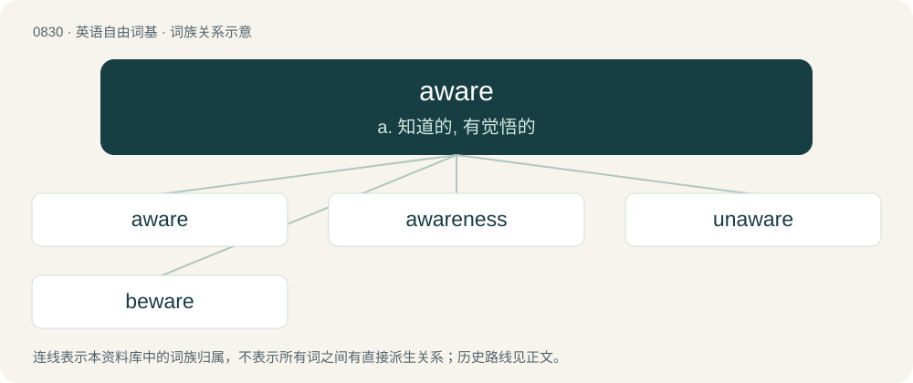

# 0902 · aware — a. 知道的, 有觉悟的

[总目录](../00_总目录_按常用程度.md)

**类型**：英语自由词基　｜　**来源语言**：见词源记录

## 核心含义与来源

- 核心含义：a. 知道的, 有觉悟的
- 英文含义：Vigilant or on one's guard against danger or difficulty.
- 词形：aware

**来源记录 1**（形容词；Vigilant or on one's guard against danger or difficulty.）

Inherited from Middle English aware, iwar, iware, ywar, from Old English ġewær (“aware”), from Proto-West Germanic \*gawar, from Proto-Germanic \*waraz (“aware, cautious”), from Proto-Indo-European \*worós (“attentive”), from \*wer- (“to heed; watch out”). Cognate with Dutch gewaar, German gewahr, Danish var, Swedish var, Icelandic varr.

## 词族图

## 单词速览（常用到不常用）

| 单词 | 音标 | 释义 |
|---|---|---|
| [aware](#w-1) | 英 /əˈwɛə/；美 /əˈwɛɚ/ | a. 知道的, 有觉悟的 |
| [awareness](#w-2) | 英 /əˈwɛə.nəs/；美 /əˈwɛɹ.nəs/ | n. 意识, 认识；\[计\] 识别, 议定, 明白 |
| [unaware](#w-3) | 英 /ˌʌnəˈwɛə/；美 /ˌʌnəˈwɛɚ/ | a. 未认识到的, 不知道的；\[法\] 不知道的, 不察觉的, 无意的 |
| [beware](#w-4) | /biˈwɛɚ/ | v. 小心, 谨防 |

## 逐词详解

### 1. aware

**词性**：形容词　｜　**音标**：英 /əˈwɛə/；美 /əˈwɛɚ/

**中文释义**：a. 知道的, 有觉悟的

**英文义项**：Vigilant or on one's guard against danger or difficulty. / Conscious or having knowledge of something; awake.

**词源与演化**：

Inherited from Middle English aware, iwar, iware, ywar, from Old English ġewær (“aware”), from Proto-West Germanic \*gawar, from Proto-Germanic \*waraz (“aware, cautious”), from Proto-Indo-European \*worós (“attentive”), from \*wer- (“to heed; watch out”). Cognate with Dutch gewaar, German gewahr, Danish var, Swedish var, Icelandic varr.

**例句**：

> Gotta get going. I wasn’t aware that it was already so late.

该用例对应义项：Conscious or having knowledge of something; awake.

### 2. awareness

**词性**：名词　｜　**音标**：英 /əˈwɛə.nəs/；美 /əˈwɛɹ.nəs/

**中文释义**：n. 意识, 认识；\[计\] 识别, 议定, 明白

**英文义项**：The state or level of consciousness where sense data can be confirmed by an observer. / The state or quality of being aware of something.

**构词拆分**：aware + -ness

**词源与演化**：

From aware + -ness.

**例句**：

> I gradually passed from sleep to full awareness.

该用例对应义项：The state or level of consciousness where sense data can be confirmed by an observer.

### 3. unaware

**词性**：形容词　｜　**音标**：英 /ˌʌnəˈwɛə/；美 /ˌʌnəˈwɛɚ/

**中文释义**：a. 未认识到的, 不知道的；\[法\] 不知道的, 不察觉的, 无意的

**英文义项**：Not aware or informed; lacking knowledge; unmindful. / Not noticing; paying no heed.

**构词拆分**：un- + aware

**词源与演化**：

From un- + aware.

**例句**：

> Luckily, she was unaware that I'd spent the last five years in prison.

该用例对应义项：Not aware or informed; lacking knowledge; unmindful.

### 4. beware

**词性**：动词　｜　**音标**：/biˈwɛɚ/

**中文释义**：v. 小心, 谨防

**英文义项**：To use caution, pay attention to (used both with and without of).

**构词拆分**：be + ware；be + aware

**词源与演化**：

From Middle English bewar, be war, be ware, forms of Middle English ben ware (“to be on one's guard, be vigilant”, literally “be ware”), equivalent to be + ware or be + aware. Compare Old English bewarian.

**例句**：

> And Abraham said: Beware thou never bring my son back again thither.
