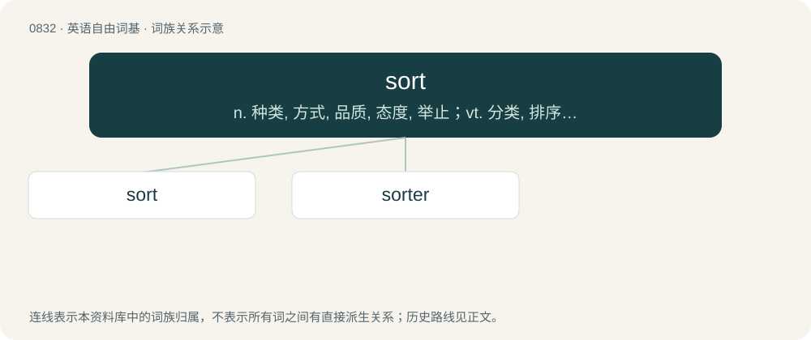

# 0904 · sort — n. 种类, 方式, 品质, 态度, 举止；vt. 分类, 排序, 挑选；vi. 交往, 协调

[总目录](../00_总目录_按常用程度.md)

**类型**：英语自由词基　｜　**来源语言**：见词源记录

## 核心含义与来源

- 核心含义：n. 种类, 方式, 品质, 态度, 举止；vt. 分类, 排序, 挑选；vi. 交往, 协调
- 英文含义：A general type.
- 词形：sort

**多个词源／构词路径**：同一拼写可能有不同来源；以下按词性和含义分别列出。

**来源记录 1**（名词；A general type.）

From Middle English sort, soort, sorte (cognate Dutch soort, German Sorte, Danish sort, Swedish sort), borrowed from Old French sorte (“class, kind”), from Latin sortem, accusative form of sors (“lot, fate, share, rank, category”).

**来源记录 2**（动词；To separate items into different categories according to certain criteria that determine their sorts.）

From Middle English sorten, from Old French sortir (“to allot, sort”), from Latin sortīre (“draw lots, divide, choose”), from sors.

## 词族图

## 单词速览（常用到不常用）

| 单词 | 音标 | 释义 |
|---|---|---|
| [sort](#w-1) | 英 /sɔːt/；美 /soɹt/ | n. 种类, 方式, 品质, 态度, 举止；vt. 分类, 排序, 挑选；vi. 交往, 协调 |
| [sorter](#w-2) | /sɔː.tə/ | n. 从事分类的人, 分拣的人；\[计\] 分类机; 分类人员 |

## 逐词详解

### 1. sort

**词性**：名词　｜　**音标**：英 /sɔːt/；美 /soɹt/

**中文释义**：n. 种类, 方式, 品质, 态度, 举止；vt. 分类, 排序, 挑选；vi. 交往, 协调

**英文义项**：A general type. / A person evaluated in a certain way.

**词源与演化**：

From Middle English sort, soort, sorte (cognate Dutch soort, German Sorte, Danish sort, Swedish sort), borrowed from Old French sorte (“class, kind”), from Latin sortem, accusative form of sors (“lot, fate, share, rank, category”).

**例句**：

> Popular algorithms for sorts include quicksort and heapsort.

该用例对应义项：An algorithm for sorting a list of items into a particular sequence.

### 2. sorter

**词性**：名词　｜　**音标**：/sɔː.tə/

**中文释义**：n. 从事分类的人, 分拣的人；\[计\] 分类机; 分类人员

**英文义项**：A person employed to sort. / A machine or algorithm that performs sorting.

**构词拆分**：From sort + -er.

**词源与演化**：

From sort + -er.
