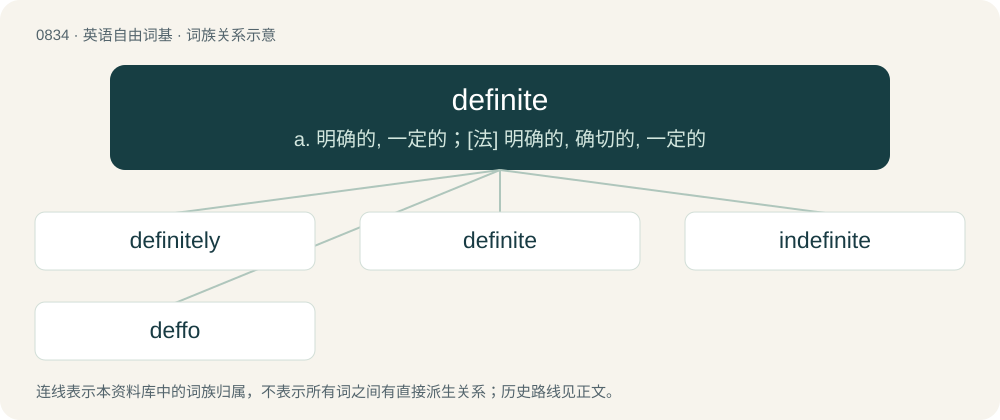

# 0905 · definite — a. 明确的, 一定的；\[法\] 明确的, 确切的, 一定的

[总目录](../00_总目录_按常用程度.md)

**类型**：英语自由词基　｜　**来源语言**：见词源记录

## 核心含义与来源

- 核心含义：a. 明确的, 一定的；\[法\] 明确的, 确切的, 一定的
- 英文含义：Having distinct limits.
- 词形：definite

**来源记录 1**（形容词；Having distinct limits.）

From Latin dēfīnītus, past participle of dēfīniō, whence also English define.

## 词族图

## 单词速览（常用到不常用）

| 单词 | 音标 | 释义 |
|---|---|---|
| [definitely](#w-1) | 英 /ˈdɛf.ɪ.nɪt.li/ | adv. 明确无疑地, 清楚地 |
| [definite](#w-2) | 英 /ˈdɛfɪnɪt/；美 /ˈdɛfɪnɪt/ | a. 明确的, 一定的；\[法\] 明确的, 确切的, 一定的 |
| [indefinite](#w-3) | /ɪnˈdɛfɪnɪt/ | a. 模糊的, 不确定的, 无限的；\[法\] 不确定的, 无限制的 |
| [deffo](#w-4) | 英 /ˈdɛfəʊ/ | 【英文】Definite. |

## 逐词详解

### 1. definitely

**词性**：副词　｜　**音标**：英 /ˈdɛf.ɪ.nɪt.li/

**中文释义**：adv. 明确无疑地, 清楚地

**英文义项**：Without question and beyond doubt. / In a definite manner; decisively.

**构词拆分**：definite + -ly

**词源与演化**：

From definite + -ly.

**例句**：

> Joe definitely doesn't know how to drive a tractor.

该用例对应义项：Without question and beyond doubt.

### 2. definite

**词性**：形容词　｜　**音标**：英 /ˈdɛfɪnɪt/；美 /ˈdɛfɪnɪt/

**中文释义**：a. 明确的, 一定的；\[法\] 明确的, 确切的, 一定的

**英文义项**：Having distinct limits. / Free from any doubt.

**词源与演化**：

From Latin dēfīnītus, past participle of dēfīniō, whence also English define.

**用法示例／搭配（非完整句）**：

> definite dimensions; a definite measure; a definite period or interval

该用例对应义项：Having distinct limits.

### 3. indefinite

**词性**：形容词　｜　**音标**：/ɪnˈdɛfɪnɪt/

**中文释义**：a. 模糊的, 不确定的, 无限的；\[法\] 不确定的, 无限制的

**英文义项**：Without limit; forever, or until further notice; not definite. / Vague or unclear.

**构词拆分**：in- + definite

**词源与演化**：

From Late Latin indēfīnītus. Morphologically in- + definite.

**例句**：

> Your account will be suspended for an indefinite period of time.

该用例对应义项：Without limit; forever, or until further notice; not definite.

### 4. deffo

**词性**：形容词　｜　**音标**：英 /ˈdɛfəʊ/

**英文义项**：Definite.

**构词拆分**：definite + -o (diminutive suffix)

**词源与演化**：

From definitely or definite + -o (diminutive suffix).
