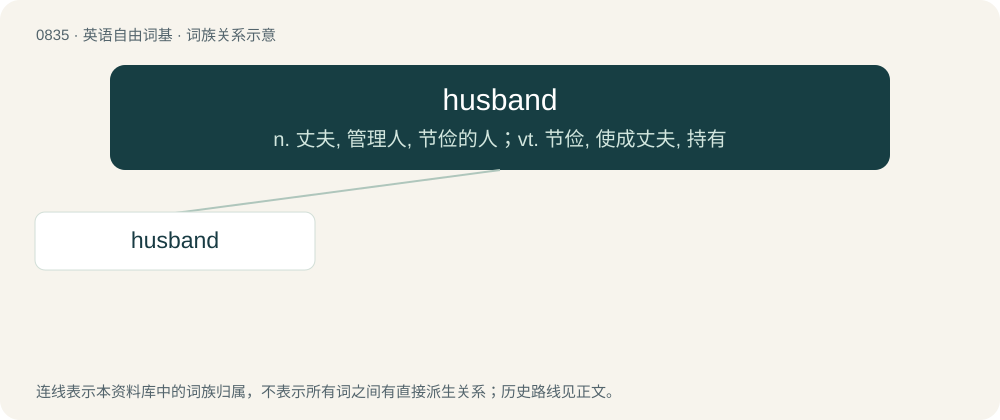

# 0906 · husband — n. 丈夫, 管理人, 节俭的人；vt. 节俭, 使成丈夫, 持有

[总目录](../00_总目录_按常用程度.md)

**类型**：英语自由词基　｜　**来源语言**：见词源记录

## 核心含义与来源

- 核心含义：n. 丈夫, 管理人, 节俭的人；vt. 节俭, 使成丈夫, 持有
- 英文含义：A man in a marriage or marital relationship, especially in relation to his spouse.
- 词形：husband

**来源记录 1**（名词；A man in a marriage or marital relationship, especially in relation to his spouse.）

Inherited from Middle English husbonde, from Old English hūsbonda, from hūs + bonda. Calque of Old Norse húsbóndi. By surface analysis, house + bond.

## 词族图

## 单词速览（常用到不常用）

| 单词 | 音标 | 释义 |
|---|---|---|
| [husband](#w-1) | /ˈhʌzbənd/ | n. 丈夫, 管理人, 节俭的人；vt. 节俭, 使成丈夫, 持有 |

## 逐词详解

### 1. husband

**词性**：名词　｜　**音标**：/ˈhʌzbənd/

**中文释义**：n. 丈夫, 管理人, 节俭的人；vt. 节俭, 使成丈夫, 持有

**英文义项**：A man in a marriage or marital relationship, especially in relation to his spouse. / A manager of property; one who has the care of another's belongings, owndom, or interests; a steward; an economist.

**词源与演化**：

Inherited from Middle English husbonde, from Old English hūsbonda, from hūs + bonda. Calque of Old Norse húsbóndi. By surface analysis, house + bond.

**例句**：

> While reading her book, Sally leaned back against her husband, wishing it were the human kind.

该用例对应义项：A large cushion with arms meant to support a person in the sitting position.
