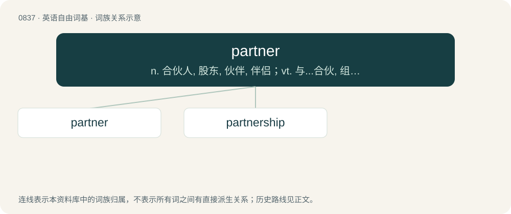

# 0907 · partner — n. 合伙人, 股东, 伙伴, 伴侣；vt. 与...合伙, 组成一对；vi. 做伙伴, 当助手

[总目录](../00_总目录_按常用程度.md)

**类型**：英语自由词基　｜　**来源语言**：见词源记录

## 核心含义与来源

- 核心含义：n. 合伙人, 股东, 伙伴, 伴侣；vt. 与...合伙, 组成一对；vi. 做伙伴, 当助手
- 英文含义：Either of a pair of people or things that belong together.
- 词形：partner

**来源记录 1**（名词；Either of a pair of people or things that belong together.）

From Middle English partener, partiner, alteration (due to Middle English part) of Middle English parcener, from Old French parçonier, parçonneour (“joint heir”) from parçon (“partition”), from Latin partītiōnem, singular accusative of partītiō (“portion”). The word may also represent Old French part tenour (“part holder”). Compare also Middle English partifere (“partner”), partifelewe (“partner”). Doublet of parcener.

## 词族图

## 单词速览（常用到不常用）

| 单词 | 音标 | 释义 |
|---|---|---|
| [partner](#w-1) | 英 /ˈpɑːt.nə(ɹ)/；美 /ˈpɑɹt.nɚ/ | n. 合伙人, 股东, 伙伴, 伴侣；vt. 与...合伙, 组成一对；vi. 做伙伴, 当助手 |
| [partnership](#w-2) | 英 /ˈpɑːtnəʃɪp/；美 /ˈpɑɹtnɚʃɪp/ | n. 合伙, 合股, 合作关系；\[经\] 合伙(合作)关系, 全体合伙人 |

## 逐词详解

### 1. partner

**词性**：名词　｜　**音标**：英 /ˈpɑːt.nə(ɹ)/；美 /ˈpɑɹt.nɚ/

**中文释义**：n. 合伙人, 股东, 伙伴, 伴侣；vt. 与...合伙, 组成一对；vi. 做伙伴, 当助手

**英文义项**：Either of a pair of people or things that belong together. / Someone who is associated with another in a common activity or interest.

**词源与演化**：

From Middle English partener, partiner, alteration (due to Middle English part) of Middle English parcener, from Old French parçonier, parçonneour (“joint heir”) from parçon (“partition”), from Latin partītiōnem, singular accusative of partītiō (“portion”). The word may also represent Old French part tenour (“part holder”). Compare also Middle English partifere (“partner”), partifelewe (“partner”). Doublet of parcener.

**用法示例／搭配（非完整句）**：

> business partner

该用例对应义项：Someone who is associated with another in a common activity or interest.

### 2. partnership

**词性**：名词　｜　**音标**：英 /ˈpɑːtnəʃɪp/；美 /ˈpɑɹtnɚʃɪp/

**中文释义**：n. 合伙, 合股, 合作关系；\[经\] 合伙(合作)关系, 全体合伙人

**英文义项**：The state of being associated with a partner. / An association of two or more people to conduct a business.

**构词拆分**：partner + -ship

**词源与演化**：

From partner + -ship. Cognate with West Frisian partnerskip (“partnership”), Dutch partnerschap (“partnership”), Low German Partnerschop (“partnership”), German Partnerschaft (“partnership”), Danish partnerskab (“partnership”), Danish partnerskab (“partnership”), Norwegian Bokmål partnerskap (“partnership”), Norwegian Nynorsk partnerskap (“partnership”).

**用法示例／搭配（非完整句）**：

> scientists working in close partnership with colleagues overseas

该用例对应义项：The state of being associated with a partner.
