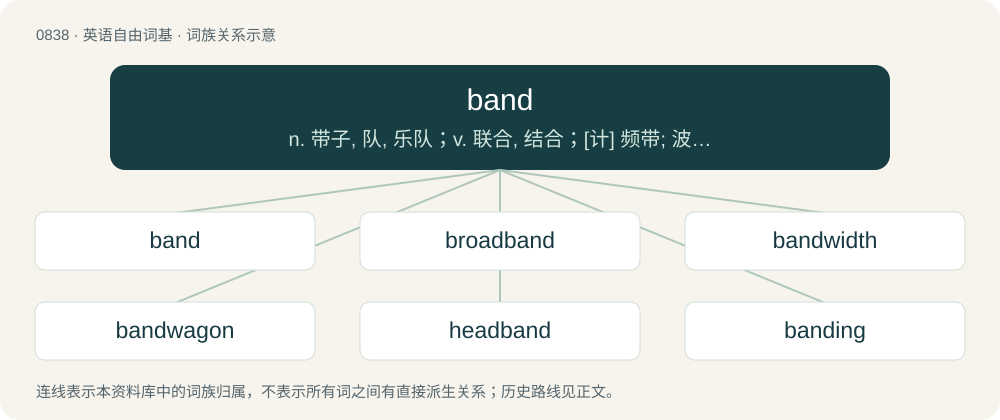

# 0908 · band — n. 带子, 队, 乐队；v. 联合, 结合；\[计\] 频带; 波段; 区

[总目录](../00_总目录_按常用程度.md)

**类型**：英语自由词基　｜　**来源语言**：见词源记录

## 核心含义与来源

- 核心含义：n. 带子, 队, 乐队；v. 联合, 结合；\[计\] 频带; 波段; 区
- 英文含义：A strip of material wrapped around things to hold them together.
- 词形：band

**多个词源／构词路径**：同一拼写可能有不同来源；以下按词性和含义分别列出。

**来源记录 1**（名词；A strip of material wrapped around things to hold them together.）

Inherited from Middle English band (also bond), from Old English beand, bænd, bend (“bond, chain, fetter, band, ribbon, ornament, chaplet, crown”), from Proto-Germanic \*bandą, \*bandiz (“band, fetter”), from Proto-Indo-European \*bʰendʰ- (“to tie, bind”). Middle English band reinforced by Old French bande. Cognate with Dutch band, German Band, Danish bånd, Swedish band, Icelandic band (“band”). Related to bond, bind, bend.

**来源记录 2**（名词；A group of musicians who perform together as an ensemble; sometimes, such a group working for a professional recording artist.）

Derived from Middle English band, from Old French bande, from Old Occitan banda (“regiment of troops”), perhaps from Frankish \*bend, from Proto-Germanic \*bandiz, from Proto-Indo-European \*bʰendʰ- (“to tie; bond, band”). Compare German Bande (“band”).

## 词族图

## 单词速览（常用到不常用）

| 单词 | 音标 | 释义 |
|---|---|---|
| [band](#w-1) | 英 /bænd/ | n. 带子, 队, 乐队；v. 联合, 结合；\[计\] 频带; 波段; 区 |
| [broadband](#w-2) | 英 /ˈbɹɔːdbænd/；美 /ˈbɹɔdbænd/ | \[计\] 宽带 |
| [bandwidth](#w-3) | /ˈbændwɪdθ/ | n. 频带宽度, 通带宽度；\[计\] 带宽, 频宽 |
| [bandwagon](#w-4) | 英 /ˈbændˌwæɡ.ən/；/ˈbeə̯ndˌweɪ̯ɡ.ən/ | n. 乐队彩车, 流行 |
| [headband](#w-5) | /ˈhɛdˌbænd/ | n. 头巾, 头饰带；\[医\] 额镜带 |
| [banding](#w-6) | /ˈbændɪŋ/ | \[机\] 模式带 |
| [wristband](#w-7) | /ˈɹɪs(t)ˌbænd/ | n. 袖口 |
| [waistband](#w-8) | /ˈweɪstˌbænd/ | n. 腰带, 束腰带 |
| [armband](#w-9) | /ˈɑːmbænd/ | n. 臂章 |
| [bandstand](#w-10) | 英 /ˈbænd.stænd/ | n. 音乐台, 乐池 |
| [bandleader](#w-11) | /ˈbænd,liːdə(r)/ | n. 伴舞乐队的指挥 |
| [bandmate](#w-12) | /ˈbændˌmeɪt/ | 【英文】Someone with whom one shares membership in a band. |
| [wideband](#w-13) | /ˈwaidˈbænd/ | \[计\] 宽带 |
| [baseband](#w-14) | /ˈbeisbænd/ | n. 基带；\[计\] 基带, 基本频带 |
| [bandgap](#w-15) | /ˈbændgæp/ | n. \[物\]能带隙 |
| [narrowband](#w-16) |  | \[计\] 窄带 |

## 逐词详解

### 1. band

**词性**：名词　｜　**音标**：英 /bænd/

**中文释义**：n. 带子, 队, 乐队；v. 联合, 结合；\[计\] 频带; 波段; 区

**英文义项**：A strip of material wrapped around things to hold them together. / A narrow strip of cloth or other material on clothing, to bind, strengthen, or ornament it.

**词源与演化**：

Inherited from Middle English band (also bond), from Old English beand, bænd, bend (“bond, chain, fetter, band, ribbon, ornament, chaplet, crown”), from Proto-Germanic \*bandą, \*bandiz (“band, fetter”), from Proto-Indo-European \*bʰendʰ- (“to tie, bind”). Middle English band reinforced by Old French bande. Cognate with Dutch band, German Band, Danish bånd, Swedish band, Icelandic band (“band”). Related to bond, bind, bend.

**用法示例／搭配（非完整句）**：

> valence band; conduction band

该用例对应义项：A group of energy levels in a solid state material.

### 2. broadband

**词性**：名词　｜　**音标**：英 /ˈbɹɔːdbænd/；美 /ˈbɹɔdbænd/

**中文释义**：\[计\] 宽带

**英文义项**：A wideband of electromagnetic frequencies. / An Internet connection provisioned over an existing service using alternate signal frequencies such as ADSL or a cable modem.

**构词拆分**：broad + band

**词源与演化**：

From broad + band.

**例句**：

> "It's very difficult to operate a business without reliable broadband," Allman says.

### 3. bandwidth

**词性**：名词　｜　**音标**：/ˈbændwɪdθ/

**中文释义**：n. 频带宽度, 通带宽度；\[计\] 带宽, 频宽

**英文义项**：The width, usually measured in hertz, of a frequency band. / The width of the smallest frequency band within which the signal can fit.

**构词拆分**：band + width

**词源与演化**：

From band + width.

**例句**：

> I think it's a worthy project, but I just don't have the bandwidth right now.

该用例对应义项：The capacity, energy or time required.

### 4. bandwagon

**词性**：名词　｜　**音标**：英 /ˈbændˌwæɡ.ən/；/ˈbeə̯ndˌweɪ̯ɡ.ən/

**中文释义**：n. 乐队彩车, 流行

**英文义项**：A large wagon used to carry a band of musicians in a parade. / A current movement that attracts wide support.

**构词拆分**：band + wagon

**词源与演化**：

From band + wagon.

**例句**：

> The gaudy bandwagon led the circus parade.

该用例对应义项：a large ornate wagon for carrying a musical band

### 5. headband

**词性**：名词　｜　**音标**：/ˈhɛdˌbænd/

**中文释义**：n. 头巾, 头饰带；\[医\] 额镜带

**英文义项**：A strip of fabric worn around the head. / A hair accessory, made of a flexible material and curved like a horseshoe, for holding one's hair back.

**构词拆分**：head + band

**词源与演化**：

From Middle English \*hedband, from Old English hēafodbænd, hēafodbend (“headband”), equivalent to head + band. Cognate with Old High German houbitbant (“headband”), Dutch hoofdband (“headband”).

**例句**：

> The earphones were held in place by a headband.

该用例对应义项：a band worn around or over the head

### 6. banding

**词性**：名词　｜　**音标**：/ˈbændɪŋ/

**中文释义**：\[机\] 模式带

**英文义项**：A pattern of band-like markings. / A technique used in the study of wild birds, by attaching a small, individually numbered, metal or plastic tag to their legs or wings.

**构词拆分**：band + -ing

**词源与演化**：

From band + -ing.

**例句**：

> You can recognize this species of bird by the banding on the wing.

该用例对应义项：A pattern of band-like markings.

### 7. wristband

**词性**：名词　｜　**音标**：/ˈɹɪs(t)ˌbænd/

**中文释义**：n. 袖口

**英文义项**：The cuff of a sleeve that wraps around the wrist. / A strip of material worn around the wrist, e.g. to absorb perspiration, especially in sports.

**构词拆分**：From wrist + band.

**词源与演化**：

From wrist + band.

**例句**：

> Ziri wore a wristband to protest against what is happening in Palestine.

### 8. waistband

**词性**：名词　｜　**音标**：/ˈweɪstˌbænd/

**中文释义**：n. 腰带, 束腰带

**英文义项**：A band of fabric encircling the waist, especially a part of a pair of pants or a skirt.

**构词拆分**：waist + band

**词源与演化**：

From waist + band.

**例句**：

> Ziri lifted his T-shirt to reveal a handgun tucked into his waistband.

### 9. armband

**词性**：名词　｜　**音标**：/ˈɑːmbænd/

**中文释义**：n. 臂章

**英文义项**：A band worn around the arm, usually to symbolize mourning or protest. / A band worn around the arm of the captain of a team.

**构词拆分**：arm + band

**词源与演化**：

From arm + band.

**例句**：

> Only a captain should wear an armband on the field.

### 10. bandstand

**词性**：名词　｜　**音标**：英 /ˈbænd.stænd/

**中文释义**：n. 音乐台, 乐池

**英文义项**：A small, open-air platform or enclosure for bands to play on, usually roofed. / A small, informal stage, usually located in nightclubs, where local and amateur musicians perform.

**构词拆分**：band + stand

**词源与演化**：

From band + stand.

**例句**：

> Only a few of the deck chairs ranged around the bandstand were occupied.

### 11. bandleader

**词性**：名词　｜　**音标**：/ˈbænd,liːdə(r)/

**中文释义**：n. 伴舞乐队的指挥

**英文义项**：A musician who conducts or leads a band of musicians.

**构词拆分**：band + leader

**词源与演化**：

From band + leader.

### 12. bandmate

**词性**：名词　｜　**音标**：/ˈbændˌmeɪt/

**英文义项**：Someone with whom one shares membership in a band.

**构词拆分**：band + -mate

**词源与演化**：

From band + -mate.

**例句**：

> This number one hit was written in just 20 minutes by Nash's bandmate, Matt Slocum.

### 13. wideband

**词性**：名词　｜　**音标**：/ˈwaidˈbænd/

**中文释义**：\[计\] 宽带

**英文义项**：A communications transmission rate between that of narrowband and broadband.

**构词拆分**：wide + band

**词源与演化**：

From wide + band.

### 14. baseband

**词性**：名词　｜　**音标**：/ˈbeisbænd/

**中文释义**：n. 基带；\[计\] 基带, 基本频带

**英文义项**：The frequency range occupied by a message signal prior to modulation. / A method of transmission in which only one frequency channel is used at a time.

**构词拆分**：base + band

**词源与演化**：

From base + band.

### 15. bandgap

**词性**：名词　｜　**音标**：/ˈbændgæp/

**中文释义**：n. \[物\]能带隙

**英文义项**：The energy difference between two allowed ranges of electron energy in a solid; especially the difference between the energies of the valence band and the conduction band. / A gap in a frequency range in which waves cannot propagate.

**构词拆分**：band + gap

**词源与演化**：

From band + gap.

**例句**：

> The propagation of an acoustic wave inside a phononic crystal is forbidden in the bandgap frequency range due to Bragg scattering.

该用例对应义项：A gap in a frequency range in which waves cannot propagate.

### 16. narrowband

**词性**：形容词

**中文释义**：\[计\] 窄带

**英文义项**：Describing communication systems with a smaller bandwidth than wideband.

**构词拆分**：narrow + band

**词源与演化**：

From narrow + band.
