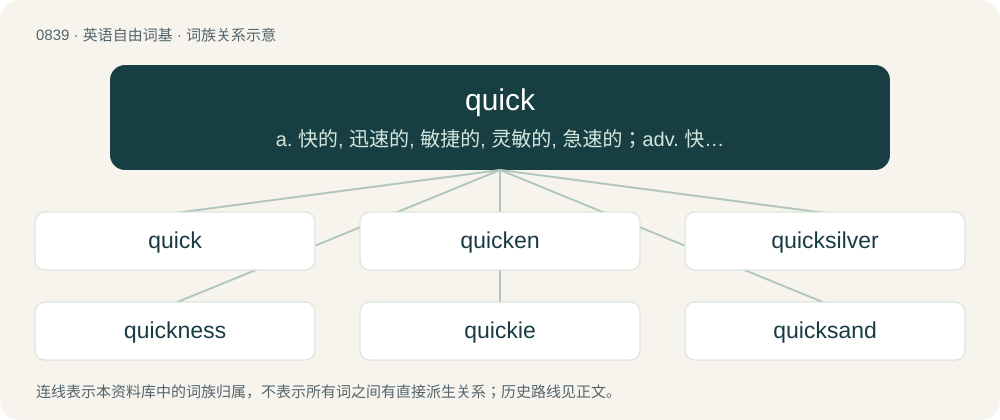

# 0909 · quick — a. 快的, 迅速的, 敏捷的, 灵敏的, 急速的；adv. 快；n. 新长出的肉, 要害, 核心, 感觉敏锐部位

[总目录](../00_总目录_按常用程度.md)

**类型**：英语自由词基　｜　**来源语言**：见词源记录

## 核心含义与来源

- 核心含义：a. 快的, 迅速的, 敏捷的, 灵敏的, 急速的；adv. 快；n. 新长出的肉, 要害, 核心, 感觉敏锐部位
- 英文含义：Moving with speed, rapidity or swiftness, or capable of doing so; rapid; fast.
- 词形：quick

**来源记录 1**（形容词；Moving with speed, rapidity or swiftness, or capable of doing so; rapid; fast.）

From Middle English quik, quic (“living, alive, active”), from Old English cwic (“alive”), from Proto-West Germanic \*kwiku (“alive, lively quick”), from Proto-Germanic \*kwikwaz (“alive, lively, quick”), from Proto-Indo-European \*gʷih₃wós (“alive”), from \*gʷeyh₃- (“to live”), \*gʷeyh₃w- (“to live”). For semantic development, compare lively. Cognate with Dutch kwik, kwiek (“lively, quick”), German keck (“sassy, cheeky”), Danish kvik (“lively, quick-witted, quick”), kvæg (“cattle”), Faroese kvikur (“quick”), Icelandic kvikur (“lively, quick”), Norn kvikk, hwikk (“living, swarming, teeming”), Norwegian kvikk (“quick, lively, quick-witted”), Swedish kvick (“quick, witty”), and also (from Indo-European) with Greek βίος (víos, “life”), Latin vivus (“alive”), Lithuanian gývas (“alive”), Latvian dzīvs (“alive”), Russian живо́й (živój, “alive, lively, quick”), Polish żywy (“alive”), Welsh byw (“alive”), Irish beo (“alive”), biathaigh (“to feed”), Northern Kurdish jîn (“to live”), jiyan (“life”), giyan (“soul”), can (“soul”), Sanskrit जीव (jīva, “alive”), Albanian nxit (“to urge, stimulate”). Doublet of jiva.

## 词族图

## 单词速览（常用到不常用）

| 单词 | 音标 | 释义 |
|---|---|---|
| [quick](#w-1) | /kwɪk/ | a. 快的, 迅速的, 敏捷的, 灵敏的, 急速的；adv. 快；n. 新长出的肉, 要害, 核心, 感觉敏锐部位 |
| [quicken](#w-2) | 英 /ˈkwɪk(ə)n/ | vt. 加快, 激发, 使有生气, 鼓舞, 使复活；vi. 加快, 变活跃, 进入胎动期 |
| [quicksilver](#w-3) | 美 /ˈkwɪkˌsɪlvɚ/ | n. 水银, 汞；vt. 涂水银于；a. 水银似的, 易变的 |
| [quickness](#w-4) | /ˈkwɪknəs/ | n. 急速, 迅速, 速度 |
| [quickie](#w-5) | /ˈkwɪki/ | n. 匆匆做成的事；a. 简短的, 迅速的, 突发的 |
| [quicksand](#w-6) | 美 /ˈkwɪkˌsænd/ | n. 流沙, 流沙区, 危险状态 |
| [quickstep](#w-7) | /ˈkwikstep/ | n. 齐步, 快步进行曲, 快狐步舞 |

## 逐词详解

### 1. quick

**词性**：形容词　｜　**音标**：/kwɪk/

**中文释义**：a. 快的, 迅速的, 敏捷的, 灵敏的, 急速的；adv. 快；n. 新长出的肉, 要害, 核心, 感觉敏锐部位

**英文义项**：Moving with speed, rapidity or swiftness, or capable of doing so; rapid; fast. / Occurring in a short time; happening or done rapidly.

**词源与演化**：

From Middle English quik, quic (“living, alive, active”), from Old English cwic (“alive”), from Proto-West Germanic \*kwiku (“alive, lively quick”), from Proto-Germanic \*kwikwaz (“alive, lively, quick”), from Proto-Indo-European \*gʷih₃wós (“alive”), from \*gʷeyh₃- (“to live”), \*gʷeyh₃w- (“to live”). For semantic development, compare lively. Cognate with Dutch kwik, kwiek (“lively, quick”), German keck (“sassy, cheeky”), Danish kvik (“lively, quick-witted, quick”), kvæg (“cattle”), Faroese kvikur (“quick”), Icelandic kvikur (“lively, quick”), Norn kvikk, hwikk (“living, swarming, teeming”), Norwegian kvikk (“quick, lively, quick-witted”), Swedish kvick (“quick, witty”), and also (from Indo-European) with Greek βίος (víos, “life”), Latin vivus (“alive”), Lithuanian gývas (“alive”), Latvian dzīvs (“alive”), Russian живо́й (živój, “alive, lively, quick”), Polish żywy (“alive”), Welsh byw (“alive”), Irish beo (“alive”), biathaigh (“to feed”), Northern Kurdish jîn (“to live”), jiyan (“life”), giyan (“soul”), can (“soul”), Sanskrit जीव (jīva, “alive”), Albanian nxit (“to urge, stimulate”). Doublet of jiva.

**例句**：

> You have to be very quick to be able to compete in ad-lib theatrics.

该用例对应义项：Lively, fast-thinking, witty, intelligent.

### 2. quicken

**词性**：动词　｜　**音标**：英 /ˈkwɪk(ə)n/

**中文释义**：vt. 加快, 激发, 使有生气, 鼓舞, 使复活；vi. 加快, 变活跃, 进入胎动期

**英文义项**：To put (someone or something) in a state of activity or vigour comparable to life; to excite, to rouse. / To inspire or stimulate (an action, a feeling, etc.).

**构词拆分**：quick (“moving with swiftness; occurring in a short time; (archaic) alive, living; (archaic) pregnant”) + -en (suffix attached to some adjectives forming transitive verbs meaning ‘to make \[adjective\]’)

**词源与演化**：

From Middle English quikenen (“to become alive again after dying; to raise (someone) from the dead; to regain consciousness or strength; to give vitality, revive; to regain validity; to nourish; to spare (the life of someone or something); to ignite; to illuminate; of events: to happen more quickly; of clouds: to form”) \[and other forms\], from quiken (“to come to life; to become alive again after dying; to give or regain vitality, revive; of a seed: to germinate, grow; to arouse (anger); to inspire; to reinforce, strengthen; to make (a substance) alchemically active; to nourish, sustain; to sharpen; to ignite; to illuminate; of news: to spread”) + -en (suffix forming the infinitive forms of verbs). Quiken is derived from Old English cwician (“to bring to life, vivify; to come to life, become living; to quicken”), from cwic (“alive, live, living; mentally agile; intelligent, keen”) (ultimately from Proto-Germanic \*kwikwaz (“alive; lively; quick”) and Proto-Indo-European \*gʷeyh₃- (“to live”)) + -ian (suffix forming verbs from adjectives and nouns). The English word may be analysed as quick (“moving with swiftness; occurring in a short time; (archaic) alive, living; (archaic) pregnant”) + -en (suffix attached to some adjectives forming transitive verbs meaning ‘to make \[adjective\]’). Cognates \* Danish kvikne (“to quicken, revive”) \* Icelandic kvikna (“to ignite; to turn on”) \* Swedish kvickna (“to revive”)

**例句**：

> My heartbeat quickened when I heard him approach.

该用例对应义项：To become quicker or faster.

### 3. quicksilver

**词性**：名词　｜　**音标**：美 /ˈkwɪkˌsɪlvɚ/

**中文释义**：n. 水银, 汞；vt. 涂水银于；a. 水银似的, 易变的

**英文义项**：The metal mercury. / An amalgam of mercury and tin applied to the backs of mirrors; quicksilvering.

**构词拆分**：By surface analysis, quick (“living”) + silver

**词源与演化**：

From Middle English quyk silver, quyksilver, quikselver, from Old English cwicseolfor (“quicksilver”, literally “living silver”) (see Latin argentum vīvum) from its ability to move. See quick in the sense of "living". Cognate with Dutch kwikzilver, German Low German Quicksülver, German Quecksilber, Danish kviksølv, Norwegian Bokmål kvikksølv, Swedish kvicksilver. By surface analysis, quick (“living”) + silver.

**例句**：

> The alchemist tried unsuccessfully to convert quicksilver into gold.

### 4. quickness

**词性**：名词　｜　**音标**：/ˈkwɪknəs/

**中文释义**：n. 急速, 迅速, 速度

**英文义项**：rapidity of movement or activity; agility or dexterity

**构词拆分**：quick + -ness

**词源与演化**：

From Middle English quiknes, qwiknes, quyknesse, cwicnesse, equivalent to quick + -ness.

**例句**：

> The quickness of the hand deceives the eye.

该用例对应义项：rapidity of movement or activity; agility or dexterity

### 5. quickie

**词性**：名词　｜　**音标**：/ˈkwɪki/

**中文释义**：n. 匆匆做成的事；a. 简短的, 迅速的, 突发的

**英文义项**：Something made or done swiftly. / A brief sexual encounter.

**构词拆分**：quick + -ie

**词源与演化**：

From quick + -ie.

**例句**：

> We only have time for a quick quickie.

### 6. quicksand

**词性**：名词　｜　**音标**：美 /ˈkwɪkˌsænd/

**中文释义**：n. 流沙, 流沙区, 危险状态

**英文义项**：Wet sand that appears firm but in which things readily sink, often found near rivers or coasts. / Anything that metaphorically pulls one down or buries one; a treacherous, risky danger

**构词拆分**：quick (“living”) + sand

**词源与演化**：

From Middle English quyksande, from Old English cwecesand (“quicksand”), equivalent to quick (“living”) + sand. Cognate with Swedish kvicksand (“quicksand”), Icelandic kviksandur, kviksyndi (“quicksand”). More at quick, sand.

**例句**：

> My feet were firmly lodged in the quicksand, and the more I struggled the more I sank into it.

该用例对应义项：Wet sand that appears firm but in which things readily sink, often found near rivers or coasts.

### 7. quickstep

**词性**：名词　｜　**音标**：/ˈkwikstep/

**中文释义**：n. 齐步, 快步进行曲, 快狐步舞

**英文义项**：A fast foxtrot noted for its complex and intricate footwork.

**构词拆分**：quick + step

**词源与演化**：

From quick + step.
