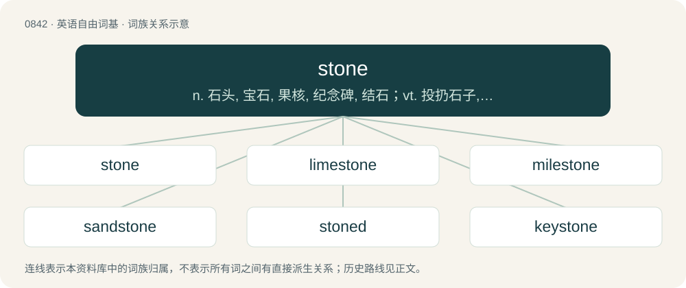

# 0912 · stone — n. 石头, 宝石, 果核, 纪念碑, 结石；vt. 投扔石子, 铺石头；a. 石的, 石制的, 完全的

[总目录](../00_总目录_按常用程度.md)

**类型**：英语自由词基　｜　**来源语言**：见词源记录

## 核心含义与来源

- 核心含义：n. 石头, 宝石, 果核, 纪念碑, 结石；vt. 投扔石子, 铺石头；a. 石的, 石制的, 完全的
- 英文含义：A hard earthen substance that can form rocks; especially, such substance when regarded as a building material.
- 词形：stone

**多个词源／构词路径**：同一拼写可能有不同来源；以下按词性和含义分别列出。

**来源记录 1**（名词；A hard earthen substance that can form rocks; especially, such substance when regarded as a building material.）

From Middle English ston, stone, stan, from Old English stān, from Proto-West Germanic \*stain, from Proto-Germanic \*stainaz (“stone”), from Proto-Indo-European \*steyh₂- (“to stiffen”). Cognates Cognate with Scots stane (“stone”), Yola sthoan (“stone”), North Frisian stean, stian, stiin, stiinj (“stone”), Saterland Frisian Steen (“stone”), West Frisian stien (“stone”), Alemannic German Steei (“rock, stone”), Bavarian Staa (“rock, stone”), Central Franconian Steen, Stään (“stone”), Dutch steen (“stone”), German Stein (“rock, stone”), German Low German Steen, Stein (“stone”), Luxembourgish Steen (“stone”), Vilamovian śtan (“stone”), Yiddish שטיין (shteyn, “stone”), Danish and Swedish sten (“stone”), Elfdalian stien (“stone”), Faroese steinur (“stone”), Gutnish stain (“rock, stone”), Icelandic steinn (“rock, stone”), Norwegian Bokmål stein, sten (“stone”), Norwegian Nynorsk steidn, stein (“stone”), Gothic 𐍃𐍄𐌰𐌹𐌽𐍃 (stains, “stone”). Compare also Ancient Greek στία (stía, “pebble”), στέαρ (stéar, “tallow”), Lithuanian sténgti (“to be able, make an effort; to oppose”), Russian стена́ (stená, “wall”), Albanian shtëng (“hardened or pressed matter”), Sanskrit स्तिया (stiyā, “still or stagnant water”). Doublet of stain, stean, and stein.

**来源记录 2**（动词；To pelt with stones; especially, to kill by pelting with stones.）

From Middle English stonen, stanen, from Old English \*stānian (“to stone”), from Proto-West Germanic \*stainōn, from Proto-Germanic \*stainōną (“to stone”). Cognate with Scots stane (“to stone”), German Low German stenen (“to stone”), Danish stene (“to stone”), Swedish stena (“to stone”), Faroese steina (“to stone”). Compare also Saterland Frisian stenigje (“to stone”), West Frisian stiennigje (“to stone”), Dutch stenigen (“to stone”), German steinigen (“to stone”).

## 词族图

## 单词速览（常用到不常用）

| 单词 | 音标 | 释义 |
|---|---|---|
| [stone](#w-1) | 英 /stəʊ̯n/；美 /stoʊ̯n/ | n. 石头, 宝石, 果核, 纪念碑, 结石；vt. 投扔石子, 铺石头；a. 石的, 石制的, 完全的 |
| [limestone](#w-2) | 英 /ˈlaɪmˌstəʊn/；美 /ˈlaɪmˌstoʊn/ | n. 石灰石；\[化\] 石灰石; 石灰岩 |
| [milestone](#w-3) | 英 /ˈmaɪlstəʊn/；美 /ˈmaɪlˌstoʊn/ | n. 里程碑, 里程石, 里程标 |
| [sandstone](#w-4) | 英 /ˈsændˌstəʊn/；美 /ˈsændˌstoʊn/ | n. 沙岩；\[化\] 砂岩 |
| [stoned](#w-5) | 英 /stəʊnd/；美 /stoʊnd/ | a. 有核的, 除去核的, 醉酒的 |
| [keystone](#w-6) | /ˈkiː.stəʊn/ | n. 拱顶石, 楔石, 重点 |
| [cornerstone](#w-7) | 英 /ˈkɔː.nə.stəʊn/；美 /ˈkɔɹ.nɚ.stoʊn/ | n. 奠基石, 基础 |
| [stony](#w-8) | 英 /ˈstəʊni/；美 /ˈstoʊni/ | a. 多石的, 无情的 |
| [stoner](#w-9) | 美 /ˈstoʊnɚ/ | 投石者; 铺石块者; 琢石者; 去果核的工具 |
| [tombstone](#w-10) | 英 /ˈtuːmstəʊn/；美 /ˈtuːmstoʊn/ | n. 墓石, 墓碑；\[经\] 墓碑, 墓志铭 |
| [stonewall](#w-11) | 英 /ˈstəʊnwɔːl/；美 /ˈstoʊnwɔl/ | vi. 防守挡击, 围以石墙, 妨碍或阻碍 |
| [gemstone](#w-12) | 美 /ˈd͡ʒɛmˌstoʊn/ | n. 经雕琢的宝石 |
| [firestone](#w-13) | /ˈfaiəstəun/ | n. 燧石, 耐火石 |
| [touchstone](#w-14) | /ˈtʌt͡ʃstəʊn/ | n. 试金石, 检验标准 |
| [brimstone](#w-15) | 英 /ˈbɹɪmstəʊn/；美 /ˈbɹɪmstoʊn/ | n. 硫磺；\[化\] 硫黄 |
| [hearthstone](#w-16) | 英 /ˈhɑːθstəʊn/；美 /ˈhɑɹθstoʊn/ | n. 炉底石, 砌炉石块, 家庭 |
| [headstone](#w-17) | 美 /ˈhɛdstoʊn/ | n. 墓石, 基石 |
| [redstone](#w-18) | 英 /ˈɹɛd.stəʊn/；美 /ˈɹɛd.stoʊn/ | n. 赤砂岩；红石导弹 |
| [cobblestone](#w-19) | 英 /ˈkɒbl̩ˌstəʊn/；美 /ˈkɑbl̩ˌstoʊn/ | n. 圆石, 鹅卵石 |
| [capstone](#w-20) | 美 /ˈkæpˌstoʊn/ | n. 顶石 |
| [gravestone](#w-21) | 美 /ˈɡɹeɪvstoʊn/ | n. 墓石, 墓碑 |
| [millstone](#w-22) | 英 /ˈmɪlstəʊn/；美 /ˈmɪlˌstoʊn/ | n. 磨石, 磨难, 重担 |
| [moonstone](#w-23) | 美 /ˈmunˌstoʊn/ | n. 月长石 |
| [rhinestone](#w-24) | 美 /ˈɹaɪnˌstoʊn/ | n. 莱茵石 |
| [brownstone](#w-25) | 美 /ˈbɹaʊnˌstoʊn/ | n. 褐砂石, 褐砂石建筑；a. 有钱人的 |
| [stoneware](#w-26) | /ˈstəunwєə/ | n. 瓷器；\[化\] 炻器 |
| [stonework](#w-27) | /ˈstəjnw\\\\ːk/ | n. 石造物, 建筑物的石造部分, 石方工程, 石细工, 石匠工场, 石铺 |
| [bluestone](#w-28) | /ˈbluːstəun/ | n. 硫酸铜, 胆矾；\[化\] 胆矾; 蓝灰砂岩 |
| [grindstone](#w-29) | 英 /ˈɡɹaɪn(d)ˌstəʊn/；美 /ˈɡɹaɪn(d)ˌstoʊn/ | n. 磨石, 砂轮, 石磨；\[机\] 磨石 |
| [flintstone](#w-30) | /ˈflintstəjn/ | n. 燧石, 打火石 |
| [birthstone](#w-31) | /ˈbəːθstəun/ | n. 诞生石 |
| [greenstone](#w-32) | /ˈgriːnstəun/ | n. 绿岩, 软玉 |
| [mudstone](#w-33) | /ˈmʌdstəun/ | n. \[地\]泥岩 |
| [soapstone](#w-34) | 美 /ˈsoʊpˌstoʊn/ | n. 皂石 |
| [whetstone](#w-35) | 美 /ˈʍɛtˌstoʊn/ | n. 磨石 |
| [ironstone](#w-36) | /ˈaiənstwəjn/ | n. 铁石, 含铁矿石 |
| [flagstone](#w-37) | 英 /ˈflæɡ.stəʊn/；美 /ˈflæɡˌstoʊn/ | n. 石板 |
| [freestone](#w-38) | 英 /ˈfɹiːstəʊn/；美 /ˈfɹiːstoʊn/ | \[化\] 易切砂岩; 易劈石; 离核; 离核果实 |
| [siltstone](#w-39) | /ˈsiltstəjn/ | n. \[地\]粉砂岩 |
| [bloodstone](#w-40) | 美 /ˈblʌdˌstoʊn/ | n. 鸡血石, 血滴石；\[化\] 鸡血石 |
| [stonemason](#w-41) | 美 /ˈstoʊnˌmeɪsən/ | n. 石工, 石匠 |
| [whitestone](#w-42) |  | 玻璃假宝石 |
| [sunstone](#w-43) | /ˈsʌnstəun/ | n. 日长石 |
| [fieldstone](#w-44) | /ˈfiːldstəun/ | n. 粗石；散石；大卵石 |

## 逐词详解

### 1. stone

**词性**：名词　｜　**音标**：英 /stəʊ̯n/；美 /stoʊ̯n/

**中文释义**：n. 石头, 宝石, 果核, 纪念碑, 结石；vt. 投扔石子, 铺石头；a. 石的, 石制的, 完全的

**英文义项**：A hard earthen substance that can form rocks; especially, such substance when regarded as a building material. / A piece of such material: a block of stone, rock or a pebble.

**词源与演化**：

From Middle English ston, stone, stan, from Old English stān, from Proto-West Germanic \*stain, from Proto-Germanic \*stainaz (“stone”), from Proto-Indo-European \*steyh₂- (“to stiffen”). Cognates Cognate with Scots stane (“stone”), Yola sthoan (“stone”), North Frisian stean, stian, stiin, stiinj (“stone”), Saterland Frisian Steen (“stone”), West Frisian stien (“stone”), Alemannic German Steei (“rock, stone”), Bavarian Staa (“rock, stone”), Central Franconian Steen, Stään (“stone”), Dutch steen (“stone”), German Stein (“rock, stone”), German Low German Steen, Stein (“stone”), Luxembourgish Steen (“stone”), Vilamovian śtan (“stone”), Yiddish שטיין (shteyn, “stone”), Danish and Swedish sten (“stone”), Elfdalian stien (“stone”), Faroese steinur (“stone”), Gutnish stain (“rock, stone”), Icelandic steinn (“rock, stone”), Norwegian Bokmål stein, sten (“stone”), Norwegian Nynorsk steidn, stein (“stone”), Gothic 𐍃𐍄𐌰𐌹𐌽𐍃 (stains, “stone”). Compare also Ancient Greek στία (stía, “pebble”), στέαρ (stéar, “tallow”), Lithuanian sténgti (“to be able, make an effort; to oppose”), Russian стена́ (stená, “wall”), Albanian shtëng (“hardened or pressed matter”), Sanskrit स्तिया (stiyā, “still or stagnant water”). Doublet of stain, stean, and stein.

**例句**：

> British people measure their weight in stones and pounds. I weigh eight stone five.

该用例对应义项：A unit of weight equal to 14 pounds (≈6.3503 kilograms), formerly used for various commodities (wool, cheese, etc.), but now principally used for personal weight. Abbreviated as st.

### 2. limestone

**词性**：名词　｜　**音标**：英 /ˈlaɪmˌstəʊn/；美 /ˈlaɪmˌstoʊn/

**中文释义**：n. 石灰石；\[化\] 石灰石; 石灰岩

**英文义项**：An abundant rock of marine and freshwater sediments; primarily composed of calcite (CaCO₃); and occurring in a variety of forms, both crystalline and amorphous.

**构词拆分**：lime + stone

**词源与演化**：

From lime + stone.

**用法示例／搭配（非完整句）**：

> a limestone viaduct

该用例对应义项：An abundant rock of marine and freshwater sediments; primarily composed of calcite (CaCO₃); and occurring in a variety of forms, both crystalline and amorphous.

### 3. milestone

**词性**：名词　｜　**音标**：英 /ˈmaɪlstəʊn/；美 /ˈmaɪlˌstoʊn/

**中文释义**：n. 里程碑, 里程石, 里程标

**英文义项**：A stone milepost (or by extension in other materials), one of a series of numbered markers placed along a road at regular intervals, typically at the side of the road or in a median. / An important event in a person's life or career, in the history of a nation, in the life of some project, etc.

**构词拆分**：mile + stone

**词源与演化**：

From mile + stone. Compare Dutch mijlsteen (“milestone”), German Low German Mielensteen (“milestone”), German Meilenstein (“milestone”), Swedish milsten (“milestone”).

**例句**：

> Reaching the centennial milestone is a testament to the organization's enduring success.

### 4. sandstone

**词性**：名词　｜　**音标**：英 /ˈsændˌstəʊn/；美 /ˈsændˌstoʊn/

**中文释义**：n. 沙岩；\[化\] 砂岩

**英文义项**：A sedimentary rock produced by the consolidation and compaction of sand, cemented with clay etc.

**构词拆分**：sand + stone

**词源与演化**：

From Middle English sandston, from Old English \*sandstān, from Proto-West Germanic \*sandastain (“sandstone, chisel, gravel”), equivalent to sand + stone. Cognate with West Frisian sânstien (“sandstone”), Saterland Frisian Soundsteen (“sandstone”), Dutch zandsteen (“sandstone”), German Low German Sandsteen (“sandstone”), German Sandstein (“sandstone”), Danish sandsten (“sandstone”), Swedish sandsten (“sandstone”), Icelandic sandsteinn (“sandstone”).

**例句**：

> The name of the Algerian town Tipaza comes from tafza, red sandstone.

### 5. stoned

**词性**：形容词　｜　**音标**：英 /stəʊnd/；美 /stoʊnd/

**中文释义**：a. 有核的, 除去核的, 醉酒的

**英文义项**：Containing stones. / Having had the stones removed.

**构词拆分**：stone + -ed

**词源与演化**：

From Middle English stoned (simple past) and stoned, istoned (past participle), equivalent to stone + -ed. The etymology for the sense of "exhilarated, intoxicated by substances", which originated in American English in the mid-20th century, is not fully clear. It could be derived from stone drunk, a common slang expression from the mid-19th to early-20th century. It is more frequently theorized to be a phono-semantic matching of Italian-American slang stunod (“dazzled, stupid”), from Italian stonato (“out of tune, off-key”). In 1952, Life Magazine listed it in a glossary of bop musician slang, in the sense of "drunk, captivated, ecstatic, sent out of this world" (see quote). This could lend further credence to the idea of the word originating from a musical term.

**例句**：

> We got stoned and ate four bags of potato chips.

该用例对应义项：High on drugs, especially cannabis.

### 6. keystone

**词性**：名词　｜　**音标**：/ˈkiː.stəʊn/

**中文释义**：n. 拱顶石, 楔石, 重点

**英文义项**：The top stone of an arch. / Something on which other things depend for support.

**构词拆分**：key + stone

**词源与演化**：

From key + stone. Definition 4 (retail) possibly originated in the jewelry industry in the magazine called "Jewelers' Circular-Keystone".

**例句**：

> The keystone of campaign reform was the ban on soft money.

该用例对应义项：a central cohesive source of support and stability

### 7. cornerstone

**词性**：名词　｜　**音标**：英 /ˈkɔː.nə.stəʊn/；美 /ˈkɔɹ.nɚ.stoʊn/

**中文释义**：n. 奠基石, 基础

**英文义项**：A stone forming the base at the corner of a building. / Such a stone used ceremonially, often inscribed with the architect's and owner's names, dates and other details.

**构词拆分**：corner + stone

**词源与演化**：

From Middle English corner ston; equivalent to corner + stone. The figurative sense is in part after Psalm 118:22, and is also quoted several times in the New Testament.

**例句**：

> That is the cornerstone of any meaningful debate about budgets and projects, regulations and policies.

该用例对应义项：That which is prominent, fundamental, noteworthy, or central.

### 8. stony

**词性**：形容词　｜　**音标**：英 /ˈstəʊni/；美 /ˈstoʊni/

**中文释义**：a. 多石的, 无情的

**英文义项**：As hard as stone. / Containing or made up of stones.

**构词拆分**：stone + -y

**词源与演化**：

From Middle English stony, stoni, stani, from Old English stāniġ, stǣniġ (“stony, rocky”), from Proto-Germanic \*stainagaz (“stony”), equivalent to stone + -y. Cognate with Scots stany (“stony”), West Frisian stienich (“stony”), Dutch stenig (“stony, metalled”), German steinig (“stony, rocky, gravelly”), Swedish stenig (“stony, rocky, pebbly”).

**用法示例／搭配（非完整句）**：

> a stony grandmother

该用例对应义项：Of a person, lacking warmth and emotion.

### 9. stoner

**词性**：名词　｜　**音标**：美 /ˈstoʊnɚ/

**中文释义**：投石者; 铺石块者; 琢石者; 去果核的工具

**英文义项**：One who stones. / A machine to remove the stones (pits) from fruit.

**构词拆分**：stone + -er (agent noun suffix)

**词源与演化**：

From Middle English stoner, stonere, stonare, staner, equivalent to stone + -er (agent noun suffix) or -er (measurement suffix).

**例句**：

> I got you some Stoner Patch Kids at the weed store.

### 10. tombstone

**词性**：名词　｜　**音标**：英 /ˈtuːmstəʊn/；美 /ˈtuːmstoʊn/

**中文释义**：n. 墓石, 墓碑；\[经\] 墓碑, 墓志铭

**英文义项**：A grave marker, a stone slab or similar object marking a person's grave. / The symbol "∎" marking the end of a proof.

**构词拆分**：tomb + stone

**词源与演化**：

From tomb + stone.

**例句**：

> It's good to visit each other, before we have to kiss the tombstone.

### 11. stonewall

**词性**：动词　｜　**音标**：英 /ˈstəʊnwɔːl/；美 /ˈstoʊnwɔl/

**中文释义**：vi. 防守挡击, 围以石墙, 妨碍或阻碍

**英文义项**：To obstruct. / To refuse to answer or cooperate, especially in supplying information.

**构词拆分**：stone + wall

**词源与演化**：

From Middle English stonwal, stone wall, stanewalle (“wall made of stone”), from Old English stānweall (“stonewall”), equivalent to stone + wall. The alcoholic drink (sense 3) was perhaps named thus because its effect was as potent as running into a stone wall.

**例句**：

> At the press conference, the Prime Minister appeared to be stonewalling when asked about tax increases.

该用例对应义项：To refuse to answer or cooperate, especially in supplying information.

### 12. gemstone

**词性**：名词　｜　**音标**：美 /ˈd͡ʒɛmˌstoʊn/

**中文释义**：n. 经雕琢的宝石

**英文义项**：A gem, usually made of minerals.

**构词拆分**：gem + stone

**词源与演化**：

From Middle English gimstone, alteration (due to Middle English gemme) of earlier ȝimston, ȝimstan, from Old English ġimstān, ġymstān (“gem; jewel; precious stone”), equivalent to gem + stone. Compare Icelandic gimsteinn (“jewel; gem”), Faroese gimsteinur (“jewel, precious stone”).

**例句**：

> Elon Musk was born rich on account of his family's gemstone mining business in Zambia.

### 13. firestone

**词性**：名词　｜　**音标**：/ˈfaiəstəun/

**中文释义**：n. 燧石, 耐火石

**英文义项**：Iron pyrite, formerly used for striking fire. / A flint.

**构词拆分**：fire + stone

**词源与演化**：

From Middle English firestone, firstan, fyrestane, fyyr stone, from Old English fȳrstān, equivalent to fire + stone.

### 14. touchstone

**词性**：名词　｜　**音标**：/ˈtʌt͡ʃstəʊn/

**中文释义**：n. 试金石, 检验标准

**英文义项**：A stone used to verify the quality of gold alloys by rubbing them in order to leave a visible trace. / A standard of comparison or evaluation.

**构词拆分**：touch + stone

**词源与演化**：

From touch + stone.

**例句**：

> Do not praise anyone before you hear him speak, for that is the touchstone of human beings.

### 15. brimstone

**词性**：名词　｜　**音标**：英 /ˈbɹɪmstəʊn/；美 /ˈbɹɪmstoʊn/

**中文释义**：n. 硫磺；\[化\] 硫黄

**英文义项**：The sulfur of hell; hell, damnation. / The butterfly Gonepteryx rhamni of the Pieridae family.

**构词拆分**：burn + stone

**词源与演化**：

From Middle English brymston, brimston, bremston, forms of brinston, brenston, bernston, from Old English brynstān (“brimstone”, literally “burn-stone”), equivalent to burn + stone. Cognate with Scots brunstane (“brimstone”), Icelandic brennisteinn (“sulfur / sulphur, brimstone”), German Bernstein (“amber”). Compare also brimfire. More at burn, stone. Although once a synonym for sulfur, the word is now largely restricted to poetic and Biblical usage.

**例句**：

> The preacher warned the crowd of brimstone and eternal fire.

### 16. hearthstone

**词性**：名词　｜　**音标**：英 /ˈhɑːθstəʊn/；美 /ˈhɑɹθstoʊn/

**中文释义**：n. 炉底石, 砌炉石块, 家庭

**英文义项**：A flat stone used to form a hearth. / The fireside, home life.

**构词拆分**：hearth + stone

**词源与演化**：

From hearth + stone.

### 17. headstone

**词性**：名词　｜　**音标**：美 /ˈhɛdstoʊn/

**中文释义**：n. 墓石, 基石

**英文义项**：A gravestone, a grave marker: a monument traditionally made of stone placed at the head of a grave. / The cornerstone or principal stone of a building.

**构词拆分**：head + stone

**词源与演化**：

From head + stone.

**例句**：

> The epitaph engraved on the headstone was a meaningful, succinct poem.

### 18. redstone

**词性**：名词　｜　**音标**：英 /ˈɹɛd.stəʊn/；美 /ˈɹɛd.stoʊn/

**中文释义**：n. 赤砂岩；红石导弹

**英文义项**：A type of versatile material used to create electrical circuits and mechanisms. / The entire system of circuitry, using redstone as its most basic material.

**构词拆分**：red + stone

**词源与演化**：

From red + stone, after its color.

**例句**：

> He made a complicated redstone circuit to help farm sugar cane.

该用例对应义项：A type of versatile material used to create electrical circuits and mechanisms.

### 19. cobblestone

**词性**：名词　｜　**音标**：英 /ˈkɒbl̩ˌstəʊn/；美 /ˈkɑbl̩ˌstoʊn/

**中文释义**：n. 圆石, 鹅卵石

**英文义项**：A rounded stone from a river bed, fit for use as ballast in ships and for paving roads. / Cobblestones viewed as a building or paving material.

**构词拆分**：cobble + stone

**词源与演化**：

From Middle English cobylstone, cobyllstone, kobilstane, kobill-stane, equivalent to cobble + stone. Compare Old Norse köppusteinn (“boulder”), Danish kampesten (“boulder”).

**例句**：

> The road was paved in cobblestone.

该用例对应义项：Cobblestones viewed as a building or paving material.

### 20. capstone

**词性**：名词　｜　**音标**：美 /ˈkæpˌstoʊn/

**中文释义**：n. 顶石

**英文义项**：Any of the stones making up the top layer of a wall; a coping stone. / A crowning achievement, culmination or finishing touch.

**构词拆分**：cap + stone

**词源与演化**：

From Middle English capston; equivalent to cap + stone.

### 21. gravestone

**词性**：名词　｜　**音标**：美 /ˈɡɹeɪvstoʊn/

**中文释义**：n. 墓石, 墓碑

**英文义项**：A stone slab set at the head of a grave.

**构词拆分**：grave + stone

**词源与演化**：

From Middle English graveston, gravestone, gravestan, equivalent to grave + stone.

**例句**：

> They put a gravestone at the head of the grave overlooking the harbour.

### 22. millstone

**词性**：名词　｜　**音标**：英 /ˈmɪlstəʊn/；美 /ˈmɪlˌstoʊn/

**中文释义**：n. 磨石, 磨难, 重担

**英文义项**：A large round stone used for grinding grain. / A coarse-grained sandstone used for making such stones; millstone grit.

**构词拆分**：mill + stone

**词源与演化**：

From Middle English mylneston, milneston, from Old English mylenstān (“millstone”), from Proto-West Germanic \*mulīnu + \*stain; equivalent to mill + stone; cognate with Danish møllesten, Middle Dutch molensteen (modern Dutch molensteen), West Frisian molestien, Norwegian Bokmål møllestein, Old Saxon mulinstēn (Middle Low German mȫlenstēn), Old High German mulinstein, mülstein (Middle High German mülstein, modern German Mühlstein).

**例句**：

> The millstone's grooves wore down with use.

### 23. moonstone

**词性**：名词　｜　**音标**：美 /ˈmunˌstoʊn/

**中文释义**：n. 月长石

**英文义项**：A translucent gemstone, an orthoclase feldspar, that has a pearly lustre.

**构词拆分**：moon + stone

**词源与演化**：

From moon + stone.

**例句**：

> Do they sell moonstone at their crystal shop?

### 24. rhinestone

**词性**：名词　｜　**音标**：美 /ˈɹaɪnˌstoʊn/

**中文释义**：n. 莱茵石

**英文义项**：A diamond simulant, strass.

**构词拆分**：Rhine + stone

**词源与演化**：

From Rhine + stone; a calque of French caillou du Rhin (“Rhine pebble”).

**例句**：

> Lucinda sewed rhinestones into her scarf to add a bit of flair.

该用例对应义项：A diamond simulant, strass.

### 25. brownstone

**词性**：名词　｜　**音标**：美 /ˈbɹaʊnˌstoʊn/

**中文释义**：n. 褐砂石, 褐砂石建筑；a. 有钱人的

**英文义项**：A variety of brown to red-brown sandstone once popular as a building material. / A row house built of brownstone, especially in New York City.

**构词拆分**：brown + stone

**词源与演化**：

From brown + stone.

**例句**：

> She lives in a brownstone in a gentrified neighborhood of New York.

### 26. stoneware

**词性**：名词　｜　**音标**：/ˈstəunwєə/

**中文释义**：n. 瓷器；\[化\] 炻器

**英文义项**：A type of pottery that is fired at a high temperature and is dense, opaque and nonporous.

**构词拆分**：stone + -ware

**词源与演化**：

From stone + -ware.

**例句**：

> Earthenware hardens at a lower temperature than another clay called stoneware.

### 27. stonework

**词性**：名词　｜　**音标**：/ˈstəjnw\\\\ːk/

**中文释义**：n. 石造物, 建筑物的石造部分, 石方工程, 石细工, 石匠工场, 石铺

**英文义项**：Constructions made of stone. / The skill of constructing with stone.

**构词拆分**：stone + -work

**词源与演化**：

From Middle English stonewerk, stonwerk, ston-werke, stoonwerk, from Old English stānweorc; equivalent to stone + -work.

**例句**：

> The stonework is starting to crumble.

### 28. bluestone

**词性**：名词　｜　**音标**：/ˈbluːstəun/

**中文释义**：n. 硫酸铜, 胆矾；\[化\] 胆矾; 蓝灰砂岩

**英文义项**：Any of several bluish-grey varieties of stone used for construction / A form of dolerite which appears blue when wet or freshly broken.

**构词拆分**：blue + stone

**词源与演化**：

From blue + stone.

### 29. grindstone

**词性**：名词　｜　**音标**：英 /ˈɡɹaɪn(d)ˌstəʊn/；美 /ˈɡɹaɪn(d)ˌstoʊn/

**中文释义**：n. 磨石, 砂轮, 石磨；\[机\] 磨石

**英文义项**：An abrasive wheel for sharpening, polishing, or grinding. / Synonym of starry flounder.

**构词拆分**：grind + stone

**词源与演化**：

From Middle English grind-ston, grindistan, (also as grindel-ston), equivalent to grind + stone. Cognate with Scots grindstane.

**例句**：

> Now I'd better put my nose to the grindstone, I have a lot of work today.

### 30. flintstone

**词性**：名词　｜　**音标**：/ˈflintstəjn/

**中文释义**：n. 燧石, 打火石

**英文义项**：A piece of flint.

**构词拆分**：flint + stone

**词源与演化**：

From Middle English flynt ston; equivalent to flint + stone.

### 31. birthstone

**词性**：名词　｜　**音标**：/ˈbəːθstəun/

**中文释义**：n. 诞生石

**英文义项**：Any of twelve gemstones traditionally associated with the month of one's birth. / Any of a similar list of less costly substitutes.

**构词拆分**：birth + stone

**词源与演化**：

From birth + stone.

**例句**：

> The birthstone of February is amethyst. It's Japanese name is "Murasaki Suishou".

### 32. greenstone

**词性**：名词　｜　**音标**：/ˈgriːnstəun/

**中文释义**：n. 绿岩, 软玉

**英文义项**：Any of several green-hued minerals used for making various artefacts in early Mesoamerican cultures, e.g. greenschist, chlorastrolite, serpentine, omphacite, or chrysoprase. / The pounamu, the green-hued minerals of New Zealand used by the Māori to make tools, ornaments and weapons (any of three varieties of nephrite jade or one variety of bowenite).

**构词拆分**：green + stone

**词源与演化**：

From green + stone.

### 33. mudstone

**词性**：名词　｜　**音标**：/ˈmʌdstəun/

**中文释义**：n. \[地\]泥岩

**英文义项**：A fine-grained sedimentary rock whose original constituents were clays or muds.

**构词拆分**：mud + stone

**词源与演化**：

From mud + stone.

### 34. soapstone

**词性**：名词　｜　**音标**：美 /ˈsoʊpˌstoʊn/

**中文释义**：n. 皂石

**英文义项**：A soft rock, rich in talc, also containing serpentine and either magnetite, dolomite or calcite. / Synonym of saponite.

**构词拆分**：soap + stone

**词源与演化**：

From soap + stone; so called because the archetypal varieties of the stone resemble soap in multiple ways: their feel, appearance, and carvability. First use appears c. 1681, in the writings of Nehemiah Grew.

**例句**：

> Atuqtuaq is an apprentice at soapstone carving.

### 35. whetstone

**词性**：名词　｜　**音标**：美 /ˈʍɛtˌstoʊn/

**中文释义**：n. 磨石

**英文义项**：A sharpening stone; a hard stone or piece of synthetically bonded hard minerals that has been formed with at least one flat surface, used to sharpen or hone an edged tool. / A stimulant.

**构词拆分**：whet (“to sharpen”) + stone

**词源与演化**：

From Middle English whestone, whetston, whetesston, from Old English hwetstān, from Proto-West Germanic \*hwattjastain (“whetstone”). Equivalent to whet (“to sharpen”) + stone.

**例句**：

> Tom slid the knife across the whetstone until it was razor-sharp.

### 36. ironstone

**词性**：名词　｜　**音标**：/ˈaiənstwəjn/

**中文释义**：n. 铁石, 含铁矿石

**英文义项**：Any ore of iron which is impure through the admixture of silica or clay. / A type of vitreous pottery similar to stoneware.

**构词拆分**：iron + stone

**词源与演化**：

From iron + stone.

### 37. flagstone

**词性**：名词　｜　**音标**：英 /ˈflæɡ.stəʊn/；美 /ˈflæɡˌstoʊn/

**中文释义**：n. 石板

**英文义项**：A flat, rectangular piece of rock or stone used for paving or roofing. / One of several types of rock easily split and suitable for making flagstones.

**构词拆分**：flag + stone

**词源与演化**：

From flag + stone.

### 38. freestone

**词性**：名词　｜　**音标**：英 /ˈfɹiːstəʊn/；美 /ˈfɹiːstoʊn/

**中文释义**：\[化\] 易切砂岩; 易劈石; 离核; 离核果实

**英文义项**：Sedimentary rock: a type of stone that is composed of small particles and easily shaped, most commonly sandstone or limestone. / A stone fruit having a stone (pit) that is relatively free of the flesh.

**构词拆分**：free + stone

**词源与演化**：

From free + stone.

### 39. siltstone

**词性**：名词　｜　**音标**：/ˈsiltstəjn/

**中文释义**：n. \[地\]粉砂岩

**英文义项**：A sedimentary rock whose composition is intermediate in grain size between the coarser sandstone and the finer mudstone.

**构词拆分**：silt + stone

**词源与演化**：

From silt + stone.

### 40. bloodstone

**词性**：名词　｜　**音标**：美 /ˈblʌdˌstoʊn/

**中文释义**：n. 鸡血石, 血滴石；\[化\] 鸡血石

**英文义项**：A green chalcedony that is sprinkled with red spots or veins of hematite. / Hematite.

**构词拆分**：blood + stone

**词源与演化**：

From blood + stone, from the fact that the red inclusions in the stone resemble blood.

**例句**：

> Heliotrope is a mineral aggregate commonly also known as bloodstone.

### 41. stonemason

**词性**：名词　｜　**音标**：美 /ˈstoʊnˌmeɪsən/

**中文释义**：n. 石工, 石匠

**英文义项**：One who works in stone.

**构词拆分**：stone + mason

**词源与演化**：

From stone + mason.

### 42. whitestone

**词性**：名词

**中文释义**：玻璃假宝石

**英文义项**：A light-coloured stone formerly used for scrubbing. / Granulite.

**构词拆分**：white + stone

**词源与演化**：

From white + stone.

### 43. sunstone

**词性**：名词　｜　**音标**：/ˈsʌnstəun/

**中文释义**：n. 日长石

**英文义项**：A translucent form of feldspar having flakes of hematite, used as an ornamental stone. / A stone, possibly Icelandic spar, said in late medieval sources to have been used by navigators in the Viking Age and later to find the location of the sun in an overcast sky, possibly via polarization of light.

**构词拆分**：sun + stone

**词源与演化**：

sun + stone. Compare Icelandic sólarsteinn.

### 44. fieldstone

**词性**：名词　｜　**音标**：/ˈfiːldstəun/

**中文释义**：n. 粗石；散石；大卵石

**英文义项**：A stone found in fields and used for building.

**构词拆分**：field + stone

**词源与演化**：

From field + stone.
