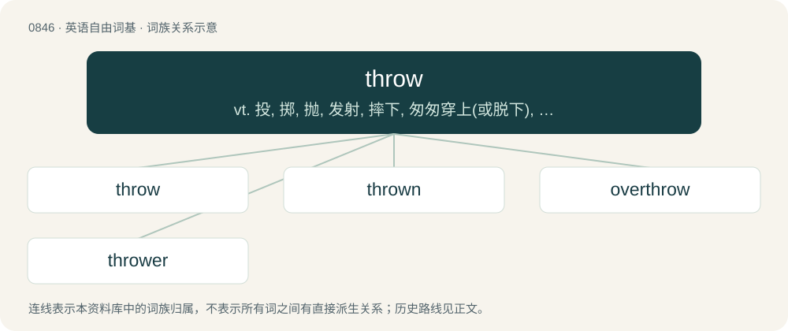

# 0914 · throw — vt. 投, 掷, 抛, 发射, 摔下, 匆匆穿上(或脱下), 抛弃, 摆脱；vi. 丢, 掷, 抛；n. 投掷, 掷骰子, 冒险

[总目录](../00_总目录_按常用程度.md)

**类型**：英语自由词基　｜　**来源语言**：见词源记录

## 核心含义与来源

- 核心含义：vt. 投, 掷, 抛, 发射, 摔下, 匆匆穿上(或脱下), 抛弃, 摆脱；vi. 丢, 掷, 抛；n. 投掷, 掷骰子, 冒险
- 英文含义：To hurl; to release (an object) with some force from one’s hands, an apparatus, etc. so that it moves rapidly through the air.
- 词形：throw

**来源记录 1**（动词；To hurl; to release (an object) with some force from one’s hands, an apparatus, etc. so that it moves rapidly through the air.）

From Middle English throwen, thrawen, from Old English þrāwan (“to turn, twist”), from Proto-West Germanic \*þrāan, from Proto-Germanic \*þrēaną (“to twist, turn”), from Proto-Indo-European \*terh₁- (“to rub, rub by twisting, twist, turn”). Cognate with Scots thraw (“to twist, turn, throw”), West Frisian triuwe (“to push”), Dutch draaien (“to turn”), Low German draien, dreien (“to turn (in a lathe)”), German drehen (“to turn”). Displaced warp as the word for hurling and was displaced by warp as the word for twisting. The use in computing comes from the fact, that in programming languages a statement reporting an error interrupts normal processing and sends an error object up the function calling stack until a handling statement intercepts it. Thus an “object” is “thrown” and “flies” until it is “caught”.

## 词族图

## 单词速览（常用到不常用）

| 单词 | 音标 | 释义 |
|---|---|---|
| [throw](#w-1) | 英 /θɹəʊ/；美 /θɹoʊ/ | vt. 投, 掷, 抛, 发射, 摔下, 匆匆穿上(或脱下), 抛弃, 摆脱；vi. 丢, 掷, 抛；n. 投掷, 掷骰子, 冒险 |
| [thrown](#w-2) | 英 /θɹəʊn/；美 /θɹoʊn/ | throw的过去分词 |
| [overthrow](#w-3) | 英 /əʊvəˈθɹəʊ/；美 /ˌoʊvɚˈθɹoʊ/ | n. 推翻, 瓦解, 倾覆；vt. 打倒, 推翻, 倾覆 |
| [thrower](#w-4) | /ˈθrəuə/ | n. 投掷者, 发射器, 喷射器, 制陶坯的工人；\[化\] 抛油环; 甩水圈 |

## 逐词详解

### 1. throw

**词性**：动词　｜　**音标**：英 /θɹəʊ/；美 /θɹoʊ/

**中文释义**：vt. 投, 掷, 抛, 发射, 摔下, 匆匆穿上(或脱下), 抛弃, 摆脱；vi. 丢, 掷, 抛；n. 投掷, 掷骰子, 冒险

**英文义项**：To hurl; to release (an object) with some force from one’s hands, an apparatus, etc. so that it moves rapidly through the air. / To eject or cause to fall off.

**词源与演化**：

From Middle English throwen, thrawen, from Old English þrāwan (“to turn, twist”), from Proto-West Germanic \*þrāan, from Proto-Germanic \*þrēaną (“to twist, turn”), from Proto-Indo-European \*terh₁- (“to rub, rub by twisting, twist, turn”). Cognate with Scots thraw (“to twist, turn, throw”), West Frisian triuwe (“to push”), Dutch draaien (“to turn”), Low German draien, dreien (“to turn (in a lathe)”), German drehen (“to turn”). Displaced warp as the word for hurling and was displaced by warp as the word for twisting. The use in computing comes from the fact, that in programming languages a statement reporting an error interrupts normal processing and sends an error object up the function calling stack until a handling statement intercepts it. Thus an “object” is “thrown” and “flies” until it is “caught”.

**例句**：

> If the file is read-only, the method throws an invalid-operation exception.

该用例对应义项：To send (an error) to an exception-handling mechanism in order to interrupt normal processing.

### 2. thrown

**词性**：形容词　｜　**音标**：英 /θɹəʊn/；美 /θɹoʊn/

**中文释义**：throw的过去分词

**英文义项**：Launched by throwing. / Twisted into a single thread, as silk or yarn.

**构词拆分**：throw + -n

**词源与演化**：

From Middle English throwen, from Old English þrāwen, ġeþrāwen, from Proto-Germanic \*þrēanaz, from Proto-Germanic \*þrēaną. Doublet of thran. Morphologically throw + -n.

**例句**：

> I was totally thrown by his bizarre remarks.

该用例对应义项：Confused; perplexed.

### 3. overthrow

**词性**：动词　｜　**音标**：英 /əʊvəˈθɹəʊ/；美 /ˌoʊvɚˈθɹoʊ/

**中文释义**：n. 推翻, 瓦解, 倾覆；vt. 打倒, 推翻, 倾覆

**英文义项**：To bring about the downfall of (a government, etc.), especially by force; to usurp.

**构词拆分**：over- + throw

**词源与演化**：

From Middle English overthrowen, equivalent to over- + throw. Compare Dutch overdraaien, German überdrehen, Old English oferweorpan (“to overthrow”). For the noun sense, compare Middle English overthrow, overthrowe (“destruction, downfall”), from the verb.

**例句**：

> I hate the current government, but not enough to want to overthrow them.

该用例对应义项：To bring about the downfall of (a government, etc.), especially by force; to usurp.

### 4. thrower

**词性**：名词　｜　**音标**：/ˈθrəuə/

**中文释义**：n. 投掷者, 发射器, 喷射器, 制陶坯的工人；\[化\] 抛油环; 甩水圈

**英文义项**：Someone who throws. / Something that throws.

**构词拆分**：throw + -er

**词源与演化**：

From Middle English thrower, equivalent to throw + -er.

**例句**：

> The javelin thrower's record was 12 metres.
