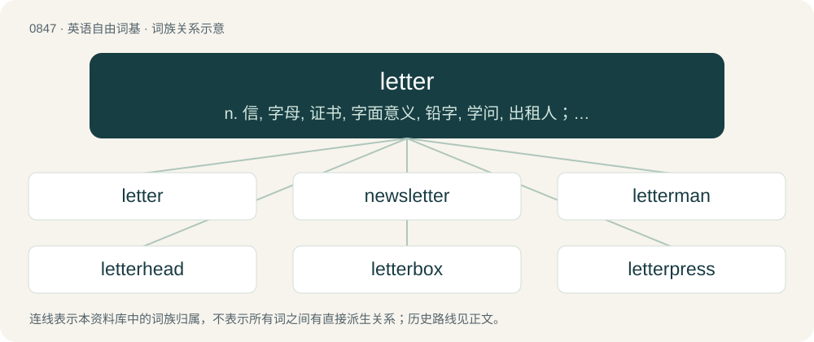

# 0915 · letter — n. 信, 字母, 证书, 字面意义, 铅字, 学问, 出租人；vt. 写字母于, 在...上刻字母, 用字母标明；vi. 写印刷体字

[总目录](../00_总目录_按常用程度.md)

**类型**：英语自由词基　｜　**来源语言**：见词源记录

## 核心含义与来源

- 核心含义：n. 信, 字母, 证书, 字面意义, 铅字, 学问, 出租人；vt. 写字母于, 在...上刻字母, 用字母标明；vi. 写印刷体字
- 英文含义：A symbol in an alphabet.
- 词形：letter

**多个词源／构词路径**：同一拼写可能有不同来源；以下按词性和含义分别列出。

**来源记录 1**（名词；A symbol in an alphabet.）

From Middle English letter, lettre, from Old French letre, from Latin littera (“letter of the alphabet"; in plural, "epistle”). Displaced Old English bōcstæf (literally “book staff”) in sense 1 and ǣrendġewrit (literally “message writing”) in sense 2.

**来源记录 2**（名词；One who lets, or lets out.）

From Middle English letere, equivalent to let + -er.

## 词族图

## 单词速览（常用到不常用）

| 单词 | 音标 | 释义 |
|---|---|---|
| [letter](#w-1) | 英 /ˈlɛtə/；美 /ˈlɛtɚ/ | n. 信, 字母, 证书, 字面意义, 铅字, 学问, 出租人；vt. 写字母于, 在...上刻字母, 用字母标明；vi. 写印刷体字 |
| [newsletter](#w-2) | 英 /ˈnjuːzˌlɛtə/；美 /ˈn(j)uzˌlɛtɚ/ | n. 时事通讯, 业务通讯, 时事传报；\[法\] 时事通讯, 时事信札 |
| [letterman](#w-3) | /ˈletəmæn/ | n. (得奖的)运动员 |
| [letterhead](#w-4) | /ˈlɛtə(ɹ)ˌhɛd/ | n. 信笺上方的印刷文字, 印有抬头的信笺 |
| [letterbox](#w-5) |  | n. 邮筒, 邮箱, 投信口, 信箱 |
| [letterpress](#w-6) | 美 /ˈlɛtɚˌpɹɛs/ | n. 文字部分, 正文, 书信复印器；\[化\] 活版印刷 |

## 逐词详解

### 1. letter

**词性**：名词　｜　**音标**：英 /ˈlɛtə/；美 /ˈlɛtɚ/

**中文释义**：n. 信, 字母, 证书, 字面意义, 铅字, 学问, 出租人；vt. 写字母于, 在...上刻字母, 用字母标明；vi. 写印刷体字

**英文义项**：A symbol in an alphabet. / A written or printed communication, usually defined as longer and more formal than a note. (Sometimes specifically one that is on paper.)

**词源与演化**：

From Middle English letter, lettre, from Old French letre, from Latin littera (“letter of the alphabet"; in plural, "epistle”). Displaced Old English bōcstæf (literally “book staff”) in sense 1 and ǣrendġewrit (literally “message writing”) in sense 2.

**例句**：

> Benjamin Franklin was multiskilled – a scientist, politician and a man of letters.

该用例对应义项：Literature.

### 2. newsletter

**词性**：名词　｜　**音标**：英 /ˈnjuːzˌlɛtə/；美 /ˈn(j)uzˌlɛtɚ/

**中文释义**：n. 时事通讯, 业务通讯, 时事传报；\[法\] 时事通讯, 时事信札

**英文义项**：A periodically sent publication containing current events or the like, generally on a particular topic or geared toward a limited audience.

**构词拆分**：news + letter

**词源与演化**：

From news + letter.

**例句**：

> Subscribing to the newsletter will ensure you receive regular information about news.

### 3. letterman

**词性**：名词　｜　**音标**：/ˈletəmæn/

**中文释义**：n. (得奖的)运动员

**英文义项**：A student who has attained a specified level of participation in a sporting or other activity, and is awarded a cloth “letter” to be affixed to an item of clothing.

**构词拆分**：letter + -man

**词源与演化**：

From letter + -man.

### 4. letterhead

**词性**：名词　｜　**音标**：/ˈlɛtə(ɹ)ˌhɛd/

**中文释义**：n. 信笺上方的印刷文字, 印有抬头的信笺

**英文义项**：A portion of text at the top of a letter, identifying the sender and often giving their address etc., used for formal correspondence. / Paper marked with a letterhead.

**构词拆分**：letter + head

**词源与演化**：

From letter + head.

**例句**：

> Internal memos do not need to be printed on letterhead.

该用例对应义项：Paper marked with a letterhead.

### 5. letterbox

**词性**：名词

**中文释义**：n. 邮筒, 邮箱, 投信口, 信箱

**英文义项**：A collection point for mail intended for onward delivery, a secure box or receptacle for this purpose. / A delivery point for mail, a box, compartment or slot for this purpose.

**构词拆分**：letter + box

**词源与演化**：

From letter + box.

**例句**：

> A wad of junk mail was pushed through the letterbox in the front door and dropped onto the mat.

该用例对应义项：A delivery point for mail, a box, compartment or slot for this purpose.

### 6. letterpress

**词性**：名词　｜　**音标**：美 /ˈlɛtɚˌpɹɛs/

**中文释义**：n. 文字部分, 正文, 书信复印器；\[化\] 活版印刷

**英文义项**：The printing process in which ink is applied to the top surface of a raised image area, which is then pressed against paper to transfer the image. / Printing directly from type, in distinction from printing from plates.

**构词拆分**：letter + press

**词源与演化**：

From letter + press.
