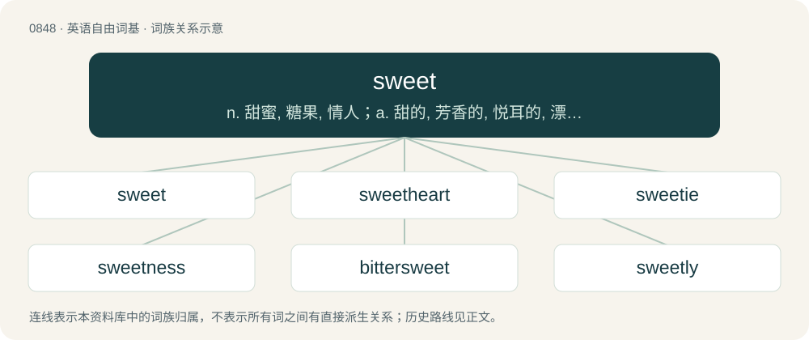

# 0916 · sweet — n. 甜蜜, 糖果, 情人；a. 甜的, 芳香的, 悦耳的, 漂亮的, 和蔼的, 不咸的, 灵活的, 轻快的

[总目录](../00_总目录_按常用程度.md)

**类型**：英语自由词基　｜　**来源语言**：见词源记录

## 核心含义与来源

- 核心含义：n. 甜蜜, 糖果, 情人；a. 甜的, 芳香的, 悦耳的, 漂亮的, 和蔼的, 不咸的, 灵活的, 轻快的
- 英文含义：Tasting of sugars.
- 词形：sweet

**来源记录 1**（形容词；Tasting of sugars.）

From Middle English soot, sweete, swete, swoote, from Old English swēte, swoete, swōt, swœ̄te (“sweet”), from Proto-West Germanic \*swōtī, from Proto-Germanic \*swōtuz (“sweet”), from Proto-Indo-European \*swéh₂dus (“sweet”), from \*sweh₂d- (“sweet”) + \*-us. Cognates Cognate with Yola sweet (“sweet”), Saterland Frisian swäit (“sweet”), West Frisian swiet (“sweet”), Alemannic German süeß (“sweet”), Bavarian siaß (“sweet; cute”), Central Franconian söß (“sweet”), Dutch zoet (“sweet”), German süss, süß (“sweet; cute”), Limburgish söüt (“sweet; cute”), Low German seut, sööt (“sweet”), Luxembourgish séiss (“sweet”), Vilamovian ziss (“sweet”), Yiddish זיס (zis, “sweet; cute”), Danish sød (“sweet; cute, pretty”), Faroese søtur (“sweet”), Icelandic sætur (“sweet; cute, pretty”), Norwegian Bokmål and Norwegian Nynorsk søt (“sweet; cute”), Swedish söt (“sweet; cute”); also Latin suāvis (“delicious, pleasant, sweet”), Ancient Greek ἡδύς (hēdús, “sweet; pleasant; glad, pleased”), Albanian shije (“flavour, taste”), Lithuanian sūdyti (“to add salt; to brine, souse”), Armenian քաղցր (kʻaġcʻr, “sweet”), Tocharian A swār (“sweet”), Tocharian B swāre (“sweet, tender”), Sanskrit स्वादु (svādú, “delicious, palatable, savoury, sweet, tasty; dainty, delicate”). Doublet of suave.

## 词族图

## 单词速览（常用到不常用）

| 单词 | 音标 | 释义 |
|---|---|---|
| [sweet](#w-1) | 英 /swiːt/；美 /swit/ | n. 甜蜜, 糖果, 情人；a. 甜的, 芳香的, 悦耳的, 漂亮的, 和蔼的, 不咸的, 灵活的, 轻快的 |
| [sweetheart](#w-2) | 英 /ˈswiːtˌhɑːt/；/ˈswitˌhɑɹt/ | n. 心上人, 爱人；vi. 爱慕；vt. 向...求爱 |
| [sweetie](#w-3) | 英 /ˈswiːti/；美 /ˈswi.ti/ | n. 情人, 爱人, 甜食 |
| [sweetness](#w-4) | 英 /ˈswiːtnəs/；美 /ˈswitnəs/ | n. 甜蜜, 芳香, 美妙 |
| [bittersweet](#w-5) | 美 /ˈbɪtɚˌswit/ | a. 又苦又甜的, 苦乐参半的；\[医\] 白英, 蜀羊泉 |
| [sweetly](#w-6) | /ˈswiːtli/ | adv. 甜美地, 惬意地, 讨人喜欢地 |
| [sweeten](#w-7) | /ˈswiːtən/ | vt. 使变甜, 加糖于, 使悦耳, 使温和, 减轻；vi. 变甜 |
| [sweetwater](#w-8) | /ˈswiːtwɔtə/ | n. 淡水 |

## 逐词详解

### 1. sweet

**词性**：形容词　｜　**音标**：英 /swiːt/；美 /swit/

**中文释义**：n. 甜蜜, 糖果, 情人；a. 甜的, 芳香的, 悦耳的, 漂亮的, 和蔼的, 不咸的, 灵活的, 轻快的

**英文义项**：Tasting of sugars. / Retaining a portion of sugar.

**词源与演化**：

From Middle English soot, sweete, swete, swoote, from Old English swēte, swoete, swōt, swœ̄te (“sweet”), from Proto-West Germanic \*swōtī, from Proto-Germanic \*swōtuz (“sweet”), from Proto-Indo-European \*swéh₂dus (“sweet”), from \*sweh₂d- (“sweet”) + \*-us. Cognates Cognate with Yola sweet (“sweet”), Saterland Frisian swäit (“sweet”), West Frisian swiet (“sweet”), Alemannic German süeß (“sweet”), Bavarian siaß (“sweet; cute”), Central Franconian söß (“sweet”), Dutch zoet (“sweet”), German süss, süß (“sweet; cute”), Limburgish söüt (“sweet; cute”), Low German seut, sööt (“sweet”), Luxembourgish séiss (“sweet”), Vilamovian ziss (“sweet”), Yiddish זיס (zis, “sweet; cute”), Danish sød (“sweet; cute, pretty”), Faroese søtur (“sweet”), Icelandic sætur (“sweet; cute, pretty”), Norwegian Bokmål and Norwegian Nynorsk søt (“sweet; cute”), Swedish söt (“sweet; cute”); also Latin suāvis (“delicious, pleasant, sweet”), Ancient Greek ἡδύς (hēdús, “sweet; pleasant; glad, pleased”), Albanian shije (“flavour, taste”), Lithuanian sūdyti (“to add salt; to brine, souse”), Armenian քաղցր (kʻaġcʻr, “sweet”), Tocharian A swār (“sweet”), Tocharian B swāre (“sweet, tender”), Sanskrit स्वादु (svādú, “delicious, palatable, savoury, sweet, tasty; dainty, delicate”). Doublet of suave.

**例句**：

> The attraction was mutual and instant; they were sweet on one another from first sight.

该用例对应义项：Romantically fixated; enamored with; fond of.

### 2. sweetheart

**词性**：名词　｜　**音标**：英 /ˈswiːtˌhɑːt/；/ˈswitˌhɑɹt/

**中文释义**：n. 心上人, 爱人；vi. 爱慕；vt. 向...求爱

**英文义项**：A person who is always very kind. / A person very much liked or loved by someone, especially when both partners are young.

**构词拆分**：sweet + heart

**词源与演化**：

From Middle English swete heorte, swete hert (term of endearment); equivalent to sweet + heart.

**例句**：

> She is such a sweetheart: she never complains about me being late.

该用例对应义项：A person who is always very kind.

### 3. sweetie

**词性**：名词　｜　**音标**：英 /ˈswiːti/；美 /ˈswi.ti/

**中文释义**：n. 情人, 爱人, 甜食

**英文义项**：A person who is much loved. / A sweetheart.

**构词拆分**：sweet + -ie

**词源与演化**：

From sweet + -ie.

**例句**：

> Can I have a box of sweeties for being a good boy?

该用例对应义项：A sweet; a candy.

### 4. sweetness

**词性**：名词　｜　**音标**：英 /ˈswiːtnəs/；美 /ˈswitnəs/

**中文释义**：n. 甜蜜, 芳香, 美妙

**英文义项**：The condition of being sweet (all senses). / A pleasant disposition; kindness.

**构词拆分**：sweet + -ness

**词源与演化**：

From Middle English swetnes, swetnesse, from Old English swētnes (“sweetness”), from Proto-West Germanic \*swōtinassī (“sweetness”), equivalent to sweet + -ness. Cognate with West Frisian swietens (“sweetness”), obsolete Dutch zoetenis (“sweetness”), Old High German swuoznessi, suoznessi (“sweetness”).

**例句**：

> Ruth's overwhelming sweetness made Robert forget about his hopelessly low school grades.

该用例对应义项：A pleasant disposition; kindness.

### 5. bittersweet

**词性**：形容词　｜　**音标**：美 /ˈbɪtɚˌswit/

**中文释义**：a. 又苦又甜的, 苦乐参半的；\[医\] 白英, 蜀羊泉

**英文义项**：Both bitter and sweet. / Expressing contrasting emotions of pain and pleasure.

**构词拆分**：bitter + sweet

**词源与演化**：

From Middle English bitterswete, biterswete, equivalent to bitter + sweet. Cognate with Saterland Frisian bitterswäit (“bittersweet”), West Frisian bittersoet (“bittersweet”), Dutch bitterzoet (“bittersweet”), German bittersüß (“bittersweet”), Danish bittersød (“bittersweet”), Swedish bittersöt (“bittersweet”).

**例句**：

> The break-up was very bittersweet; they both hurt to end it, but were glad it was over.

该用例对应义项：Expressing contrasting emotions of pain and pleasure.

### 6. sweetly

**词性**：副词　｜　**音标**：/ˈswiːtli/

**中文释义**：adv. 甜美地, 惬意地, 讨人喜欢地

**英文义项**：With a sweet taste or aroma. / In a sweet or pleasant manner.

**构词拆分**：sweet + -ly

**词源与演化**：

From Middle English swetly, swetely, sweteliche, from Old English swētlīċe (“sweetly; pleasantly”), equivalent to sweet + -ly. Cognate with Old High German swuozlīhho (“sweetly”), Icelandic sætlega (“sweetly; with gratitude”), German süßlich (“sweetish; sugary”), Dutch zoetelijk (“sentimental”).

**例句**：

> Susan Hayward plays the wife sharply and sweetly.

该用例对应义项：in an affectionate or loving manner (`sweet' is sometimes a poetic or informal variant of `sweetly')

### 7. sweeten

**词性**：动词　｜　**音标**：/ˈswiːtən/

**中文释义**：vt. 使变甜, 加糖于, 使悦耳, 使温和, 减轻；vi. 变甜

**英文义项**：To make sweet to the taste. / To make (more) pleasant or to the mind or feelings.

**构词拆分**：sweet + -en

**词源与演化**：

From sweet + -en. Eclipsed non-native Middle English doucen and endoucen, borrowed from Old French adoucir and endoucir (“to sweeten”).

**用法示例／搭配（非完整句）**：

> to sweeten rooms or apartments that have been infected

该用例对应义项：To make pure and healthful by destroying noxious matter.

### 8. sweetwater

**词性**：名词　｜　**音标**：/ˈswiːtwɔtə/

**中文释义**：n. 淡水

**英文义项**：A variety of white grape, better known as Chasselas. / Water that still contains sucrose after filtration by a sugar cane refinery, usually one of the main by-products of a sugar cane refining process.

**构词拆分**：sweet + water

**词源与演化**：

From sweet + water.
