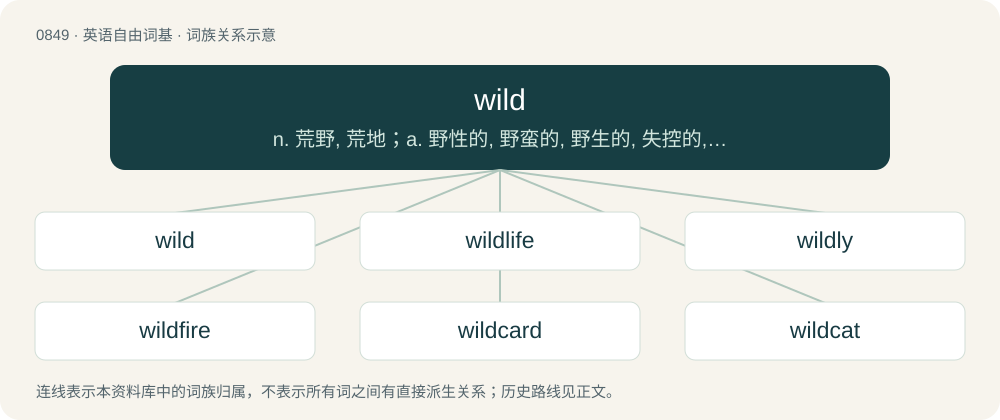

# 0918 · wild — n. 荒野, 荒地；a. 野性的, 野蛮的, 野生的, 失控的, 任性的, 杂乱的, 轻率的, 狂热的, 疯狂的；adv. 狂暴地, 失控地

[总目录](../00_总目录_按常用程度.md)

**类型**：英语自由词基　｜　**来源语言**：见词源记录

## 核心含义与来源

- 核心含义：n. 荒野, 荒地；a. 野性的, 野蛮的, 野生的, 失控的, 任性的, 杂乱的, 轻率的, 狂热的, 疯狂的；adv. 狂暴地, 失控地
- 英文含义：Especially, being of the wild type: being of an unbroken ancestral line of undomesticated animals, as opposed to being feral, being an undomesticated animal whose ancestors were domesticated.
- 词形：wild

**来源记录 1**（形容词；Especially, being of the wild type: being of an unbroken ancestral line of undomesticated animals, as opposed to being feral, being an undomesticated animal whose ancestors were domesticated.）

From Middle English weilde, wield, wielde, wijlde, wild, wilde, wyld, wylde, wyled, wyyld, from Old English wilde, from Proto-West Germanic \*wilþī, from Proto-Germanic \*wilþijaz (“wild”), from Proto-Indo-European \*h₂welh₁- (“hair; wool”). Cognates Cognate with North Frisian wil (“wild”), Saterland Frisian wíeld, wüüld (“wild”), West Frisian wyld (“wild”), Bavarian wüd (“wild”), Central Franconian weld (“wild”), Cimbrian bill (“crazy, mad; wild; stupid”), Dutch, German, and Low German wild (“wild”), Luxembourgish wëll (“wild; savage”), Vilamovian wyłd (“wild”), Yiddish ווילד (vild, “wild; savage”), Danish and Swedish vild (“wild”), Faroese villur (“wild”), Icelandic villtur (“wild; lost; barbaric, savage; uncultivated; untamed”), Norwegian Bokmål and Norwegian Nynorsk vill (“wild”), vill (“lost”), Gothic 𐍅𐌹𐌻𐌸𐌴𐌹𐍃 (wilþeis, “wild”); also Cornish gwlan (“wool”), Irish and Scottish Gaelic olann (“wool”), Manx ollan (“wool”), Welsh gwlân (“wool”), Latin vellus (“fleece, wool”), villus (“hair, shaggy hair”), Ancient Greek λάχνη (lákhnē, “woolly hair; thin hair; soft nap or pile on cloth; quills hedgehog; leafage”), Lithuanian valai (“hair of the horse tail”), Belarusian во́лас (vólas, “single hair”), Czech and Slovak vlas (“single hair”), Macedonian влас (vlas, “fluff; thread (of hair)”), Polish włos (“single hair”), Russian and Ukrainian во́лос (vólos, “single hair”), Serbo-Croatian вла̑с, vlȃs (“single hair”), Slovene las (“hair on top of head; nap, pile”), Armenian գեղմ (geġm, “fleece, wool”), Central Kurdish پرچ (pirç, “fax, headhair”), Northern Kurdish hirî (“wool”), Persian گرس (gors, “curl, ringlet; braid”), Hittite 𒋠𒀸 (SÍG-aš, “wool”), Tocharian A urṇ (“the circles of white hair between the brows of the Buddha or other deity”), Tocharian B \*ūrṇ (“the circles of white hair between the brows of the Buddha or other deity”), Sanskrit वल्श (valśa, “branch, shoot, twig”).

## 词族图

## 单词速览（常用到不常用）

| 单词 | 音标 | 释义 |
|---|---|---|
| [wild](#w-1) | /ˈwaɪ̯ld/ | n. 荒野, 荒地；a. 野性的, 野蛮的, 野生的, 失控的, 任性的, 杂乱的, 轻率的, 狂热的, 疯狂的；adv. 狂暴地, 失控地 |
| [wildlife](#w-2) | /ˈwaɪldlaɪf/ | n. 野生动植物 |
| [wildly](#w-3) | /ˈwaɪldli/ | adv. 狂暴地, 激动地, 狂热地, 鲁莽地, 轻率地 |
| [wildfire](#w-4) | /ˈwaɪldˌfaɪər/ | n. (古时战争时所用的)燃料剂, 磷火, 鬼火, 野火 |
| [wildcard](#w-5) | /ˈwildkɑːd/ | n. 通配符, 百搭牌；\[计\] 通配符 |
| [wildcat](#w-6) | 英 /ˈwaɪldˌkæt/；美 /ˈwaɪ.əldˌkæt/ | n. 野猫, 凶悍的人；a. 非法经营的, 不可靠的；vi. 盲目钻井, 从事非法商业活动 |
| [wildflower](#w-7) | /ˈwaild,flajə(r)/ | n. 野花 |
| [wildwood](#w-8) | /ˈwaildwud/ | n. 天然林 |
| [wilding](#w-9) | /ˈwaildiŋ/ | n. 野生植物, 野生苹果树, 野生苹果 |
| [wildness](#w-10) | /ˈwaɪld.nəs/ | n. 野生, 野蛮, 粗暴 |
| [wildland](#w-11) | /ˈwaildlænd/ | n. 荒地 |
| [wildling](#w-12) | /ˈwaildliŋ/ | n. 野生动物或野生植物 |
| [wilden](#w-13) | /ˈwaɪldən/ | \[人名\] 怀尔登 |
| [wildfowl](#w-14) | /ˈwaɪldfaʊl/ | n. 猎鸟 |

## 逐词详解

### 1. wild

**词性**：形容词　｜　**音标**：/ˈwaɪ̯ld/

**中文释义**：n. 荒野, 荒地；a. 野性的, 野蛮的, 野生的, 失控的, 任性的, 杂乱的, 轻率的, 狂热的, 疯狂的；adv. 狂暴地, 失控地

**英文义项**：Especially, being of the wild type: being of an unbroken ancestral line of undomesticated animals, as opposed to being feral, being an undomesticated animal whose ancestors were domesticated. / Being in the wild, by any pathway (whether by being of the wild type, by being feral since birth, or by being feral after escape from domesticated life).

**词源与演化**：

From Middle English weilde, wield, wielde, wijlde, wild, wilde, wyld, wylde, wyled, wyyld, from Old English wilde, from Proto-West Germanic \*wilþī, from Proto-Germanic \*wilþijaz (“wild”), from Proto-Indo-European \*h₂welh₁- (“hair; wool”). Cognates Cognate with North Frisian wil (“wild”), Saterland Frisian wíeld, wüüld (“wild”), West Frisian wyld (“wild”), Bavarian wüd (“wild”), Central Franconian weld (“wild”), Cimbrian bill (“crazy, mad; wild; stupid”), Dutch, German, and Low German wild (“wild”), Luxembourgish wëll (“wild; savage”), Vilamovian wyłd (“wild”), Yiddish ווילד (vild, “wild; savage”), Danish and Swedish vild (“wild”), Faroese villur (“wild”), Icelandic villtur (“wild; lost; barbaric, savage; uncultivated; untamed”), Norwegian Bokmål and Norwegian Nynorsk vill (“wild”), vill (“lost”), Gothic 𐍅𐌹𐌻𐌸𐌴𐌹𐍃 (wilþeis, “wild”); also Cornish gwlan (“wool”), Irish and Scottish Gaelic olann (“wool”), Manx ollan (“wool”), Welsh gwlân (“wool”), Latin vellus (“fleece, wool”), villus (“hair, shaggy hair”), Ancient Greek λάχνη (lákhnē, “woolly hair; thin hair; soft nap or pile on cloth; quills hedgehog; leafage”), Lithuanian valai (“hair of the horse tail”), Belarusian во́лас (vólas, “single hair”), Czech and Slovak vlas (“single hair”), Macedonian влас (vlas, “fluff; thread (of hair)”), Polish włos (“single hair”), Russian and Ukrainian во́лос (vólos, “single hair”), Serbo-Croatian вла̑с, vlȃs (“single hair”), Slovene las (“hair on top of head; nap, pile”), Armenian գեղմ (geġm, “fleece, wool”), Central Kurdish پرچ (pirç, “fax, headhair”), Northern Kurdish hirî (“wool”), Persian گرس (gors, “curl, ringlet; braid”), Hittite 𒋠𒀸 (SÍG-aš, “wool”), Tocharian A urṇ (“the circles of white hair between the brows of the Buddha or other deity”), Tocharian B \*ūrṇ (“the circles of white hair between the brows of the Buddha or other deity”), Sanskrit वल्श (valśa, “branch, shoot, twig”).

**例句**：

> I'm not wild about the idea of a two day car trip with my nephews, but it's my only option.

该用例对应义项：Enthusiastic.

### 2. wildlife

**词性**：名词　｜　**音标**：/ˈwaɪldlaɪf/

**中文释义**：n. 野生动植物

**英文义项**：undomesticated animals, especially mammals, birds, and fish, which live in the wild. / Living undomesticated organisms of all kinds.

**构词拆分**：wild + life

**词源与演化**：

From wild + life.

**例句**：

> This town offers wildlife tours where you can go and watch the bears, deer, wild rabbits and other creatures in their natural habitats.

该用例对应义项：undomesticated animals, especially mammals, birds, and fish, which live in the wild.

### 3. wildly

**词性**：副词　｜　**音标**：/ˈwaɪldli/

**中文释义**：adv. 狂暴地, 激动地, 狂热地, 鲁莽地, 轻率地

**英文义项**：In a wild, uncontrolled manner. / To a ridiculous or extreme degree; extremely.

**构词拆分**：wild + -ly

**词源与演化**：

From Middle English wildely, wijldeli, wildeliche, equivalent to wild + -ly.

**例句**：

> He swung wildly at the guy's head, but ended up on the floor.

该用例对应义项：In a wild, uncontrolled manner.

### 4. wildfire

**词性**：名词　｜　**音标**：/ˈwaɪldˌfaɪər/

**中文释义**：n. (古时战争时所用的)燃料剂, 磷火, 鬼火, 野火

**英文义项**：A rapidly spreading fire, especially one occurring in a wildland area. / A spreading disease of the skin, particularly erysipelas.

**构词拆分**：By surface analysis, wild + fire

**词源与演化**：

Inherited from Middle English wilde fyr, wilde fire, wylde fyre, from Old English wilde fȳr. By surface analysis, wild + fire.

**例句**：

> Earlier this month, 92 people died in Greece—the deadliest wildfire in recent history.

### 5. wildcard

**词性**：名词　｜　**音标**：/ˈwildkɑːd/

**中文释义**：n. 通配符, 百搭牌；\[计\] 通配符

**英文义项**：A character that takes the place of any other character or string that is not known or specified. / An uncontrolled or unpredictable element.

**构词拆分**：wild + card

**词源与演化**：

From wild + card.

**例句**：

> If the character \* is acting as a wildcard, then the pattern a\*m matches each of the words amalgam, atom and alum.

该用例对应义项：A character that takes the place of any other character or string that is not known or specified.

### 6. wildcat

**词性**：动词　｜　**音标**：英 /ˈwaɪldˌkæt/；美 /ˈwaɪ.əldˌkæt/

**中文释义**：n. 野猫, 凶悍的人；a. 非法经营的, 不可靠的；vi. 盲目钻井, 从事非法商业活动

**英文义项**：To drill for oil in an area where no oil has been found before.

**构词拆分**：wild + cat

**词源与演化**：

From Middle English wyld cat, wylde cat (in the plural as wild cattes, wylde catis, wyle cattes), equivalent to wild + cat. Cognate with Middle Low German wiltkatte, German Wildkatze, Swedish vildkatt. Its adjectival senses were originally American and derived from the "wildcat banks" of Michigan, following its elevation to statehood in 1837. Two laws—one easing the requirements for establishing a new bank and another occasioned by the Panic of 1837 that removed the need for payment in specie—led to the creation and collapse of around 50 banks within two years. The term is apocryphally derived from a wildcat supposedly featured on the currency printed by one of these banks, but more probably derived from the remote locations "where the wildcats roamed" chosen by these banks to avoid oversight and minimize redemption of notes.

**例句**：

> These days, the wildcat is a protected species in Algeria.

### 7. wildflower

**词性**：名词　｜　**音标**：/ˈwaild,flajə(r)/

**中文释义**：n. 野花

**英文义项**：A wild (uncultivated) flowering plant. / A flower from such a plant.

**构词拆分**：wild + flower

**词源与演化**：

From wild + flower.

**例句**：

> Wildflower honey is harvested from various nectar sources, resulting in a unique blend of flavors.

### 8. wildwood

**词性**：名词　｜　**音标**：/ˈwaildwud/

**中文释义**：n. 天然林

**英文义项**：Woodland that has developed naturally, especially where a suitable climate has developed with it.

**构词拆分**：wild + wood

**词源与演化**：

From wild + wood.

### 9. wilding

**词性**：名词　｜　**音标**：/ˈwaildiŋ/

**中文释义**：n. 野生植物, 野生苹果树, 野生苹果

**英文义项**：A wild apple or apple tree. / Any plant that grows wild; a wildflower, etc.

**构词拆分**：wild + -ing

**词源与演化**：

From Middle English wilding, wylding, wyldyng (“grass, straw, or the stems of wild plants”), equivalent to wild + -ing.

### 10. wildness

**词性**：名词　｜　**音标**：/ˈwaɪld.nəs/

**中文释义**：n. 野生, 野蛮, 粗暴

**英文义项**：The state or quality of being wild.

**构词拆分**：wild + -ness

**词源与演化**：

From Middle English wildenes, wildenesse, equivalent to wild + -ness.

**例句**：

> Oleg kept disappearing in the wildness.

### 11. wildland

**词性**：名词　｜　**音标**：/ˈwaildlænd/

**中文释义**：n. 荒地

**英文义项**：Land that is unfit for, or has not been modified by, cultivation or other human activity; a natural area.

**构词拆分**：wild + land

**词源与演化**：

From wild + land.

### 12. wildling

**词性**：名词　｜　**音标**：/ˈwaildliŋ/

**中文释义**：n. 野生动物或野生植物

**英文义项**：A wild, i.e. not cultivated, plant. / A wild animal.

**构词拆分**：wild + -ling (“descendant”)

**词源与演化**：

From wild + -ling (“descendant”); cognate with Dutch (not synonymous) wildeling.

### 13. wilden

**词性**：动词　｜　**音标**：/ˈwaɪldən/

**中文释义**：\[人名\] 怀尔登

**英文义项**：to make or become wild or wilder

**构词拆分**：From wild + -en.

**词源与演化**：

From wild + -en.

### 14. wildfowl

**词性**：名词　｜　**音标**：/ˈwaɪldfaʊl/

**中文释义**：n. 猎鸟

**英文义项**：Any wild bird such as ducks, geese or swans.

**构词拆分**：wild + fowl

**词源与演化**：

From wild + fowl.
