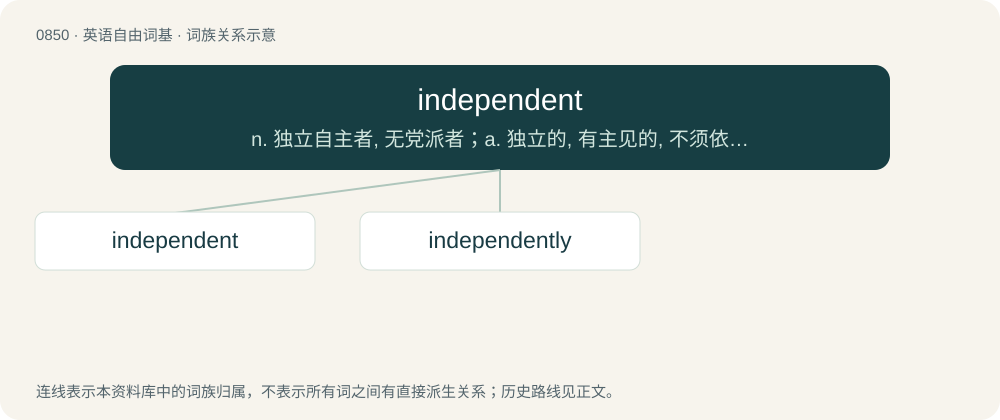

# 0919 · independent — n. 独立自主者, 无党派者；a. 独立的, 有主见的, 不须依赖的, 不受约束的

[总目录](../00_总目录_按常用程度.md)

**类型**：英语自由词基　｜　**来源语言**：见词源记录

## 核心含义与来源

- 核心含义：n. 独立自主者, 无党派者；a. 独立的, 有主见的, 不须依赖的, 不受约束的
- 英文含义：Not dependent; not contingent or depending on something else; free.
- 词形：independent

**来源记录 1**（形容词；Not dependent; not contingent or depending on something else; free.）

From Middle English independent, equivalent to in- + dependent. Compare French indépendant.

## 词族图

## 单词速览（常用到不常用）

| 单词 | 音标 | 释义 |
|---|---|---|
| [independent](#w-1) | /ˌɪn.dɪˈpɛn.dənt/ | n. 独立自主者, 无党派者；a. 独立的, 有主见的, 不须依赖的, 不受约束的 |
| [independently](#w-2) | /ˌɪndɪˈpɛndəntli/ | adv. 独立地, 自立地 |

## 逐词详解

### 1. independent

**词性**：形容词　｜　**音标**：/ˌɪn.dɪˈpɛn.dənt/

**中文释义**：n. 独立自主者, 无党派者；a. 独立的, 有主见的, 不须依赖的, 不受约束的

**英文义项**：Not dependent; not contingent or depending on something else; free. / Not affiliated with any political party.

**构词拆分**：in- + dependent

**词源与演化**：

From Middle English independent, equivalent to in- + dependent. Compare French indépendant.

**用法示例／搭配（非完整句）**：

> a man of an independent mind

该用例对应义项：Not subject to bias or influence; self-directing.

### 2. independently

**词性**：副词　｜　**音标**：/ˌɪndɪˈpɛndəntli/

**中文释义**：adv. 独立地, 自立地

**英文义项**：In an independent manner.

**构词拆分**：independent + -ly

**词源与演化**：

From independent + -ly.

**例句**：

> Both teams worked out the answers independently.

该用例对应义项：In an independent manner.
