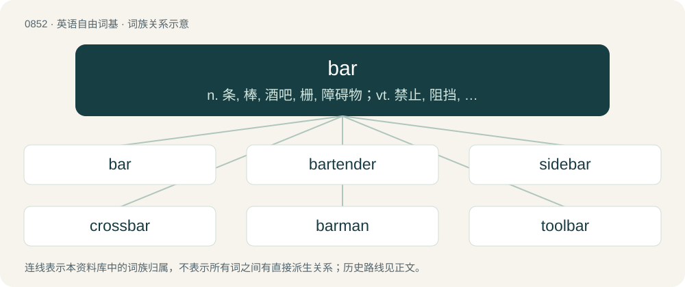

# 0922 · bar — n. 条, 棒, 酒吧, 栅, 障碍物；vt. 禁止, 阻挡, 妨碍；\[计\] 棒形图

[总目录](../00_总目录_按常用程度.md)

**类型**：英语自由词基　｜　**来源语言**：见词源记录

## 核心含义与来源

- 核心含义：n. 条, 棒, 酒吧, 栅, 障碍物；vt. 禁止, 阻挡, 妨碍；\[计\] 棒形图
- 英文含义：A solid, more or less rigid object of metal or wood with a uniform cross-section smaller than its length.
- 词形：bar

**多个词源／构词路径**：同一拼写可能有不同来源；以下按词性和含义分别列出。

**来源记录 1**（名词；A solid, more or less rigid object of metal or wood with a uniform cross-section smaller than its length.）

From Middle English barre, from Old French barre (“beam, bar, gate, barrier”), from Vulgar Latin \*barra, of uncertain origin. Doublet of barre.

**来源记录 2**（动词；To obstruct the passage of (someone or something).）

From Middle English barren, from Old French barrer, from Medieval Latin barrare (“to bar”), from the noun. Cognate to Occitan barrar, Spanish barrar, Portuguese barrar. Preposition properly imperative of the verb. Compare barring.

**来源记录 3**（名词；A non-SI unit of pressure equal to 100,000 pascals, slightly less than atmospheric pressure at sea level.）

Borrowed from Ancient Greek βάρος (báros, “weight”), coined circa 1900.

**来源记录 4**（名词；A metasyntactic variable representing an unspecified entity, often the second in a series, following foo.）

From foobar, a phonetic respelling of FUBAR.

## 词族图

## 单词速览（常用到不常用）

| 单词 | 音标 | 释义 |
|---|---|---|
| [bar](#w-1) | 英 /bɑː/；美 /bɑɹ/ | n. 条, 棒, 酒吧, 栅, 障碍物；vt. 禁止, 阻挡, 妨碍；\[计\] 棒形图 |
| [bartender](#w-2) | 英 /ˈbɑːˌtɛndə(ɹ)/；美 /ˈbɑɹˌtɛndɚ/ | n. 酒保, 酒吧侍者 |
| [sidebar](#w-3) | /ˈsaidbɑː(r)/ | n. 其他选项,工具条 |
| [crossbar](#w-4) | 美 /ˈkɹ̠ɑs.bɑɹ/ | n. 闩, 横木, 球门的横木 |
| [barman](#w-5) | 英 /ˈbɑːmən/；美 /ˈbɑɹmæn/ | n. 酒吧间男招待 |
| [toolbar](#w-6) | 英 /ˈtuːl.bɑː/；美 /ˈtul.bɑɹ/ | \[计\] 工具栏 |
| [crowbar](#w-7) | 美 /ˈkɹoʊˌbɑɹ/ | n. 铁挺, 起货钩, 撬棍, 铁撬；\[计\] 短路器 |
| [rebar](#w-8) | 英 /ɹiːˈbɑː(ɹ)/ | 【英文】To bar again. |
| [handlebar](#w-9) | 英 /ˈhændəlbɑː/；美 /ˈhændəlbɑːɹ/ | n. 手把, 八字胡 |
| [bartending](#w-10) |  | &lt;美口&gt;（尤指从业）当酒吧侍者, 在酒吧掌柜( bartend的现在分词 ) |
| [barmaid](#w-11) | 英 /ˈbɑː(ɹ).meɪd/ | n. 酒吧女侍, 酒吧女招待 |
| [minibar](#w-12) | /ˈminibɑː/ | n. 小型条信号发生器 |
| [taskbar](#w-13) | 美 /ˈtæskˌbɑɹ/ | 任务栏, 任务条 |
| [sandbar](#w-14) | 美 /ˈsændˌbɑɹ/ | n. 沙洲, 河堤 |
| [armbar](#w-15) |  | 【英文】A joint lock where the elbow is hyperextended in order to cause pain or injury. |
| [barroom](#w-16) | /ˈbɑːruːm/ | n. 酒吧间 |
| [barkeep](#w-17) | 英 /ˈbɑː(ɹ)ˌkiːp/；美 /ˈbɑɹˌkiːp/ | n. &lt;美&gt;酒吧间老板, 酒吧间招待 |
| [soundbar](#w-18) | 美 /ˈsaʊndˌbɑɹ/ | 【英文】A bar containing multiple speakers that can be mounted under or alongside a television, etc. instead of having separate speakers positioned around the room. |

## 逐词详解

### 1. bar

**词性**：名词　｜　**音标**：英 /bɑː/；美 /bɑɹ/

**中文释义**：n. 条, 棒, 酒吧, 栅, 障碍物；vt. 禁止, 阻挡, 妨碍；\[计\] 棒形图

**英文义项**：A solid, more or less rigid object of metal or wood with a uniform cross-section smaller than its length. / A solid metal object with uniform (round, square, hexagonal, octagonal or rectangular) cross-section; in the US its smallest dimension is ¹⁄₄ inch or greater, a piece of thinner material being called a strip.

**词源与演化**：

From Middle English barre, from Old French barre (“beam, bar, gate, barrier”), from Vulgar Latin \*barra, of uncertain origin. Doublet of barre.

**例句**：

> He's studying hard to pass the Bar this time; he's failed it twice before.

该用例对应义项：The bar exam, the legal licensing exam.

### 2. bartender

**词性**：名词　｜　**音标**：英 /ˈbɑːˌtɛndə(ɹ)/；美 /ˈbɑɹˌtɛndɚ/

**中文释义**：n. 酒保, 酒吧侍者

**英文义项**：One who tends a bar or pub; a person preparing and serving drinks at a bar.

**构词拆分**：bar + tender

**词源与演化**：

From bar + tender.

**例句**：

> The bartender came out from behind the counter to stop the fight.

### 3. sidebar

**词性**：名词　｜　**音标**：/ˈsaidbɑː(r)/

**中文释义**：n. 其他选项,工具条

**英文义项**：A short news story printed alongside a larger one. / A block of information placed at the side of a printed page.

**构词拆分**：side + bar

**词源与演化**：

From side + bar.

**例句**：

> If you need more room on the screen, you can hide the sidebar.

### 4. crossbar

**词性**：名词　｜　**音标**：美 /ˈkɹ̠ɑs.bɑɹ/

**中文释义**：n. 闩, 横木, 球门的横木

**英文义项**：Any transverse bar or piece, such as a bar across a door, or the iron bar or stock which passes through the shank of an anchor. / The top of the goal structure.

**构词拆分**：cross- + bar

**词源与演化**：

From Middle English crose bar, equivalent to cross- + bar.

**例句**：

> The ball smacked the crossbar with the keeper beaten all ends up.

### 5. barman

**词性**：名词　｜　**音标**：英 /ˈbɑːmən/；美 /ˈbɑɹmæn/

**中文释义**：n. 酒吧间男招待

**英文义项**：A man who works in a bar.

**构词拆分**：bar + -man

**词源与演化**：

From bar + -man.

### 6. toolbar

**词性**：名词　｜　**音标**：英 /ˈtuːl.bɑː/；美 /ˈtul.bɑɹ/

**中文释义**：\[计\] 工具栏

**英文义项**：A row of buttons, usually marked with icons, used to activate the functions of an application or operating system.

**构词拆分**：tool + bar

**词源与演化**：

From tool + bar.

**例句**：

> Can you see the toolbar at the bottom of the screen?

### 7. crowbar

**词性**：动词　｜　**音标**：美 /ˈkɹoʊˌbɑɹ/

**中文释义**：n. 铁挺, 起货钩, 撬棍, 铁撬；\[计\] 短路器

**英文义项**：To force to move, usually with a crowbar; to prise.

**构词拆分**：crow + bar；crow (“crow (bird)" also "metal lever, crowbar”) + bar

**词源与演化**：

From crow (“crow (bird)" also "metal lever, crowbar”) + bar, probably because the forked end looks like a crow's foot.

**例句**：

> Tom used a crowbar to pry open the lid of the crate.

### 8. rebar

**词性**：动词　｜　**音标**：英 /ɹiːˈbɑː(ɹ)/

**英文义项**：To bar again. / To redistribute the notes of a musical score across the bars, e.g. when changing time signature.

**构词拆分**：re- + bar

**词源与演化**：

From re- + bar.

### 9. handlebar

**词性**：名词　｜　**音标**：英 /ˈhændəlbɑː/；美 /ˈhændəlbɑːɹ/

**中文释义**：n. 手把, 八字胡

**英文义项**：The bar used to steer a bicycle, motorbike, or similar vehicle using the hands. / Xanax.

**构词拆分**：handle + bar

**词源与演化**：

From handle + bar.

**例句**：

> If I could grow a mustache, it would definitely be a handlebar mustache.

### 10. bartending

**词性**：名词

**中文释义**：&lt;美口&gt;（尤指从业）当酒吧侍者, 在酒吧掌柜( bartend的现在分词 )

**英文义项**：The craft of mixing drinks, making cocktails, and related skills of tending a bar.

**构词拆分**：bar + tending

**词源与演化**：

From bar + tending.

**例句**：

> Sami had another friend who was bartending.

### 11. barmaid

**词性**：名词　｜　**音标**：英 /ˈbɑː(ɹ).meɪd/

**中文释义**：n. 酒吧女侍, 酒吧女招待

**英文义项**：A woman who serves in a bar.

**构词拆分**：bar + maid

**词源与演化**：

From bar + maid.

**例句**：

> Mr. Carter called for some more beer and told the barmaid to put a little gin in it.

### 12. minibar

**词性**：名词　｜　**音标**：/ˈminibɑː/

**中文释义**：n. 小型条信号发生器

**英文义项**：A small refrigerator in a hotel room, containing drinks and snacks that the guest may choose to purchase during their stay.

**构词拆分**：mini- + bar

**词源与演化**：

From mini- + bar.

**例句**：

> Now there's a minibar where my liver was.

### 13. taskbar

**词性**：名词　｜　**音标**：美 /ˈtæskˌbɑɹ/

**中文释义**：任务栏, 任务条

**英文义项**：A bar on a computer desktop used to launch and monitor applications.

**构词拆分**：task + bar

**词源与演化**：

From task + bar.

**例句**：

> Cortana appears next to the Start button on the taskbar.

### 14. sandbar

**词性**：名词　｜　**音标**：美 /ˈsændˌbɑɹ/

**中文释义**：n. 沙洲, 河堤

**英文义项**：A ridge of sand caused by the action of waves along a shore.

**构词拆分**：sand + bar

**词源与演化**：

From sand + bar.

**例句**：

> My boat ran aground on a sandbar.

### 15. armbar

**词性**：名词

**英文义项**：A joint lock where the elbow is hyperextended in order to cause pain or injury.

**构词拆分**：arm + bar

**词源与演化**：

From arm + bar.

### 16. barroom

**词性**：名词　｜　**音标**：/ˈbɑːruːm/

**中文释义**：n. 酒吧间

**英文义项**：A room where alcoholic drinks are served over a counter.

**构词拆分**：bar + room

**词源与演化**：

From bar + room.

**例句**：

> Tom intervened in a barroom fight and ended up with a black eye.

### 17. barkeep

**词性**：名词　｜　**音标**：英 /ˈbɑː(ɹ)ˌkiːp/；美 /ˈbɑɹˌkiːp/

**中文释义**：n. &lt;美&gt;酒吧间老板, 酒吧间招待

**英文义项**：A bartender.

**构词拆分**：bar + keep

**词源与演化**：

From bar + keep, a clipping of barkeeper.

### 18. soundbar

**词性**：名词　｜　**音标**：美 /ˈsaʊndˌbɑɹ/

**英文义项**：A bar containing multiple speakers that can be mounted under or alongside a television, etc. instead of having separate speakers positioned around the room.

**构词拆分**：sound + bar

**词源与演化**：

From sound + bar.
