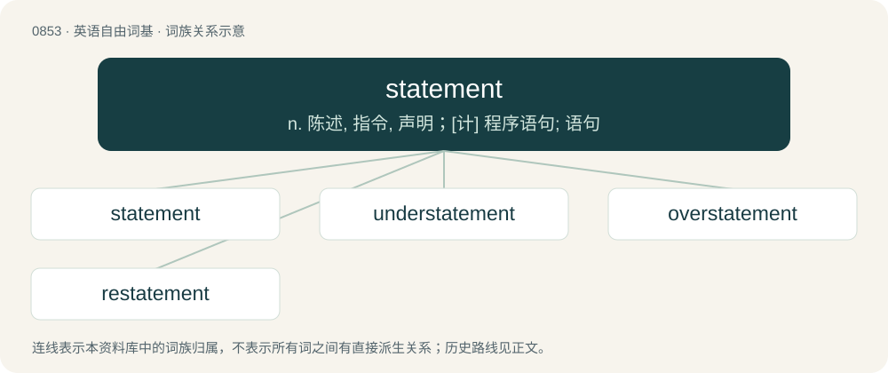

# 0923 · statement — n. 陈述, 指令, 声明；\[计\] 程序语句; 语句

[总目录](../00_总目录_按常用程度.md)

**类型**：英语自由词基　｜　**来源语言**：见词源记录

## 核心含义与来源

- 核心含义：n. 陈述, 指令, 声明；\[计\] 程序语句; 语句
- 英文含义：A declaration or remark.
- 词形：statement

**多个词源／构词路径**：同一拼写可能有不同来源；以下按词性和含义分别列出。

**来源记录 1**（名词；A declaration or remark.）

From state + -ment.

**来源记录 2**（动词；To provide an official document of a proposition, especially in the UK, a Statement of Special Educational Needs.）

Back-formation from statementing or back-formation from statemented.

## 词族图

## 单词速览（常用到不常用）

| 单词 | 音标 | 释义 |
|---|---|---|
| [statement](#w-1) | 英 /ˈsteɪtm(ə)nt/；美 /ˈsteɪtmənt/ | n. 陈述, 指令, 声明；\[计\] 程序语句; 语句 |
| [understatement](#w-2) | 英 /ˌʌndəˈsteɪtmənt/；美 /ˌʌndɚˈsteɪtmənt/ | n. 软弱无力的陈述, 克制的说法；\[经\] 少报 |
| [overstatement](#w-3) |  | \[经\] 估值过高, 夸大 |
| [restatement](#w-4) | 英 /ɹiːˈsteɪt.m(ə)nt/；美 /ɹiˈsteɪt.mənt/ | n. 再声明, 重述；\[经\] 重报, 重新陈述, 再声明 |

## 逐词详解

### 1. statement

**词性**：名词　｜　**音标**：英 /ˈsteɪtm(ə)nt/；美 /ˈsteɪtmənt/

**中文释义**：n. 陈述, 指令, 声明；\[计\] 程序语句; 语句

**英文义项**：A declaration or remark. / A presentation of opinion or position.

**构词拆分**：state + -ment

**词源与演化**：

From state + -ment.

**用法示例／搭配（非完整句）**：

> publish a statement

该用例对应义项：A declaration or remark.

### 2. understatement

**词性**：名词　｜　**音标**：英 /ˌʌndəˈsteɪtmənt/；美 /ˌʌndɚˈsteɪtmənt/

**中文释义**：n. 软弱无力的陈述, 克制的说法；\[经\] 少报

**英文义项**：A figure of speech whereby something is made to seem smaller or less important than it actually is, either through phrasing or lack of emphasis, often for ironic effect. / An instance of such phrasing or lack of emphasis; an incomplete statement.

**构词拆分**：under- + statement；understate + -ment

**词源与演化**：

From under- + statement or understate + -ment.

**例句**：

> Now that's an understatement.

该用例对应义项：An instance of such phrasing or lack of emphasis; an incomplete statement.

### 3. overstatement

**词性**：名词

**中文释义**：\[经\] 估值过高, 夸大

**英文义项**：An exaggeration; a statement in excess of what is reasonable. / The tendency to overstate.

**构词拆分**：overstate + -ment；over- + statement

**词源与演化**：

From overstate + -ment or over- + statement.

**例句**：

> The story he gave was something of an overstatement of the facts.

该用例对应义项：An exaggeration; a statement in excess of what is reasonable.

### 4. restatement

**词性**：名词　｜　**音标**：英 /ɹiːˈsteɪt.m(ə)nt/；美 /ɹiˈsteɪt.mənt/

**中文释义**：n. 再声明, 重述；\[经\] 重报, 重新陈述, 再声明

**英文义项**：The act of restating. / A second or subsequent statement.

**构词拆分**：re- + statement

**词源与演化**：

From re- + statement.
