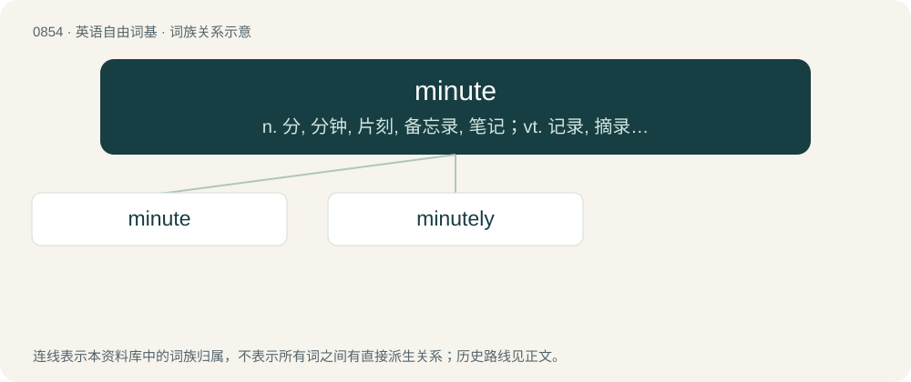

# 0925 · minute — n. 分, 分钟, 片刻, 备忘录, 笔记；vt. 记录, 摘录, 测定时间；a. 微小的, 详细的

[总目录](../00_总目录_按常用程度.md)

**类型**：英语自由词基　｜　**来源语言**：见词源记录

## 核心含义与来源

- 核心含义：n. 分, 分钟, 片刻, 备忘录, 笔记；vt. 记录, 摘录, 测定时间；a. 微小的, 详细的
- 英文含义：A unit of time which is one sixtieth of an hour (sixty seconds).
- 词形：minute

**多个词源／构词路径**：同一拼写可能有不同来源；以下按词性和含义分别列出。

**来源记录 1**（名词；A unit of time which is one sixtieth of an hour (sixty seconds).）

From Middle English mynute, minute, mynet, from Old French minute, from Medieval Latin minūta (“60th of an hour; note”). Doublet of menu and menudo.

**来源记录 2**（形容词；Very small.）

Borrowed from Latin minūtus (“small", "petty”), perfect passive participle of minuō (“make smaller”).

## 词族图

## 单词速览（常用到不常用）

| 单词 | 音标 | 释义 |
|---|---|---|
| [minute](#w-1) | /ˈmɪnɪt/ | n. 分, 分钟, 片刻, 备忘录, 笔记；vt. 记录, 摘录, 测定时间；a. 微小的, 详细的 |
| [minutely](#w-2) | /maɪˈnjuːtlɪ/ | adv. 详细地, 精密地 |

## 逐词详解

### 1. minute

**词性**：名词　｜　**音标**：/ˈmɪnɪt/

**中文释义**：n. 分, 分钟, 片刻, 备忘录, 笔记；vt. 记录, 摘录, 测定时间；a. 微小的, 详细的

**英文义项**：A unit of time which is one sixtieth of an hour (sixty seconds). / A short but unspecified time period.

**词源与演化**：

From Middle English mynute, minute, mynet, from Old French minute, from Medieval Latin minūta (“60th of an hour; note”). Doublet of menu and menudo.

**例句**：

> We need to be sure these maps are accurate to within one minute of arc.

该用例对应义项：A unit of angle equal to one-sixtieth of a degree.

### 2. minutely

**词性**：形容词　｜　**音标**：/maɪˈnjuːtlɪ/

**中文释义**：adv. 详细地, 精密地

**英文义项**：Happening every minute. / Continuing; unceasing.

**构词拆分**：minute + -ly

**词源与演化**：

From minute + -ly.

**例句**：

> "This is a very singular knife," said Holmes, lifting it up and examining it minutely.
