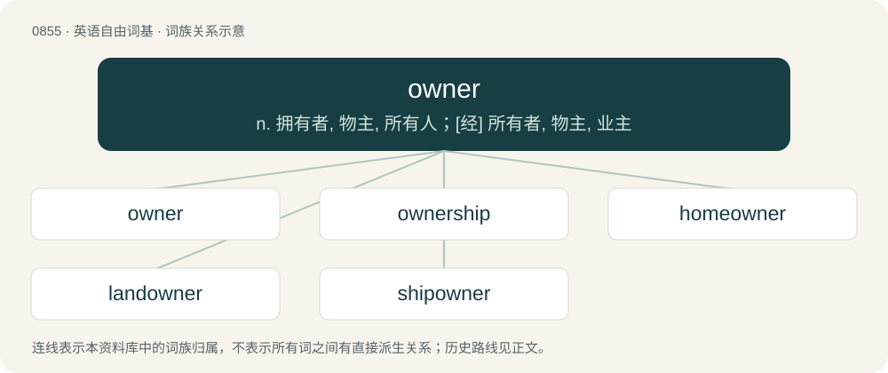

# 0926 · owner — n. 拥有者, 物主, 所有人；\[经\] 所有者, 物主, 业主

[总目录](../00_总目录_按常用程度.md)

**类型**：英语自由词基　｜　**来源语言**：见词源记录

## 核心含义与来源

- 核心含义：n. 拥有者, 物主, 所有人；\[经\] 所有者, 物主, 业主
- 英文含义：One who owns something.
- 词形：owner

**来源记录 1**（名词；One who owns something.）

Inherited from Middle English ouner, from Old English āgnere. By surface analysis, own + -er, though etymologically own is a back-formation from owner.

## 词族图

## 单词速览（常用到不常用）

| 单词 | 音标 | 释义 |
|---|---|---|
| [owner](#w-1) | 英 /ˈəʊnə/；美 /ˈoʊnɚ/ | n. 拥有者, 物主, 所有人；\[经\] 所有者, 物主, 业主 |
| [ownership](#w-2) | 英 /ˈəʊnəʃɪp/；美 /ˈoʊnɚʃɪp/ | n. 所有权, 物主身份；\[经\] 所有权, 所有制 |
| [homeowner](#w-3) | /ˈhəum.əunə/ | n. 私房屋主；自己拥有住房者 |
| [landowner](#w-4) | 英 /ˈlændˌəʊ.nə/；美 /ˈlændˌoʊ.nɚ/ | n. 地主；\[法\] 土地所有人, 地主 |
| [shipowner](#w-5) | /ˈʃipəunə/ | n. 船主 |

## 逐词详解

### 1. owner

**词性**：名词　｜　**音标**：英 /ˈəʊnə/；美 /ˈoʊnɚ/

**中文释义**：n. 拥有者, 物主, 所有人；\[经\] 所有者, 物主, 业主

**英文义项**：One who owns something. / The captain of a ship.

**词源与演化**：

Inherited from Middle English ouner, from Old English āgnere. By surface analysis, own + -er, though etymologically own is a back-formation from owner.

**例句**：

> The police recovered the stolen car and returned it to its owner.

该用例对应义项：One who owns something.

### 2. ownership

**词性**：名词　｜　**音标**：英 /ˈəʊnəʃɪp/；美 /ˈoʊnɚʃɪp/

**中文释义**：n. 所有权, 物主身份；\[经\] 所有权, 所有制

**英文义项**：The state of having complete legal control of something; possession; proprietorship. / Responsibility for or control over something.

**构词拆分**：owner + -ship

**词源与演化**：

From owner + -ship.

**例句**：

> The successful candidate will take ownership of all internal design projects.

该用例对应义项：Responsibility for or control over something.

### 3. homeowner

**词性**：名词　｜　**音标**：/ˈhəum.əunə/

**中文释义**：n. 私房屋主；自己拥有住房者

**英文义项**：Someone who owns a house. / Someone who does not have the title to a house, but has possession and is paying for it in installments.

**构词拆分**：home + owner

**词源与演化**：

From home + owner.

**例句**：

> Ziri saw who he assumed to be the homeowner.

### 4. landowner

**词性**：名词　｜　**音标**：英 /ˈlændˌəʊ.nə/；美 /ˈlændˌoʊ.nɚ/

**中文释义**：n. 地主；\[法\] 土地所有人, 地主

**英文义项**：A person who owns land.

**构词拆分**：land + owner

**词源与演化**：

From land + owner.

**例句**：

> In 1880, the Irish boycotted a landowner, Captain C.C. Boycott, for failing to lower rents.

### 5. shipowner

**词性**：名词　｜　**音标**：/ˈʃipəunə/

**中文释义**：n. 船主

**英文义项**：Someone who owns a ship.

**构词拆分**：ship + owner

**词源与演化**：

From ship + owner.

**例句**：

> The shipowner invested in two new vessels.
