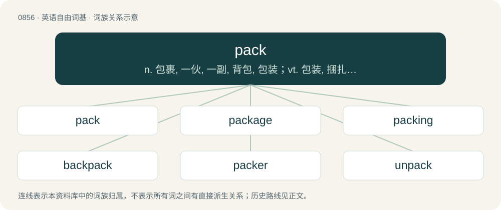

# 0927 · pack — n. 包裹, 一伙, 一副, 背包, 包装；vt. 包装, 捆扎, 塞满, 压紧, 挑选；vi. 包装货物, 挤, 群集, 被包装

[总目录](../00_总目录_按常用程度.md)

**类型**：英语自由词基　｜　**来源语言**：见词源记录

## 核心含义与来源

- 核心含义：n. 包裹, 一伙, 一副, 背包, 包装；vt. 包装, 捆扎, 塞满, 压紧, 挑选；vi. 包装货物, 挤, 群集, 被包装
- 英文含义：A bundle made up and prepared to be carried; especially, a bundle to be carried on the back, but also a load for an animal, a bale.
- 词形：pack

**多个词源／构词路径**：同一拼写可能有不同来源；以下按词性和含义分别列出。

**来源记录 1**（名词；A bundle made up and prepared to be carried; especially, a bundle to be carried on the back, but also a load for an animal, a bale.）

From Middle English pak, pakke, from Old English \*pæcca and/or Middle Dutch pak, packe; both ultimately from Proto-West Germanic \*pakkō, from Proto-Germanic \*pakkô (“bundle, pack”). Cognate with Dutch pak (“pack”), Low German Pack (“pack”), German Pack (“pack”), Swedish packe (“pack”), Icelandic pakka, pakki (“package”).

**来源记录 2**（动词；To make a pack of; to arrange closely and securely in a pack; hence, to place and arrange compactly as in a pack）

From Middle English pakken, from the noun (see above). Compare Middle Dutch packen (“to pack”), Middle Low German packen (“to pack”).

## 词族图

## 单词速览（常用到不常用）

| 单词 | 音标 | 释义 |
|---|---|---|
| [pack](#w-1) | /pæk/ | n. 包裹, 一伙, 一副, 背包, 包装；vt. 包装, 捆扎, 塞满, 压紧, 挑选；vi. 包装货物, 挤, 群集, 被包装 |
| [package](#w-2) | 英 /ˈpæk.ɪd͡ʒ/ | n. 包裹, 套装软件, 包, 包装用物, 程序包；vt. 包装, 打包；a. 一揽子的 |
| [packing](#w-3) | 英 /ˈpakɪŋ/；美 /ˈpækɪŋ/ | n. 包装, 填垫材料, 封函, 行李；\[化\] 填充物; 填料; 填充; 装柱; 装色谱柱; 垫革; 紧束; 敛集; 堆积 |
| [backpack](#w-4) | /ˈbæk.pæk/ | n. 远足用的背包；双肩背包, 背包 |
| [packer](#w-5) | 英 /ˈpækə/；美 /ˈpækɚ/ | n. 包装工人, 罐头食品工人, 打包机, 搬家工人, 批发商, 罐头食品厂经理；\[化\] 包装机; 打包机 |
| [unpack](#w-6) | /ʌnˈpæk/ | vt. 从包裹中取出, 卸下, 打开；vi. 打开包裹；\[计\] 拆开 |
| [wolfpack](#w-7) | /ˈwʊlfpæk/ | 【英文】A family or other group of wild wolves. |
| [snowpack](#w-8) | /ˈsnəupæk/ | n. 积雪场 |
| [repack](#w-9) | /reˈpæk/ | n. 重新打包, 重新装箱 |

## 逐词详解

### 1. pack

**词性**：名词　｜　**音标**：/pæk/

**中文释义**：n. 包裹, 一伙, 一副, 背包, 包装；vt. 包装, 捆扎, 塞满, 压紧, 挑选；vi. 包装货物, 挤, 群集, 被包装

**英文义项**：A bundle made up and prepared to be carried; especially, a bundle to be carried on the back, but also a load for an animal, a bale. / A number or quantity equal to the contents of a pack

**词源与演化**：

From Middle English pak, pakke, from Old English \*pæcca and/or Middle Dutch pak, packe; both ultimately from Proto-West Germanic \*pakkō, from Proto-Germanic \*pakkô (“bundle, pack”). Cognate with Dutch pak (“pack”), Low German Pack (“pack”), German Pack (“pack”), Swedish packe (“pack”), Icelandic pakka, pakki (“package”).

**例句**：

> “Carlo, I told you that three packs a day would kill you long before I was gone.”

该用例对应义项：A package of cigarettes.

### 2. package

**词性**：名词　｜　**音标**：英 /ˈpæk.ɪd͡ʒ/

**中文释义**：n. 包裹, 套装软件, 包, 包装用物, 程序包；vt. 包装, 打包；a. 一揽子的

**英文义项**：Something which is packed, a parcel, a box, an envelope. / Something which consists of various components, such as a piece of computer software.

**构词拆分**：pack + -age

**词源与演化**：

Equivalent to pack + -age. Possibly influenced by Anglo-Latin paccagium or Old French pacquage.

**例句**：

> For third and short, they're going to bring in their jumbo package.

该用例对应义项：A football formation.

### 3. packing

**词性**：名词　｜　**音标**：英 /ˈpakɪŋ/；美 /ˈpækɪŋ/

**中文释义**：n. 包装, 填垫材料, 封函, 行李；\[化\] 填充物; 填料; 填充; 装柱; 装色谱柱; 垫革; 紧束; 敛集; 堆积

**英文义项**：The action of putting things together, especially of putting clothes into a suitcase for a journey. / The spatial arrangement of objects, items or constituent parts.

**构词拆分**：pack (“verb and noun senses”) + -ing

**词源与演化**：

From Middle English pakkynge; equivalent to pack (“verb and noun senses”) + -ing.

**用法示例／搭配（非完整句）**：

> Packing in a packed bed, or a column such as a distillation column or a chromatography column

该用例对应义项：Special material used to fill containers or vessels for certain chemically related applications.

### 4. backpack

**词性**：动词　｜　**音标**：/ˈbæk.pæk/

**中文释义**：n. 远足用的背包；双肩背包, 背包

**英文义项**：To hike and camp overnight in backcountry with one's gear carried in a backpack. / To engage in low-cost, generally urban, travel with minimal luggage and frugal accommodation.

**构词拆分**：back + pack

**词源与演化**：

From back + pack. First attested in 1896.

**例句**：

> Astronauts backpack oxygen during spacewalks.

该用例对应义项：To place or carry (an item or items) in a backpack.

### 5. packer

**词性**：名词　｜　**音标**：英 /ˈpækə/；美 /ˈpækɚ/

**中文释义**：n. 包装工人, 罐头食品工人, 打包机, 搬家工人, 批发商, 罐头食品厂经理；\[化\] 包装机; 打包机

**英文义项**：A person whose business is to pack things; especially, one who packs food for preservation / A software program that compresses code or data.

**构词拆分**：pack + -er

**词源与演化**：

From Middle English pakker, pakkere, packare, equivalent to pack + -er.

**例句**：

> When his back problems kept him from lifting furniture, his skill as a packer kept him employed.

该用例对应义项：A person whose business is to pack things; especially, one who packs food for preservation

### 6. unpack

**词性**：动词　｜　**音标**：/ʌnˈpæk/

**中文释义**：vt. 从包裹中取出, 卸下, 打开；vi. 打开包裹；\[计\] 拆开

**英文义项**：To remove from a package or container, particularly with respect to items that had previously been arranged closely and securely in a pack. / To empty containers that had been packed.

**构词拆分**：un- + pack

**词源与演化**：

From Middle English unpakken, equivalent to un- + pack. Compare Saterland Frisian uutpakje (“to unpack”), West Frisian útpakke (“to unpack”), Dutch uitpakken (“to unpack”), German auspacken (“to unpack”).

**例句**：

> They didn't have time to unpack their bags before going out to dinner.

该用例对应义项：To remove from a package or container, particularly with respect to items that had previously been arranged closely and securely in a pack.

### 7. wolfpack

**词性**：名词　｜　**音标**：/ˈwʊlfpæk/

**英文义项**：A family or other group of wild wolves.

**构词拆分**：wolf + pack

**词源与演化**：

From wolf + pack.

### 8. snowpack

**词性**：名词　｜　**音标**：/ˈsnəupæk/

**中文释义**：n. 积雪场

**英文义项**：An accumulation of packed snow, usually the seasonal amount.

**构词拆分**：snow + pack

**词源与演化**：

From snow + pack.

**例句**：

> The melted snowpack seeps down to fill mountainside indentations to form glacial lakes.

### 9. repack

**词性**：动词　｜　**音标**：/reˈpæk/

**中文释义**：n. 重新打包, 重新装箱

**英文义项**：To pack again or in a different way. / To clean the bearings and replace the grease on a wheel.

**构词拆分**：re- + pack

**词源与演化**：

From re- + pack.
