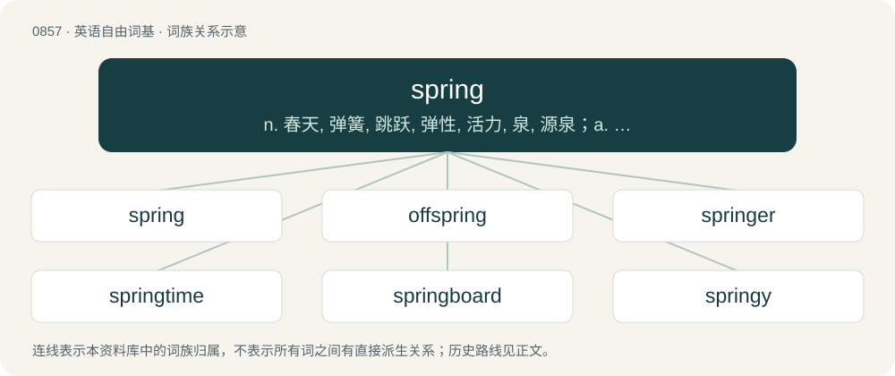

# 0929 · spring — n. 春天, 弹簧, 跳跃, 弹性, 活力, 泉, 源泉；a. 春天的；vi. 跳, 弹跳, 涌出, 生长, 裂开, 高耸

[总目录](../00_总目录_按常用程度.md)

**类型**：英语自由词基　｜　**来源语言**：见词源记录

## 核心含义与来源

- 核心含义：n. 春天, 弹簧, 跳跃, 弹性, 活力, 泉, 源泉；a. 春天的；vi. 跳, 弹跳, 涌出, 生长, 裂开, 高耸
- 英文含义：To move or burst forth.
- 词形：spring

**多个词源／构词路径**：同一拼写可能有不同来源；以下按词性和含义分别列出。

**来源记录 1**（动词；To move or burst forth.）

From Middle English springen, from Old English springan (“to spring, leap, bounce, sprout forth, emerge, spread out”), from Proto-West Germanic \*springan, from Proto-Germanic \*springaną (“to burst forth”), from Proto-Indo-European \*spre(n)ǵʰ- (“to move, race, spring”), from \*sperǵʰ- (“to hurry”). Cognates \* Saterland Frisian springe \* West Frisian springe \* Dutch springen \* German Low German springen \* German springen \* Danish springe \* Swedish springa \* Norwegian springe \* Faroese springa \* Icelandic springa (“to burst, explode”). Other possible cognates include Lithuanian spreñgti (“to push (in)”), Old Church Slavonic прѧсти (pręsti, “to spin, to stretch”), Latin spargere (“to sprinkle, to scatter”), Ancient Greek σπέρχω (spérkhō, “to hasten”), Sanskrit स्पृहयति (spṛháyati, “to be eager”). Some newer senses derived from the noun.

**来源记录 2**（名词；An act of springing: a leap, a jump.）

From Middle English spryng (“a wellspring, tide, branch, sunrise, kind of dance or blow, ulcer, snare, flock”); partly from Old English spring (“wellspring, ulcer”), from Proto-West Germanic \*spring, from Proto-Germanic \*springaz (“a wellspring, fount”); and partly from Old English spryng (“a jump”), from Proto-West Germanic \*sprungi, from Proto-Germanic \*sprungiz (“a jump”). Further senses derived from the verb and from clippings of day-spring, springtime, spring tide, etc. Its sense as the season, first attested in a work predating 1325, gradually replaced Middle English lenten, lente, from Old English lencten (“spring, Lent”) as that word became more specifically liturgical. Compare fall.

## 词族图

## 单词速览（常用到不常用）

| 单词 | 音标 | 释义 |
|---|---|---|
| [spring](#w-1) | 英 /ˈspɹɪŋ/；/ˈspɹiŋ/ | n. 春天, 弹簧, 跳跃, 弹性, 活力, 泉, 源泉；a. 春天的；vi. 跳, 弹跳, 涌出, 生长, 裂开, 高耸 |
| [offspring](#w-2) | 英 /ˈɒfspɹɪŋ/；美 /ˈɔfspɹɪŋ/ | n. 子孙, 后代, 产物；\[法\] 后辈, 子孙, 后裔 |
| [springer](#w-3) | /ˈspriŋə/ | n. 跳的人 |
| [springtime](#w-4) | /ˈspriŋtaim/ | n. 春天, 春季, 初期 |
| [springboard](#w-5) | /ˈspriŋbɒːd/ | n. 跳板, 出发点 |
| [springy](#w-6) | /ˈspɹɪŋi/ | a. 有弹力的, 轻快的, 多泉水的 |
| [wellspring](#w-7) | 美 /ˈwɛlsprɪŋ/ | n. 水源, 泉源 |
| [springwood](#w-8) | /ˈspriŋwud/ | n. 春材 |

## 逐词详解

### 1. spring

**词性**：动词　｜　**音标**：英 /ˈspɹɪŋ/；/ˈspɹiŋ/

**中文释义**：n. 春天, 弹簧, 跳跃, 弹性, 活力, 泉, 源泉；a. 春天的；vi. 跳, 弹跳, 涌出, 生长, 裂开, 高耸

**英文义项**：To move or burst forth. / To appear.

**词源与演化**：

From Middle English springen, from Old English springan (“to spring, leap, bounce, sprout forth, emerge, spread out”), from Proto-West Germanic \*springan, from Proto-Germanic \*springaną (“to burst forth”), from Proto-Indo-European \*spre(n)ǵʰ- (“to move, race, spring”), from \*sperǵʰ- (“to hurry”). Cognates \* Saterland Frisian springe \* West Frisian springe \* Dutch springen \* German Low German springen \* German springen \* Danish springe \* Swedish springa \* Norwegian springe \* Faroese springa \* Icelandic springa (“to burst, explode”). Other possible cognates include Lithuanian spreñgti (“to push (in)”), Old Church Slavonic прѧсти (pręsti, “to spin, to stretch”), Latin spargere (“to sprinkle, to scatter”), Ancient Greek σπέρχω (spérkhō, “to hasten”), Sanskrit स्पृहयति (spṛháyati, “to be eager”). Some newer senses derived from the noun.

**例句**：

> Deer spring with their hind legs, using their front hooves to steady themselves.

该用例对应义项：To move with great speed and energy.

### 2. offspring

**词性**：名词　｜　**音标**：英 /ˈɒfspɹɪŋ/；美 /ˈɔfspɹɪŋ/

**中文释义**：n. 子孙, 后代, 产物；\[法\] 后辈, 子孙, 后裔

**英文义项**：A person's daughter or son; a person's child. / Any of a person's descendants, including of further generations.

**构词拆分**：off- + spring

**词源与演化**：

From Middle English ofspring, from Old English ofspring (“offspring, descendants, posterity”), equivalent to off- + spring. Compare Icelandic afspringur (“offspring”). More at off, spring.

**例句**：

> Artists often treasure their works as their immortal offspring.

该用例对应义项：Anything produced; the result of an entity's efforts.

### 3. springer

**词性**：名词　｜　**音标**：/ˈspriŋə/

**中文释义**：n. 跳的人

**英文义项**：A person that springs. / Anything that springs.

**构词拆分**：From spring + -er.

**词源与演化**：

From spring + -er.

**例句**：

> Ziri turned the conversation into an episode of Jerry Springer Show.

### 4. springtime

**词性**：名词　｜　**音标**：/ˈspriŋtaim/

**中文释义**：n. 春天, 春季, 初期

**英文义项**：The season of spring, between winter and summer. / A period of flourishing and renewal.

**构词拆分**：spring + time

**词源与演化**：

From spring + time.

**例句**：

> It was springtime... and everything was quiet and peaceful in the country.

### 5. springboard

**词性**：名词　｜　**音标**：/ˈspriŋbɒːd/

**中文释义**：n. 跳板, 出发点

**英文义项**：A board consisting of a flexible, springy, cantilevered platform that propels one into the air, used for diving or gymnastics. / Something that acts as a catalyst to begin or accelerate an action or growth.

**构词拆分**：spring + board

**词源与演化**：

From spring + board.

**例句**：

> The opportunity acted as a springboard for their success.

该用例对应义项：Something that acts as a catalyst to begin or accelerate an action or growth.

### 6. springy

**词性**：形容词　｜　**音标**：/ˈspɹɪŋi/

**中文释义**：a. 有弹力的, 轻快的, 多泉水的

**英文义项**：That returns rapidly to its original form (as a spring does) after being bent, compressed, stretched, etc. / Lively; bouncy.

**构词拆分**：From spring + -y.

**词源与演化**：

From spring + -y.

**例句**：

> The soft peat was springy under her feet.

该用例对应义项：That returns rapidly to its original form (as a spring does) after being bent, compressed, stretched, etc.

### 7. wellspring

**词性**：名词　｜　**音标**：美 /ˈwɛlsprɪŋ/

**中文释义**：n. 水源, 泉源

**英文义项**：The source of water for a stream, spring or well; a fountainhead; a wellhead. / A perennial source of anything; a fountainhead of supply or emanation; resource.

**构词拆分**：well + spring

**词源与演化**：

From Middle English wellespring, from Old English wiellspring, wiellġespring (“spring, fount, fountain”), corresponding to well + spring. More at well, spring.

### 8. springwood

**词性**：名词　｜　**音标**：/ˈspriŋwud/

**中文释义**：n. 春材

**英文义项**：The wood in a tree's growth ring formed earlier in the growing season, when growth is more rapid, thus composed of wider elements and usually lighter in colour.

**构词拆分**：spring + wood

**词源与演化**：

From spring + wood.
