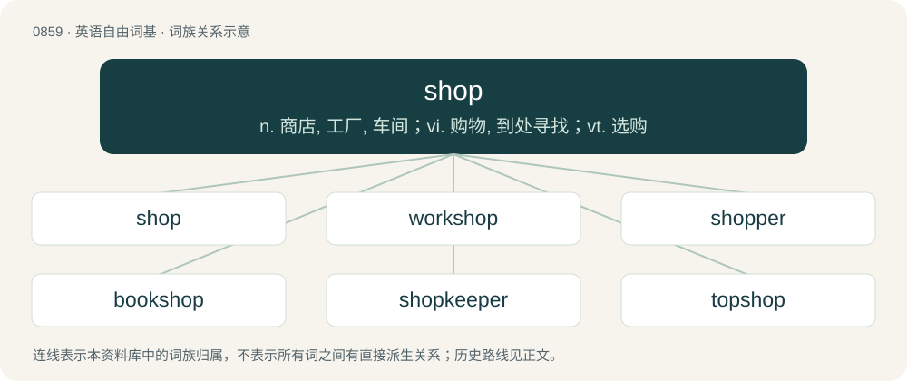

# 0931 · shop — n. 商店, 工厂, 车间；vi. 购物, 到处寻找；vt. 选购

[总目录](../00_总目录_按常用程度.md)

**类型**：英语自由词基　｜　**来源语言**：见词源记录

## 核心含义与来源

- 核心含义：n. 商店, 工厂, 车间；vi. 购物, 到处寻找；vt. 选购
- 英文含义：An establishment that sells goods or services to the public; originally only a physical location, but now a virtual establishment as well.
- 词形：shop

**来源记录 1**（名词；An establishment that sells goods or services to the public; originally only a physical location, but now a virtual establishment as well.）

From Middle English shoppe, schoppe, from Old English sċoppa (“shed; booth; stall; shop”), from Proto-Germanic \*skupp-, \*skup- (“barn, shed”), from Proto-Indo-European \*skub-, \*skup- (“to bend, bow, curve, vault”). Cognate with Dutch schop (“shed”), German Schuppen (“shed”), German Schober (“barn”), French échoppe (“booth, shop”) (&lt; Germanic). The verb is denominal. The noun senses “act of shopping”, “purchased items” are backformed from the verb.

## 词族图

## 单词速览（常用到不常用）

| 单词 | 音标 | 释义 |
|---|---|---|
| [shop](#w-1) | 英 /ʃɒp/；美 /ʃɑp/ | n. 商店, 工厂, 车间；vi. 购物, 到处寻找；vt. 选购 |
| [workshop](#w-2) | 英 /ˈwɜːk.ʃɒp/；美 /ˈwɝk.ʃɑp/ | n. 工场, 车间, 研讨会；\[计\] 讨论会; 专题研究组 |
| [shopper](#w-3) | 英 /ˈʃɒp.ə/；美 /ˈʃɑ.pɚ/ | n. 购物者；\[经\] 顾客, 购物的人 |
| [bookshop](#w-4) | /ˈbukʃɒp/ | n. 书店 |
| [shopkeeper](#w-5) | 英 /ˈʃɒpkiːpə/；美 /ˈʃɑpkiːpɚ/ | n. 零售商, 店主, 老板 |
| [topshop](#w-6) |  | 【英文】A building found in parts of the English Midlands, having three storeys, the lower two serving as living accommodation and the upper floor as a workshop containing a weaver's loom. |
| [sweatshop](#w-7) | 英 /ˈswɛtˌʃɒp/；美 /ˈswɛtˌʃɑp/ | n. 血汗工厂 |
| [shoplifter](#w-8) | /ˈʃɒp.liftə/ | n. 商店扒手 |
| [pawnshop](#w-9) | 英 /ˈpɔːnʃɒp/；美 /ˈpɔnʃɑp/ | n. 当铺；\[经\] 当铺 |
| [shopaholic](#w-10) | /ˌʃɒpəˈhɒlɪk/ | n. 购物狂 |
| [shoplift](#w-11) | /ˈʃɒplɪft/ | vi.vt. 入店偷窃商品 |

## 逐词详解

### 1. shop

**词性**：名词　｜　**音标**：英 /ʃɒp/；美 /ʃɑp/

**中文释义**：n. 商店, 工厂, 车间；vi. 购物, 到处寻找；vt. 选购

**英文义项**：An establishment that sells goods or services to the public; originally only a physical location, but now a virtual establishment as well. / A place where things are manufactured or crafted; a workshop.

**词源与演化**：

From Middle English shoppe, schoppe, from Old English sċoppa (“shed; booth; stall; shop”), from Proto-Germanic \*skupp-, \*skup- (“barn, shed”), from Proto-Indo-European \*skub-, \*skup- (“to bend, bow, curve, vault”). Cognate with Dutch schop (“shed”), German Schuppen (“shed”), German Schober (“barn”), French échoppe (“booth, shop”) (&lt; Germanic). The verb is denominal. The noun senses “act of shopping”, “purchased items” are backformed from the verb.

**例句**：

> I’ve got a big shop, so feel free to go in front.

该用例对应义项：The collective items bought (or to be bought) on a shopping trip.

### 2. workshop

**词性**：名词　｜　**音标**：英 /ˈwɜːk.ʃɒp/；美 /ˈwɝk.ʃɑp/

**中文释义**：n. 工场, 车间, 研讨会；\[计\] 讨论会; 专题研究组

**英文义项**：A room, especially one which is not particularly large, used for manufacturing or other light industrial work. / A brief, intensive course of education for a small group, emphasizing interaction and practical problem solving.

**构词拆分**：work + shop

**词源与演化**：

From work + shop.

**例句**：

> Last night Tom dreamt he had been employed in the Devil's workshop.

### 3. shopper

**词性**：名词　｜　**音标**：英 /ˈʃɒp.ə/；美 /ˈʃɑ.pɚ/

**中文释义**：n. 购物者；\[经\] 顾客, 购物的人

**英文义项**：A person who shops. / A free local newspaper containing advertisements for local shops etc; sometimes includes discount coupons.

**构词拆分**：shop + -er

**词源与演化**：

From shop + -er.

**例句**：

> I'm not wealthy enough to afford a personal shopper.

### 4. bookshop

**词性**：名词　｜　**音标**：/ˈbukʃɒp/

**中文释义**：n. 书店

**英文义项**：A shop that sells books.

**构词拆分**：book + shop

**词源与演化**：

From book + shop.

**例句**：

> I am working full-time at a bookshop until the end of September.

### 5. shopkeeper

**词性**：名词　｜　**音标**：英 /ˈʃɒpkiːpə/；美 /ˈʃɑpkiːpɚ/

**中文释义**：n. 零售商, 店主, 老板

**英文义项**：A trader who sells goods in a shop, or by retail, in distinction from one who sells by wholesale, or sells door to door.

**构词拆分**：shop + keeper

**词源与演化**：

From shop + keeper.

**例句**：

> "But don't you think that it's a little big?" asked the shopkeeper.

### 6. topshop

**词性**：名词

**英文义项**：A building found in parts of the English Midlands, having three storeys, the lower two serving as living accommodation and the upper floor as a workshop containing a weaver's loom.

**构词拆分**：top + shop

**词源与演化**：

From top + shop.

### 7. sweatshop

**词性**：名词　｜　**音标**：英 /ˈswɛtˌʃɒp/；美 /ˈswɛtˌʃɑp/

**中文释义**：n. 血汗工厂

**英文义项**：A factory or other place of work where pay is low and conditions are poor or even illegal.

**构词拆分**：sweat (“to extract money, labour, etc.”, verb) + shop

**词源与演化**：

From sweat (“to extract money, labour, etc.”, verb) + shop.

**例句**：

> Many Jews were employed in the garment industry, working under sweatshop conditions.

### 8. shoplifter

**词性**：名词　｜　**音标**：/ˈʃɒp.liftə/

**中文释义**：n. 商店扒手

**英文义项**：A person who shoplifts, one who steals from shops.

**构词拆分**：shop + lifter

**词源与演化**：

From shop + lifter.

**例句**：

> Shoplifters will be prosecuted.

该用例对应义项：A person who shoplifts, one who steals from shops.

### 9. pawnshop

**词性**：名词　｜　**音标**：英 /ˈpɔːnʃɒp/；美 /ˈpɔnʃɑp/

**中文释义**：n. 当铺；\[经\] 当铺

**英文义项**：The business premises of a pawnbroker; where loans are made, with personal property as security

**构词拆分**：pawn + shop

**词源与演化**：

From pawn + shop.

**例句**：

> Never turn down expensive gifts. Love comes and goes, but the pawnshop is always open.

### 10. shopaholic

**词性**：名词　｜　**音标**：/ˌʃɒpəˈhɒlɪk/

**中文释义**：n. 购物狂

**英文义项**：One who shops excessively; a shopping addict.

**构词拆分**：shop + -aholic

**词源与演化**：

From shop + -aholic.

**例句**：

> Shopaholics lose a lot of their money and possibly go broke because they've spent all of it.

该用例对应义项：One who shops excessively; a shopping addict.

### 11. shoplift

**词性**：动词　｜　**音标**：/ˈʃɒplɪft/

**中文释义**：vi.vt. 入店偷窃商品

**英文义项**：To steal something from a shop or store during business hours, usually by means of hiding merchandise. / To steal from shops / stores during trading hours.

**构词拆分**：shop + lift (“to steal”)

**词源与演化**：

From shop + lift (“to steal”), after shoplifting, shoplifter, and shoplift (noun).

**例句**：

> It was simply caprice that led them to shoplift.
