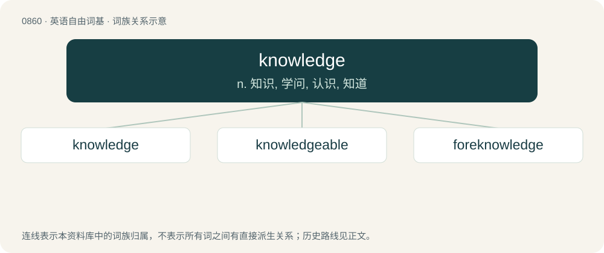

# 0933 · knowledge — n. 知识, 学问, 认识, 知道

[总目录](../00_总目录_按常用程度.md)

**类型**：英语自由词基　｜　**来源语言**：见词源记录

## 核心含义与来源

- 核心含义：n. 知识, 学问, 认识, 知道
- 英文含义：The fact of knowing about something; general understanding or familiarity with a subject, place, situation etc.
- 词形：knowledge

**来源记录 1**（名词；The fact of knowing about something; general understanding or familiarity with a subject, place, situation etc.）

From Middle English knowleche, knaweleche, cnawlece (“knowledge”), from knowen (“to know, recognise”) + -leche. Related to Middle English knowlechen (“to find out, acknowledge”). For more on the Middle English suffix -leche, compare freelage. Compare also Old English cnāwelǣċ, cnāwelǣċing (“acknowledging, acknowledgement”).

## 词族图

## 单词速览（常用到不常用）

| 单词 | 音标 | 释义 |
|---|---|---|
| [knowledge](#w-1) | 英 /ˈnɒl.ɪdʒ/；美 /ˈnɑ.lɪdʒ/ | n. 知识, 学问, 认识, 知道 |
| [knowledgeable](#w-2) | 英 /ˈnɒl.ɪ.d͡ʒə.bəl/；美 /ˈnɑ.lɪ.d͡ʒə.bəl/ | a. 聪明的, 有知识的 |
| [foreknowledge](#w-3) | /ˈfɒːnɒlidʒ/ | n. 预知, 先见之明 |

## 逐词详解

### 1. knowledge

**词性**：名词　｜　**音标**：英 /ˈnɒl.ɪdʒ/；美 /ˈnɑ.lɪdʒ/

**中文释义**：n. 知识, 学问, 认识, 知道

**英文义项**：The fact of knowing about something; general understanding or familiarity with a subject, place, situation etc. / Awareness of a particular fact or situation; a state of having been informed or made aware of something.

**词源与演化**：

From Middle English knowleche, knaweleche, cnawlece (“knowledge”), from knowen (“to know, recognise”) + -leche. Related to Middle English knowlechen (“to find out, acknowledge”). For more on the Middle English suffix -leche, compare freelage. Compare also Old English cnāwelǣċ, cnāwelǣċing (“acknowledging, acknowledgement”).

**例句**：

> Knowledge consists in recognizing the difference between good and bad decisions.

该用例对应义项：Intellectual understanding; the state of appreciating truth or information.

### 2. knowledgeable

**词性**：形容词　｜　**音标**：英 /ˈnɒl.ɪ.d͡ʒə.bəl/；美 /ˈnɑ.lɪ.d͡ʒə.bəl/

**中文释义**：a. 聪明的, 有知识的

**英文义项**：Having knowledge, especially of a particular subject. / Educated and well-informed.

**构词拆分**：knowledge + -able

**词源与演化**：

From knowledge + -able.

**用法示例／搭配（非完整句）**：

> a knowledgeable man

该用例对应义项：Having knowledge, especially of a particular subject.

### 3. foreknowledge

**词性**：名词　｜　**音标**：/ˈfɒːnɒlidʒ/

**中文释义**：n. 预知, 先见之明

**英文义项**：Knowing beforehand via natural or ordinary means. / Knowing beforehand via supernatural or paranormal means.

**构词拆分**：From fore- + knowledge.

**词源与演化**：

From fore- + knowledge.

**例句**：

> The prosecution intends to prove that the defendant had foreknowledge.

该用例对应义项：Knowing beforehand via natural or ordinary means.
