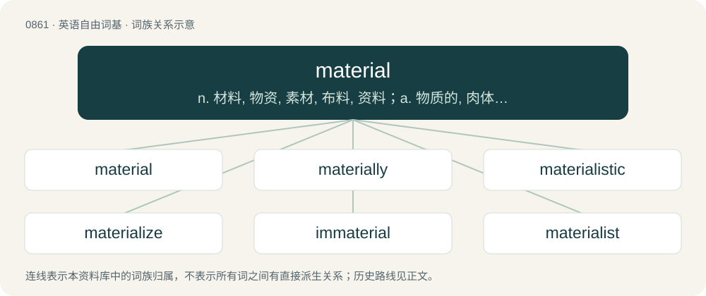

# 0934 · material — n. 材料, 物资, 素材, 布料, 资料；a. 物质的, 肉体的, 重要的

[总目录](../00_总目录_按常用程度.md)

**类型**：英语自由词基　｜　**来源语言**：见词源记录

## 核心含义与来源

- 核心含义：n. 材料, 物资, 素材, 布料, 资料；a. 物质的, 肉体的, 重要的
- 英文含义：Of, relating to, or consisting of matter, especially physical.
- 词形：material

**来源记录 1**（形容词；Of, relating to, or consisting of matter, especially physical.）

From Middle English material, from Late Latin māteriālis, from Latin māteria (“wood, material, substance”), from māter (“mother”). Displaced native Middle English andweorc, andwork (“material, matter”) (from Old English andweorc (“matter, substance, material”)). Doublet of materiel.

## 词族图

## 单词速览（常用到不常用）

| 单词 | 音标 | 释义 |
|---|---|---|
| [material](#w-1) | 英 /məˈtɪə.ɹi.əl/；美 /məˈtɪɹ.i.əl/ | n. 材料, 物资, 素材, 布料, 资料；a. 物质的, 肉体的, 重要的 |
| [materially](#w-2) | /məˈtiəriəli/ | adv. 实质上, 重大, 物质上 |
| [materialistic](#w-3) | /məˌtɪəɹ.i.əˈlɪs.tɪk/ | a. 唯物论的, 唯物主义的 |
| [materialize](#w-4) | /məˈtɪɹiəlaɪz/ | vt. 赋予实质, 使体现, 物质化；vi. 成有形, 体现, 实现 |
| [immaterial](#w-5) | 英 /ˌɪ.məˈtɪə.ɹɪ.əl/；美 /ˌɪ.məˈtɪ.ɹi.əl/ | a. 非物质的, 无形的, 精神的；\[法\] 非物质的, 无形的, 非实质的 |
| [materialist](#w-6) | /məˈtiːɹɪəlɪst/ | n. 唯物主义者 |
| [materiality](#w-7) | /mə.tiəriˈæliti/ | n. 实质性, 物质性, 实体；\[经\] 重要性 |

## 逐词详解

### 1. material

**词性**：形容词　｜　**音标**：英 /məˈtɪə.ɹi.əl/；美 /məˈtɪɹ.i.əl/

**中文释义**：n. 材料, 物资, 素材, 布料, 资料；a. 物质的, 肉体的, 重要的

**英文义项**：Of, relating to, or consisting of matter, especially physical. / Of, relating to, or affecting physical well-being; corporeal; bodily.

**词源与演化**：

From Middle English material, from Late Latin māteriālis, from Latin māteria (“wood, material, substance”), from māter (“mother”). Displaced native Middle English andweorc, andwork (“material, matter”) (from Old English andweorc (“matter, substance, material”)). Doublet of materiel.

**例句**：

> Don't let material concerns get in the way of living a happy life.

该用例对应义项：Relating to or concerned with what is purely physical rather than intellectual or spiritual, especially excessively so; materialistic.

### 2. materially

**词性**：副词　｜　**音标**：/məˈtiəriəli/

**中文释义**：adv. 实质上, 重大, 物质上

**英文义项**：In a material manner; with regard to physical things or characteristics. / To a significant degree.

**构词拆分**：material + -ly

**词源与演化**：

From Middle English materialy; equivalent to material + -ly.

**例句**：

> It aided him materially in winning the argument.

该用例对应义项：to a significant degree

### 3. materialistic

**词性**：形容词　｜　**音标**：/məˌtɪəɹ.i.əˈlɪs.tɪk/

**中文释义**：a. 唯物论的, 唯物主义的

**英文义项**：Being overly concerned with material possessions and wealth. / Synonym of materialist, of or concerning materialism.

**构词拆分**：material + -istic

**词源与演化**：

From material + -istic.

**例句**：

> Tom doesn't seem to be as materialistic as Mary seems to be.

### 4. materialize

**词性**：动词　｜　**音标**：/məˈtɪɹiəlaɪz/

**中文释义**：vt. 赋予实质, 使体现, 物质化；vi. 成有形, 体现, 实现

**英文义项**：To cause to take physical form, or to cause an object to appear. / To take physical form, to appear seemingly from nowhere.

**构词拆分**：material + -ize

**词源与演化**：

From material + -ize.

**例句**：

> Unless you put some effort in, your successes won't materialize overnight.

### 5. immaterial

**词性**：形容词　｜　**音标**：英 /ˌɪ.məˈtɪə.ɹɪ.əl/；美 /ˌɪ.məˈtɪ.ɹi.əl/

**中文释义**：a. 非物质的, 无形的, 精神的；\[法\] 非物质的, 无形的, 非实质的

**英文义项**：Having no matter or substance; incorporeal. / Of the nature of the soul or spirit; spiritual.

**构词拆分**：im- + material

**词源与演化**：

The adjective is derived from Late Middle English immaterial, inmateriall (“incorporeal; spiritual”), from Middle French immateriel (“not material”) (modern French immatériel), and from its etymon Medieval Latin immāteriālis (“not material”), from Latin im- (a variant of in- (prefix meaning ‘not’)) + māteriālis (“made of matter, material”) (from māteria (“matter, substance, material”) (from māter, from Proto-Indo-European \*méh₂tēr, + ia) + -ālis (suffix forming adjectives of relationship)). The English word is analysable as im- + material. The noun is derived from the adjective.

**例句**：

> Objection, your Honour! The defendant’s criminal record is immaterial to this case.

该用例对应义项：Especially of evidence; chiefly followed by to: not associated in any way that is important or useful to the context being discussed; irrelevant.

### 6. materialist

**词性**：名词　｜　**音标**：/məˈtiːɹɪəlɪst/

**中文释义**：n. 唯物主义者

**英文义项**：Someone who is materialistic, concerned only with material possessions. / A follower or proponent of philosophical materialism.

**构词拆分**：material + -ist

**词源与演化**：

From material + -ist.

**例句**：

> I tend to look at things from a scientific materialist perspective.

### 7. materiality

**词性**：名词　｜　**音标**：/mə.tiəriˈæliti/

**中文释义**：n. 实质性, 物质性, 实体；\[经\] 重要性

**英文义项**：The quality of being material; having a physical existence. / The quality of being of consequence to a legal decision.

**构词拆分**：material (adjective and noun) + -ity

**词源与演化**：

From material (adjective and noun) + -ity, perhaps modelled on Latin māteriālitās.
