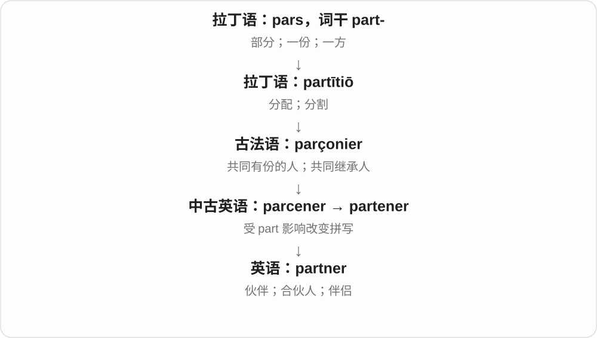
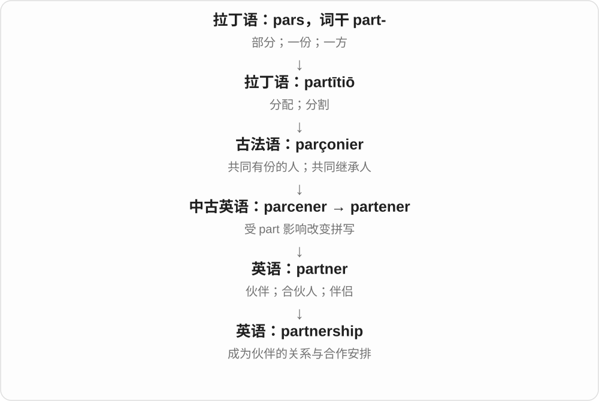

# 0935 · partner — 伙伴；合伙人；搭档

[逐词精讲目录](../00_逐词精讲目录.md) · [总目录](../00_总目录_按常用程度.md)

## 核心词根与来源

partner 的历史联系 part 的部分、分有一份一支，并受相关词形影响。partnership 把伙伴关系或合伙安排名词化。

**PARTNER：共同参与一件事的人**

不是只站在一起，而是分担任务、利益或责任。

- **参与者与关系**：partner · partnership
- **partner → partners：共同有份的人**：partner · partners

## 词形与演化规律

partner 可作名词或动词；partner with 是与……合作。partnership 在商业语境可有具体组织含义，不能只当一般友情。

中古英语形式受 part 影响定形，现代伙伴、合伙人等义按语境分。

## 单词速览（按词族由简到繁）

同一基础词的相关扩展放在一起，先读基础形式，再读扩展；各组之间优先读常用的。具体词源关系见各词讲解。

| 单词 | 音标 | 核心意思 |
|---|---|---|
| [partner](#w-1) | 英 /ˈpɑːtnə/；美 /ˈpɑːrtnər/ | 伙伴；合伙人；伴侣 |
| [partners](#w-3) | 英 /ˈpɑːtnəz/；美 /ˈpɑːrtnərz/ | 伙伴、合伙人、搭档；伴侣〔复数〕；与……搭档〔第三人称单数〕 |
| [partnership](#w-2) | 英 /ˈpɑːtnəʃɪp/；美 /ˈpɑːrtnərʃɪp/ | 合作关系；合伙关系 |

## 逐词讲解

### 1. partner — 伙伴；合伙人；伴侣

**音标**：英 /ˈpɑːtnə/；美 /ˈpɑːrtnər/

**先抓住这个画面**

事情不是你一个人做，另一个人也在其中占一份、承担一份；你们是 partners。

**怎么拆**

来自古法语表示“共同有份的人”的词，经中古英语 parcener 等形式，受 part 影响变成 partner。不要硬拆成 part + ner。

**怎么变成今天的意思**

“共同有份”连接了商业合作、双人活动和亲密关系。partner 不自带婚姻状态或性别，要看具体语境。

**常见搭配与例句**

a business partner；a dance partner；partner with another organization。

> She started the company with a business partner.

她和一位合伙人创办了这家公司。

> Please choose a partner for the speaking exercise.

请选一位搭档做口语练习。

**别混淆**

friend 说友谊；partner 说共同参与或共同生活的关系。商业合伙人未必是私人好友。

### 2. partners — 伙伴、合伙人、搭档；伴侣〔复数〕；与……搭档〔第三人称单数〕

**音标**：英 /ˈpɑːtnəz/；美 /ˈpɑːrtnərz/

**先抓住这个画面**

一起参与、共同有份的人，是 partners；工作、比赛、舞蹈、生活里都能有这种共同参与的关系。

**怎么拆**

partner + -s，词尾 /ə/ 或 /ər/ 后读 /z/。partner 接古法语共同有份的人相关词，经中古英语 parcener 等形式，受 part 的拼写、意义影响形成 partner；现代不拆成独立后缀 ner。

**怎么变成今天的意思**

**古法语共同有份者词 → 中古英语 parcener 等 → partner**  
共同参与、共有一份的人；受 part 影响定形

↓

**partner + -s → partners；名词转动词**  
多个伙伴；单数主语与人合作

business partners 商业伙伴、合伙人；dance partners 舞伴；project partners 项目合作方。

**常见搭配与例句**

partners in the project；partners with a local school。

> The students worked with different partners each week.

学生们每周和不同的搭档合作。

> The two companies became partners in the project.

这两家公司成为该项目的合作伙伴。

**别混淆**

partners 不必是亲密朋友，也可只是共同完成某件事的搭档。生活关系中可指伴侣；具体亲密程度、法律身份不由这个词单独决定。

### 3. partnership — 合作关系；合伙关系

**音标**：英 /ˈpɑːtnəʃɪp/；美 /ˈpɑːrtnərʃɪp/

**先抓住这个画面**

partner 是一起承担的人；partnership 是把这些人连接起来、让合作持续运转的关系。

**怎么拆**

partner + -ship，-ship 表示身份、状态或关系。

**怎么变成今天的意思**

它可以指正式商业合伙，也可以泛指学校、团队等之间的合作。是否构成某种法律组织，要看上下文，单凭这个词不能决定。

**常见搭配与例句**

form a partnership；work in partnership with；a long partnership。

> The school formed a partnership with a local museum.

学校与当地一家博物馆建立了合作关系。

> Their partnership has lasted more than ten years.

他们的合作关系已经持续十多年。

**别混淆**

partnership 是合作关系；participation 是参与行为。参加一次活动，并不一定建立长期 partnership。

## 这一组要分清什么

partner 是参与角色，friend 是朋友；商业搭档不一定是私人好友，伴侣义也要看语境。

## 串起来练习

The two partners built a successful partnership.

两位合伙人建立了成功的合作关系。
