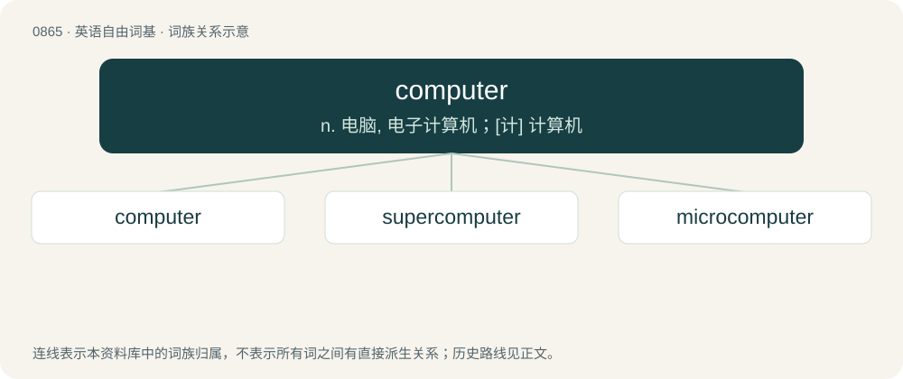

# 0936 · computer — n. 电脑, 电子计算机；\[计\] 计算机

[总目录](../00_总目录_按常用程度.md)

**类型**：英语自由词基　｜　**来源语言**：见词源记录

## 核心含义与来源

- 核心含义：n. 电脑, 电子计算机；\[计\] 计算机
- 英文含义：A programmable electronic device that performs mathematical calculations and logical operations, especially one that can process, store and retrieve large amounts of data very quickly; now especially, a small one for personal or home use employed for manipulating text or graphics, accessing the Internet, or playing games or media.
- 词形：computer

**来源记录 1**（名词；A programmable electronic device that performs mathematical calculations and logical operations, especially one that can process, store and retrieve large amounts of data very quickly; now especially, a small one for personal or home use employed for manipulating text or graphics, accessing the Internet, or playing games or media.）

From compute + -er. Doublet of cantore, counter, and kontor. The sense referring to people first appears c. 1613 in the works of the poet Richard Brathwait. The sense referring to a machine first appears c. 1897 in the magazine Engineering.

## 词族图

## 单词速览（常用到不常用）

| 单词 | 音标 | 释义 |
|---|---|---|
| [computer](#w-1) | 英 /kəmˈpjuː.tə/；美 /kəmˈpju.tɚ/ | n. 电脑, 电子计算机；\[计\] 计算机 |
| [supercomputer](#w-2) | /,sjuːpəkəmˈpjuːtə/ | \[计\] 巨型计算机, 巨型机, 超级计算机 |
| [microcomputer](#w-3) | /.maikrəuˈkɒmpjutə/ | n. 微电脑, 微机；\[计\] 微型计算机; 微计算机 |

## 逐词详解

### 1. computer

**词性**：名词　｜　**音标**：英 /kəmˈpjuː.tə/；美 /kəmˈpju.tɚ/

**中文释义**：n. 电脑, 电子计算机；\[计\] 计算机

**英文义项**：A programmable electronic device that performs mathematical calculations and logical operations, especially one that can process, store and retrieve large amounts of data very quickly; now especially, a small one for personal or home use employed for manipulating text or graphics, accessing the Internet, or playing games or media.

**构词拆分**：compute + -er

**词源与演化**：

From compute + -er. Doublet of cantore, counter, and kontor. The sense referring to people first appears c. 1613 in the works of the poet Richard Brathwait. The sense referring to a machine first appears c. 1897 in the magazine Engineering.

**例句**：

> As well as saving the photos on my computer, I have them backed up on a USB drive.

该用例对应义项：A programmable electronic device that performs mathematical calculations and logical operations, especially one that can process, store and retrieve large amounts of data very quickly; now especially, a small one for personal or home use employed for manipulating text or graphics, accessing the Internet, or playing games or media.

### 2. supercomputer

**词性**：名词　｜　**音标**：/,sjuːpəkəmˈpjuːtə/

**中文释义**：\[计\] 巨型计算机, 巨型机, 超级计算机

**英文义项**：Any computer that has a far greater processing power than others of its generation.

**构词拆分**：super- + computer

**词源与演化**：

From super- + computer.

**例句**：

> I know this is an impossible question. I asked our supercomputer, and it killed itself.

### 3. microcomputer

**词性**：名词　｜　**音标**：/.maikrəuˈkɒmpjutə/

**中文释义**：n. 微电脑, 微机；\[计\] 微型计算机; 微计算机

**英文义项**：A microprocessor that is based on a single chip.

**构词拆分**：micro- + computer

**词源与演化**：

From micro- + computer. First use appears c. 1956. See cite below.

**例句**：

> Students learned BASIC programming on a simple microcomputer connected to a small monitor.
