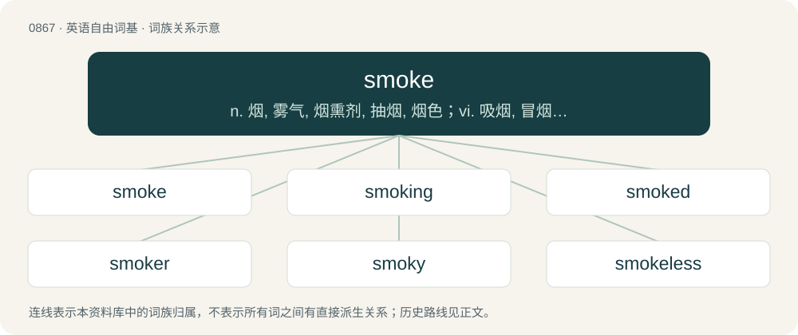

# 0938 · smoke — n. 烟, 雾气, 烟熏剂, 抽烟, 烟色；vi. 吸烟, 冒烟, 弥漫；vt. 以烟熏, 抽烟而导致...

[总目录](../00_总目录_按常用程度.md)

**类型**：英语自由词基　｜　**来源语言**：见词源记录

## 核心含义与来源

- 核心含义：n. 烟, 雾气, 烟熏剂, 抽烟, 烟色；vi. 吸烟, 冒烟, 弥漫；vt. 以烟熏, 抽烟而导致...
- 英文含义：The visible vapor/vapour, gases, and fine particles given off by burning or smoldering material.
- 词形：smoke

**多个词源／构词路径**：同一拼写可能有不同来源；以下按词性和含义分别列出。

**来源记录 1**（名词；The visible vapor/vapour, gases, and fine particles given off by burning or smoldering material.）

From Middle English smoke, from Old English smoca (“smoke”), probably a derivative of the verb (see below). Related to Dutch smook (“smoke”), Middle Low German smôk (“smoke”), German Schmauch (“smoke (from a gun barrel)”).

**来源记录 2**（动词；To inhale and exhale the smoke from a burning cigarette or cigar, burning material in a pipe, etc.）

From Middle English smoken, from Old English smocian (“to smoke, to emit smoke”), from Proto-West Germanic \*smokōn, from Proto-Germanic \*smukōną (“to smoke”), ablaut derivative of Proto-Germanic \*smaukaną (“to smoke”), from Proto-Indo-European \*(s)mewg- (“to smoke”). Cognate with Saterland Frisian smookje (“to smoke”), West Frisian smoke (“to smoke”), Dutch smoken (“to smoke”), Low German smöken (“to smoke”), German Low German smoken (“to smoke”). Related also to Old English smēocan (“to smoke, emit smoke; fumigate”), Bavarian schmuckelen (“to smell bad, reek”).

## 词族图

## 单词速览（常用到不常用）

| 单词 | 音标 | 释义 |
|---|---|---|
| [smoke](#w-1) | 英 /sməʊk/；美 /smoʊk/ | n. 烟, 雾气, 烟熏剂, 抽烟, 烟色；vi. 吸烟, 冒烟, 弥漫；vt. 以烟熏, 抽烟而导致... |
| [smoking](#w-2) | 英 /ˈsməʊkɪŋ/；美 /ˈsmoʊkɪŋ/ | n. 抽烟, 冒烟；\[医\] 烟熏; 吸烟 |
| [smoked](#w-3) | 英 /sməʊkt/；美 /smoʊkt/ | a. 熏制的 |
| [smoker](#w-4) | 美 /ˈsmoʊkɚ/ | n. 吸烟者, 吸烟的人, 吸烟车厢, (美)(非正式)蒸汽火车头 |
| [smoky](#w-5) | 美 /ˈsmoʊki/ | a. 冒烟的, 满是烟的, 熏脏的, 烟灰色的 |
| [smokeless](#w-6) | /ˈsməuklis/ | a. 无烟的；\[机\] 无烟的, 不出烟的 |
| [smokescreen](#w-7) | 美 /ˈsmoʊkˌskɹin/ | n. 烟幕, 掩盖某人真实意图的东西 |
| [smokehouse](#w-8) | 美 /ˈsmoʊkˌhaʊs/ | n. 熏制室 |
| [smokestack](#w-9) | 美 /ˈsmoʊkˌstæk/ | n. 烟囱；\[机\] 烟堆 |
| [smokie](#w-10) | /ˈsməuki/ | 除内脏去头熏鳕 |

## 逐词详解

### 1. smoke

**词性**：名词　｜　**音标**：英 /sməʊk/；美 /smoʊk/

**中文释义**：n. 烟, 雾气, 烟熏剂, 抽烟, 烟色；vi. 吸烟, 冒烟, 弥漫；vt. 以烟熏, 抽烟而导致...

**英文义项**：The visible vapor/vapour, gases, and fine particles given off by burning or smoldering material. / A cigarette.

**词源与演化**：

From Middle English smoke, from Old English smoca (“smoke”), probably a derivative of the verb (see below). Related to Dutch smook (“smoke”), Middle Low German smôk (“smoke”), German Schmauch (“smoke (from a gun barrel)”).

**例句**：

> The excitement behind the new candidate proved to be smoke.

该用例对应义项：A fleeting illusion; something insubstantial, evanescent, unreal, transitory, or without result.

### 2. smoking

**词性**：形容词　｜　**音标**：英 /ˈsməʊkɪŋ/；美 /ˈsmoʊkɪŋ/

**中文释义**：n. 抽烟, 冒烟；\[医\] 烟熏; 吸烟

**英文义项**：Giving off smoke. / Sexually attractive, usually referring to a woman.

**构词拆分**：smoke + -ing

**词源与演化**：

From Middle English smokynge, smokiende, from Old English smociende (“smoking”), from Proto-Germanic \*smukōndz (“emitting smoke, smoking”), equivalent to smoke + -ing.

**例句**：

> The band put on a smoking performance.

该用例对应义项：Showing great skill or talent.

### 3. smoked

**词性**：形容词　｜　**音标**：英 /sməʊkt/；美 /smoʊkt/

**中文释义**：a. 熏制的

**英文义项**：Of food, treated with smoke, often for flavor or as a method of preservation. / Of glass, tinted.

**构词拆分**：smoke + -ed

**词源与演化**：

From Middle English smoked, y-smoked, equivalent to smoke + -ed.

**用法示例／搭配（非完整句）**：

> smoked salmon

该用例对应义项：Of food, treated with smoke, often for flavor or as a method of preservation.

### 4. smoker

**词性**：名词　｜　**音标**：美 /ˈsmoʊkɚ/

**中文释义**：n. 吸烟者, 吸烟的人, 吸烟车厢, (美)(非正式)蒸汽火车头

**英文义项**：A person who smokes tobacco habitually. / Someone who smokes (something).

**构词拆分**：smoke + -er

**词源与演化**：

From smoke + -er.

**用法示例／搭配（非完整句）**：

> a smoker of cannabis

该用例对应义项：Someone who smokes (something).

### 5. smoky

**词性**：形容词　｜　**音标**：美 /ˈsmoʊki/

**中文释义**：a. 冒烟的, 满是烟的, 熏脏的, 烟灰色的

**英文义项**：Filled with smoke. / Filled with or enveloped in tobacco smoke.

**构词拆分**：smoke + -y (adjectival suffix)

**词源与演化**：

From Middle English smoke, smokei, smoki, smokie, smoky, equivalent to smoke + -y (adjectival suffix). Doublet of Samoki.

**用法示例／搭配（非完整句）**：

> a few smoky jazz notes

该用例对应义项：Having a dark, thick, bass sound.

### 6. smokeless

**词性**：形容词　｜　**音标**：/ˈsməuklis/

**中文释义**：a. 无烟的；\[机\] 无烟的, 不出烟的

**英文义项**：Without smoke. / Of a gun, that does not produce smoke when fired.

**构词拆分**：smoke + -less

**词源与演化**：

From smoke + -less.

**用法示例／搭配（非完整句）**：

> smokeless gunpowder

该用例对应义项：Without smoke.

### 7. smokescreen

**词性**：名词　｜　**音标**：美 /ˈsmoʊkˌskɹin/

**中文释义**：n. 烟幕, 掩盖某人真实意图的东西

**英文义项**：Smoke used as a disguise, mask or cover, as of troops in battle. / Anything used metaphorically to conceal or distract.

**构词拆分**：smoke + screen

**词源与演化**：

From smoke + screen.

**例句**：

> All that talk is just a smokescreen to disguise the fact that he has nothing to say.

该用例对应义项：Anything used metaphorically to conceal or distract.

### 8. smokehouse

**词性**：名词　｜　**音标**：美 /ˈsmoʊkˌhaʊs/

**中文释义**：n. 熏制室

**英文义项**：A structure used to smoke food to preserve it and to add flavor. / A structure in which freshly harvested tobacco is cured or preserved by smoking.

**构词拆分**：smoke + house

**词源与演化**：

From smoke + house.

**例句**：

> Now and then, he would bring a kipper or two home from the smokehouse.

### 9. smokestack

**词性**：名词　｜　**音标**：美 /ˈsmoʊkˌstæk/

**中文释义**：n. 烟囱；\[机\] 烟堆

**英文义项**：A conduit or group of conduits atop a structure allowing smoke to flow out, as on a steam locomotive, ship, factory, or power plant using fossil fuels.

**构词拆分**：smoke + stack

**词源与演化**：

From smoke + stack.

**例句**：

> This smokestack is releasing greenhouse gases and other pollutants into the atmosphere.

### 10. smokie

**词性**：名词　｜　**音标**：/ˈsməuki/

**中文释义**：除内脏去头熏鳕

**英文义项**：A type of smoked sausage, often used for hot dogs. / A smoked fish.

**构词拆分**：From smoke + -ie.

**词源与演化**：

From smoke + -ie.
