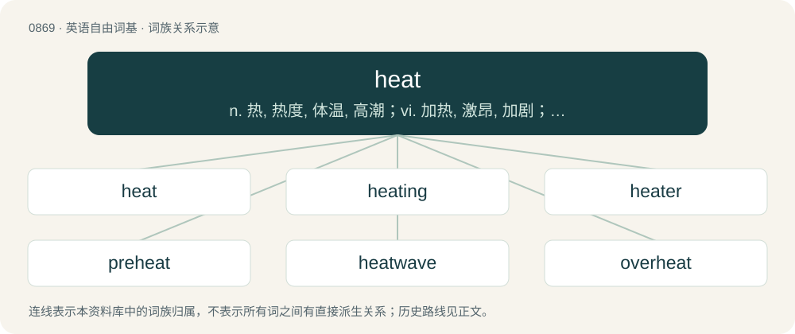

# 0941 · heat — n. 热, 热度, 体温, 高潮；vi. 加热, 激昂, 加剧；vt. 把...加热, 使激动

[总目录](../00_总目录_按常用程度.md)

**类型**：英语自由词基　｜　**来源语言**：见词源记录

## 核心含义与来源

- 核心含义：n. 热, 热度, 体温, 高潮；vi. 加热, 激昂, 加剧；vt. 把...加热, 使激动
- 英文含义：Thermal energy.
- 词形：heat

**多个词源／构词路径**：同一拼写可能有不同来源；以下按词性和含义分别列出。

**来源记录 1**（名词；Thermal energy.）

From Middle English hete, from Old English hǣtu, from Proto-West Germanic \*haitī, from Proto-Germanic \*haitį̄ (“heat”), from Proto-Indo-European \*keHy- (“heat; hot”). Cognate with Scots hete (“heat”), Saterland Frisian Hatte (“heat”), Old High German heizī (“heat”). Related also to Dutch hitte (“heat”), German Hitze (“heat”), Swedish hetta (“heat”), Faroese and Icelandic hiti (“heat”). Related to hot.

**来源记录 2**（动词；To cause an increase in temperature of (an object or space); to cause to become hot (often with "up").）

From Middle English heten, from Old English hǣtan (“to heat; become hot”), from Proto-Germanic \*haitijaną (“to heat, make hot”).

## 词族图

## 单词速览（常用到不常用）

| 单词 | 音标 | 释义 |
|---|---|---|
| [heat](#w-1) | /ˈhiːt/ | n. 热, 热度, 体温, 高潮；vi. 加热, 激昂, 加剧；vt. 把...加热, 使激动 |
| [heating](#w-2) | /ˈhiːtɪŋ/ | n. 加热, 供热, 暖气设备, 供暖系统, 暖气装置；a. 加热的, 供暖的 |
| [heater](#w-3) | 英 /ˈhiːtə/；美 /ˈhitɚ/ | n. 加热器, 灯丝, 加热工；\[化\] 加热器 |
| [preheat](#w-4) | /pɹiːˈhiːt/ | vt. 预热；\[机\] 预热 |
| [heatwave](#w-5) | /ˈhitˌweɪv/ | n. 热浪\[波\], 酷暑期 |
| [overheat](#w-6) | 英 /ˌəʊvəˈhiːt/；美 /ˌoʊvɚˈhit/ | vt. 使过热；vi. 变得过热 |
| [reheat](#w-7) | /ɹiːˈhiːt/ | vt. 再热；\[化\] 再热; 再热炉 |

## 逐词详解

### 1. heat

**词性**：名词　｜　**音标**：/ˈhiːt/

**中文释义**：n. 热, 热度, 体温, 高潮；vi. 加热, 激昂, 加剧；vt. 把...加热, 使激动

**英文义项**：Thermal energy. / The condition or quality of being hot.

**词源与演化**：

From Middle English hete, from Old English hǣtu, from Proto-West Germanic \*haitī, from Proto-Germanic \*haitį̄ (“heat”), from Proto-Indo-European \*keHy- (“heat; hot”). Cognate with Scots hete (“heat”), Saterland Frisian Hatte (“heat”), Old High German heizī (“heat”). Related also to Dutch hitte (“heat”), German Hitze (“heat”), Swedish hetta (“heat”), Faroese and Icelandic hiti (“heat”). Related to hot.

**例句**：

> The runner had high hopes, but was out of contention after the first heat.

该用例对应义项：A preliminary race, used to determine the participants in a final race.

### 2. heating

**词性**：名词　｜　**音标**：/ˈhiːtɪŋ/

**中文释义**：n. 加热, 供热, 暖气设备, 供暖系统, 暖气装置；a. 加热的, 供暖的

**英文义项**：A system that raises the temperature of a room or building. Compare heater. / The act of making something hot.

**构词拆分**：From heat + -ing.

**词源与演化**：

From heat + -ing.

**例句**：

> We're hoping to have the new heating installed before winter.

该用例对应义项：A system that raises the temperature of a room or building. Compare heater.

### 3. heater

**词性**：名词　｜　**音标**：英 /ˈhiːtə/；美 /ˈhitɚ/

**中文释义**：n. 加热器, 灯丝, 加热工；\[化\] 加热器

**英文义项**：A device that produces and radiates heat, typically to raise the temperature of a room or building. / A person who heats something, for example in metalworking.

**构词拆分**：heat + -er

**词源与演化**：

From heat + -er.

**例句**：

> Emmy went on a heater in Las Vegas and came back six thousand dollars richer.

该用例对应义项：An extended winning streak.

### 4. preheat

**词性**：动词　｜　**音标**：/pɹiːˈhiːt/

**中文释义**：vt. 预热；\[机\] 预热

**英文义项**：To heat beforehand or in advance, to heat something in preparation for further action.

**构词拆分**：pre- + heat

**词源与演化**：

From pre- + heat.

**用法示例／搭配（非完整句）**：

> to preheat the spare room for the guests

该用例对应义项：To heat beforehand or in advance, to heat something in preparation for further action.

### 5. heatwave

**词性**：名词　｜　**音标**：/ˈhitˌweɪv/

**中文释义**：n. 热浪\[波\], 酷暑期

**英文义项**：A heat haze.

**构词拆分**：From heat + wave.

**词源与演化**：

From heat + wave.

**例句**：

> The little dog drank all of his water during the heatwave.

### 6. overheat

**词性**：动词　｜　**音标**：英 /ˌəʊvəˈhiːt/；美 /ˌoʊvɚˈhit/

**中文释义**：vt. 使过热；vi. 变得过热

**英文义项**：To heat excessively. / To become excessively hot.

**构词拆分**：By surface analysis, over- + heat

**词源与演化**：

From Middle English overheten. Cognate with German überheizen, überhitzen (“to overheat”), Swedish överhetta (“to overheat”). By surface analysis, over- + heat.

**例句**：

> Don't leave the TV on for too long, it can overheat.

### 7. reheat

**词性**：名词　｜　**音标**：/ɹiːˈhiːt/

**中文释义**：vt. 再热；\[化\] 再热; 再热炉

**英文义项**：An afterburner. / The act of heating something again.

**构词拆分**：re- + heat

**词源与演化**：

From re- + heat.

**例句**：

> I gave the potatoes a reheat.

该用例对应义项：The act of heating something again.
