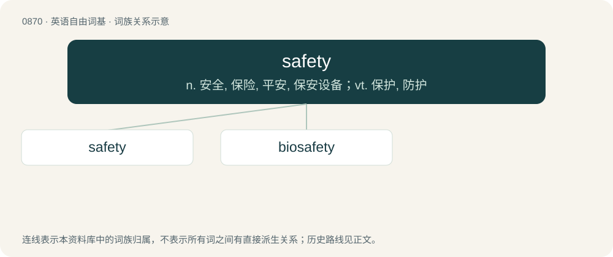

# 0942 · safety — n. 安全, 保险, 平安, 保安设备；vt. 保护, 防护

[总目录](../00_总目录_按常用程度.md)

**类型**：英语自由词基　｜　**来源语言**：见词源记录

## 核心含义与来源

- 核心含义：n. 安全, 保险, 平安, 保安设备；vt. 保护, 防护
- 英文含义：The condition or feeling of being safe; security; certainty.
- 词形：safety

**来源记录 1**（名词；The condition or feeling of being safe; security; certainty.）

Inherited from Middle English savete, from Old French sauveté, from earlier salvetet, from Medieval Latin salvitās, salvitātem, from Latin salvus.

## 词族图

## 单词速览（常用到不常用）

| 单词 | 音标 | 释义 |
|---|---|---|
| [safety](#w-1) | /ˈseɪfti/ | n. 安全, 保险, 平安, 保安设备；vt. 保护, 防护 |
| [biosafety](#w-2) | /baɪ.ɑˈseɪf.tiː/ | n. \[常用作定语\]生物研究安全性 |

## 逐词详解

### 1. safety

**词性**：名词　｜　**音标**：/ˈseɪfti/

**中文释义**：n. 安全, 保险, 平安, 保安设备；vt. 保护, 防护

**英文义项**：The condition or feeling of being safe; security; certainty. / A safety lock or safety catch: a mechanism on a weapon or dangerous equipment designed to prevent accidental firing or operation.

**词源与演化**：

Inherited from Middle English savete, from Old French sauveté, from earlier salvetet, from Medieval Latin salvitās, salvitātem, from Latin salvus.

**例句**：

> The free safety made a game-saving tackle on the runner who had broken past the linebackers.

该用例对应义项：Any of the defensive players who are in position furthest from the line of scrimmage and whose responsibility is to defend against passes as well as to be the tacklers of last resort.

### 2. biosafety

**词性**：名词　｜　**音标**：/baɪ.ɑˈseɪf.tiː/

**中文释义**：n. \[常用作定语\]生物研究安全性

**英文义项**：Protection from potential harm from biological agents, such as infectious microbes or modified genes.

**构词拆分**：bio- + safety

**词源与演化**：

From bio- + safety.
