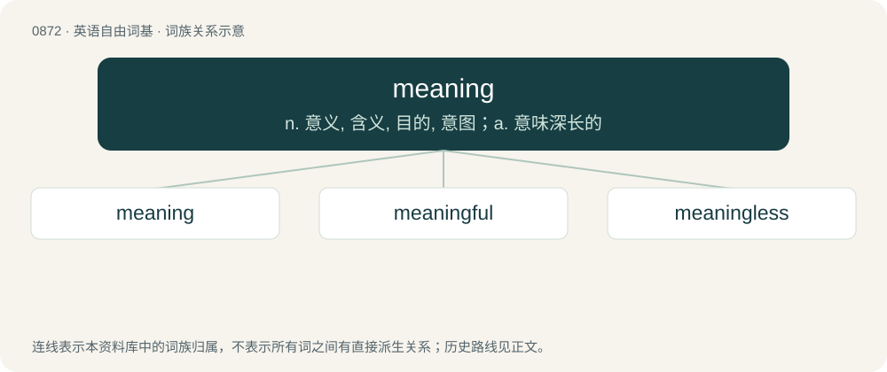

# 0944 · meaning — n. 意义, 含义, 目的, 意图；a. 意味深长的

[总目录](../00_总目录_按常用程度.md)

**类型**：英语自由词基　｜　**来源语言**：见词源记录

## 核心含义与来源

- 核心含义：n. 意义, 含义, 目的, 意图；a. 意味深长的
- 英文含义：The denotation, referent, or idea connected with a word, expression, or symbol.
- 词形：meaning

**多个词源／构词路径**：同一拼写可能有不同来源；以下按词性和含义分别列出。

**来源记录 1**（名词；The denotation, referent, or idea connected with a word, expression, or symbol.）

From Middle English mening, menyng, equivalent to mean + -ing. Cognate with Scots mening (“intent, purpose, sense, meaning”), West Frisian miening (“opinion, mind”), Dutch mening (“view, opinion, judgement”), German Meinung (“opinion, view, mind, idea”), Danish and Swedish mening (“meaning, sense, sentence, opinion”), Icelandic meining (“meaning”).

**来源记录 2**（形容词；Having a (specified) intention.）

From mean + -ing.

## 词族图

## 单词速览（常用到不常用）

| 单词 | 音标 | 释义 |
|---|---|---|
| [meaning](#w-1) | 英 /ˈmiː.nɪŋ/；美 /ˈmi.nɪŋ/ | n. 意义, 含义, 目的, 意图；a. 意味深长的 |
| [meaningful](#w-2) | 英 /ˈmiː.nɪŋ.fl̩/；美 /ˈmi.nɪŋ.fl̩/ | a. 意味深长的 |
| [meaningless](#w-3) | /ˈmiː.nɪŋ.ləs/ | a. 无意义的 |

## 逐词详解

### 1. meaning

**词性**：名词　｜　**音标**：英 /ˈmiː.nɪŋ/；美 /ˈmi.nɪŋ/

**中文释义**：n. 意义, 含义, 目的, 意图；a. 意味深长的

**英文义项**：The denotation, referent, or idea connected with a word, expression, or symbol. / The connotation associated with a word, expression, or symbol.

**构词拆分**：mean + -ing

**词源与演化**：

From Middle English mening, menyng, equivalent to mean + -ing. Cognate with Scots mening (“intent, purpose, sense, meaning”), West Frisian miening (“opinion, mind”), Dutch mening (“view, opinion, judgement”), German Meinung (“opinion, view, mind, idea”), Danish and Swedish mening (“meaning, sense, sentence, opinion”), Icelandic meining (“meaning”).

**例句**：

> The number of persons attending the vigil had a lot of meaning to the families.

该用例对应义项：The purpose, value, or significance (of something) beyond the fact of that thing's existence.

### 2. meaningful

**词性**：形容词　｜　**音标**：英 /ˈmiː.nɪŋ.fl̩/；美 /ˈmi.nɪŋ.fl̩/

**中文释义**：a. 意味深长的

**英文义项**：Having meaning, significant. / Full of implication; heavy with unstated meaning.

**构词拆分**：meaning + -ful

**词源与演化**：

From meaning + -ful.

**例句**：

> "So you enjoyed yourself, did you," she said, with a meaningful smile.

该用例对应义项：Full of implication; heavy with unstated meaning.

### 3. meaningless

**词性**：形容词　｜　**音标**：/ˈmiː.nɪŋ.ləs/

**中文释义**：a. 无意义的

**英文义项**：Lacking meaning. / Insignificant; not worthy of importance.

**构词拆分**：meaning + -less

**词源与演化**：

From meaning + -less.

**例句**：

> The word "gugugu" is meaningless in English.

该用例对应义项：Lacking meaning.
