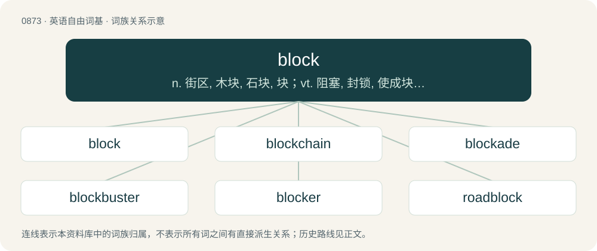

# 0945 · block — n. 街区, 木块, 石块, 块；vt. 阻塞, 封锁, 使成块状；\[计\] 块, 数据块

[总目录](../00_总目录_按常用程度.md)

**类型**：英语自由词基　｜　**来源语言**：见词源记录

## 核心含义与来源

- 核心含义：n. 街区, 木块, 石块, 块；vt. 阻塞, 封锁, 使成块状；\[计\] 块, 数据块
- 英文含义：A substantial, often approximately cuboid, piece of any substance.
- 词形：block

**来源记录 1**（名词；A substantial, often approximately cuboid, piece of any substance.）

From Middle English blok (“log, stump, solid piece”), from Old French bloc (“log, block”), from Middle Dutch blok (“treetrunk”), from Old Dutch \*blok (“log”), from Proto-West Germanic \*blokk, from Proto-Germanic \*blukką (“beam, log”), from Proto-Indo-European \*bʰelǵ- (“thick plank, beam, pile, prop”). Cognate with Old Frisian blok, Old Saxon blok, Old High German bloh, bloc (“block”), Old English bolca (“gangway of a ship, plank”), Old Norse bǫlkr (“divider, partition”). More at balk. See also bloc, bulk.

## 词族图

## 单词速览（常用到不常用）

| 单词 | 音标 | 释义 |
|---|---|---|
| [block](#w-1) | 英 /blɒk/；美 /blɑk/ | n. 街区, 木块, 石块, 块；vt. 阻塞, 封锁, 使成块状；\[计\] 块, 数据块 |
| [blockchain](#w-2) |  | 【英文】A shared record of past transactions in a distributed network, typically used for cryptocurrency. |
| [blockade](#w-3) | 英 /blɒˈkeɪd/；美 /blɑˈkeɪd/ | n. 阻塞；vt. 封锁 |
| [blockbuster](#w-4) | 英 /ˈblɒkˌbʌs.tə(ɹ)/；美 /ˈblɑkˌbʌs.tɚ/ | n. 巨型炸弹 |
| [blocker](#w-5) | 英 /ˈblɒkəː/；美 /ˈblɑkɚ/ | \[医\] 阻滞物, 阻滞剂, 阻滞抗体 |
| [roadblock](#w-6) | /ˈrəudblɒk/ | n. 障碍, 障碍物 |
| [blockage](#w-7) | 英 /ˈblɒkɪd͡ʒ/；美 /ˈblɑkɪd͡ʒ/ | n. 封锁, 妨碍；\[化\] 堵塞 |
| [unblock](#w-8) | /ʌnˈblɒk/ | \[计\] 解锁, 解块；\[经\] 解冻 |
| [blocky](#w-9) | 英 /ˈblɒk.i/；美 /ˈblɑk.i/ | a. 短而结实的, 斑驳的 |
| [adblock](#w-10) |  | 【英文】Synonym of adblocker. |
| [sunblock](#w-11) | /ˈsʌnblɒk/ | n. 防晒霜, 紫外线防护霜 |
| [blockhead](#w-12) | /ˈblɒkhed/ | n. 笨蛋, 傻子 |
| [woodblock](#w-13) | /ˈwʊdblɒk/ | n. 木板, 木版; 版画; 木刻版 |
| [blockhouse](#w-14) | /ˈblɒkhaus/ | n. 碉堡 |

## 逐词详解

### 1. block

**词性**：名词　｜　**音标**：英 /blɒk/；美 /blɑk/

**中文释义**：n. 街区, 木块, 石块, 块；vt. 阻塞, 封锁, 使成块状；\[计\] 块, 数据块

**英文义项**：A substantial, often approximately cuboid, piece of any substance. / A chopping block: a cuboid base for cutting or beheading.

**词源与演化**：

From Middle English blok (“log, stump, solid piece”), from Old French bloc (“log, block”), from Middle Dutch blok (“treetrunk”), from Old Dutch \*blok (“log”), from Proto-West Germanic \*blokk, from Proto-Germanic \*blukką (“beam, log”), from Proto-Indo-European \*bʰelǵ- (“thick plank, beam, pile, prop”). Cognate with Old Frisian blok, Old Saxon blok, Old High German bloh, bloc (“block”), Old English bolca (“gangway of a ship, plank”), Old Norse bǫlkr (“divider, partition”). More at balk. See also bloc, bulk.

**例句**：

> The "Specials" block comprises the sixteen codepoints from U+FFF0 through U+FFFF.

该用例对应义项：A contiguous range of Unicode code points used to encode characters of a specific type; can be of any size evenly divisible by 16, up to 65,536 (a full plane).

### 2. blockchain

**词性**：名词

**英文义项**：A shared record of past transactions in a distributed network, typically used for cryptocurrency.

**构词拆分**：block + chain

**词源与演化**：

From block + chain, from earlier “block chain”. In the 2008 Bitcoin paper block and chain are used separately; the concept is referred to as “chain of hash-based proof-of-work” or “chain of digital signatures”.

**例句**：

> Tom created an AI that uses blockchain technology to attract venture capital.

### 3. blockade

**词性**：名词　｜　**音标**：英 /blɒˈkeɪd/；美 /blɑˈkeɪd/

**中文释义**：n. 阻塞；vt. 封锁

**英文义项**：The physical blocking or surrounding of a place, especially a port, in order to prevent commerce and traffic in or out. / Any form of formal isolation or inhibition of something, especially with the force of law or arms.

**构词拆分**：block + -ade

**词源与演化**：

From block + -ade, probably after Dutch blocquade (now blokkade) or German Blockade.

**用法示例／搭配（非完整句）**：

> beta-blockade

该用例对应义项：Inhibition of the activity (function) of chemical messengers or their receptors, such as (often) receptor antagonism.

### 4. blockbuster

**词性**：名词　｜　**音标**：英 /ˈblɒkˌbʌs.tə(ɹ)/；美 /ˈblɑkˌbʌs.tɚ/

**中文释义**：n. 巨型炸弹

**英文义项**：A high-explosive bomb used for the purposes of demolishing extensive areas, such as a city block. / Something, such as a film or book, that sustains exceptional and widespread popularity and achieves enormous sales, as opposed to a box office bomb.

**构词拆分**：block + buster

**词源与演化**：

From block + buster, referring originally to aerial bombs capable of destroying a whole block of buildings.

**例句**：

> He was watching the blockbuster film series Harry Potter.

该用例对应义项：Something, such as a film or book, that sustains exceptional and widespread popularity and achieves enormous sales, as opposed to a box office bomb.

### 5. blocker

**词性**：名词　｜　**音标**：英 /ˈblɒkəː/；美 /ˈblɑkɚ/

**中文释义**：\[医\] 阻滞物, 阻滞剂, 阻滞抗体

**英文义项**：One who blocks or impedes the movement of an opponent. / A defensive or low-scoring batter.

**构词拆分**：block + -er

**词源与演化**：

From Middle English blocker, blokker, bloker, blokkere, equivalent to block + -er.

**用法示例／搭配（非完整句）**：

> a content blocker

该用例对应义项：An application or feature that stops or impedes something.

### 6. roadblock

**词性**：名词　｜　**音标**：/ˈrəudblɒk/

**中文释义**：n. 障碍, 障碍物

**英文义项**：Something that blocks or obstructs a road. / An obstacle or impediment.

**构词拆分**：From road + block.

**词源与演化**：

From road + block.

**用法示例／搭配（非完整句）**：

> to hit roadblocks

该用例对应义项：An obstacle or impediment.

### 7. blockage

**词性**：名词　｜　**音标**：英 /ˈblɒkɪd͡ʒ/；美 /ˈblɑkɪd͡ʒ/

**中文释义**：n. 封锁, 妨碍；\[化\] 堵塞

**英文义项**：The state or condition of being blocked. / The thing that is the cause of such a state, blocking a passage.

**构词拆分**：block + -age

**词源与演化**：

From block + -age.

**例句**：

> There was a blockage in the sewer, so we called out the plumber.

该用例对应义项：The thing that is the cause of such a state, blocking a passage.

### 8. unblock

**词性**：动词　｜　**音标**：/ʌnˈblɒk/

**中文释义**：\[计\] 解锁, 解块；\[经\] 解冻

**英文义项**：To remove or clear a block or obstruction from. / To free or make available.

**构词拆分**：From un- + block.

**词源与演化**：

From un- + block.

**例句**：

> We need a plumber to unblock the sink.

该用例对应义项：To remove or clear a block or obstruction from.

### 9. blocky

**词性**：形容词　｜　**音标**：英 /ˈblɒk.i/；美 /ˈblɑk.i/

**中文释义**：a. 短而结实的, 斑驳的

**英文义项**：Resembling a block in shape.

**构词拆分**：block + -y

**词源与演化**：

From block + -y.

**例句**：

> The oldest video games had crude, blocky graphics.

该用例对应义项：Resembling a block in shape.

### 10. adblock

**词性**：名词

**英文义项**：Synonym of adblocker.

**构词拆分**：ad (“advertisement”) + block

**词源与演化**：

From ad (“advertisement”) + block, a genericized name from AdBlock or Adblock Plus.

### 11. sunblock

**词性**：名词　｜　**音标**：/ˈsʌnblɒk/

**中文释义**：n. 防晒霜, 紫外线防护霜

**英文义项**：A sunscreen with a high sun protection factor (SPF).

**构词拆分**：sun + block

**词源与演化**：

From sun + block.

**例句**：

> Sunblock contains chemicals that can reflect or absorb the ultraviolet light.

### 12. blockhead

**词性**：名词　｜　**音标**：/ˈblɒkhed/

**中文释义**：n. 笨蛋, 傻子

**英文义项**：A stupid person.

**构词拆分**：block (noun) + -head

**词源与演化**：

1532, block (noun) + -head.

### 13. woodblock

**词性**：名词　｜　**音标**：/ˈwʊdblɒk/

**中文释义**：n. 木板, 木版; 版画; 木刻版

**英文义项**：A woodcut. / A percussion instrument consisting of a hollow block of wood struck with a drumstick.

**构词拆分**：wood + block

**词源与演化**：

From wood + block.

### 14. blockhouse

**词性**：名词　｜　**音标**：/ˈblɒkhaus/

**中文释义**：n. 碉堡

**英文义项**：A sturdy military fortification, often of concrete, with gunports. / A reinforced building from which to control hazardous operations, such as an explosion or a rocket launch.

**构词拆分**：block + house

**词源与演化**：

From block + house. Calque of German Blockhaus.
