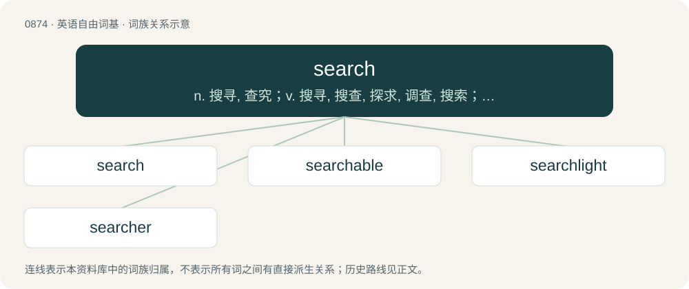

# 0946 · search — n. 搜寻, 查究；v. 搜寻, 搜查, 探求, 调查, 搜索；\[计\] 搜索, 路径检索程序

[总目录](../00_总目录_按常用程度.md)

**类型**：英语自由词基　｜　**来源语言**：见词源记录

## 核心含义与来源

- 核心含义：n. 搜寻, 查究；v. 搜寻, 搜查, 探求, 调查, 搜索；\[计\] 搜索, 路径检索程序
- 英文含义：An attempt to find something.
- 词形：search

**来源记录 1**（名词；An attempt to find something.）

Inherited from Middle English serchen, borrowed from Anglo-Norman sercher, Old French cerchier, from Late Latin circō, ,circāre (“to circle; go around; search for”), from circus. Unrelated to German suchen, which is cognate with English seek.

## 词族图

## 单词速览（常用到不常用）

| 单词 | 音标 | 释义 |
|---|---|---|
| [search](#w-1) | 英 /sɜːt͡ʃ/；美 /sɝt͡ʃ/ | n. 搜寻, 查究；v. 搜寻, 搜查, 探求, 调查, 搜索；\[计\] 搜索, 路径检索程序 |
| [searchable](#w-2) | 美 /ˈsɝt͡ʃəbəl/ | \[计\] 可检索的 |
| [searchlight](#w-3) | 英 /ˈsɜːtʃˌlaɪt/ | n. 探照灯 |
| [searcher](#w-4) | 英 /ˈsɜː(ɹ)t͡ʃə(ɹ)/；美 /ˈsɝt͡ʃɚ/ | n. 搜索者, 调查官, 检查官；\[法\] 搜查者, 检查者, 搜寻者 |

## 逐词详解

### 1. search

**词性**：名词　｜　**音标**：英 /sɜːt͡ʃ/；美 /sɝt͡ʃ/

**中文释义**：n. 搜寻, 查究；v. 搜寻, 搜查, 探求, 调查, 搜索；\[计\] 搜索, 路径检索程序

**英文义项**：An attempt to find something. / The act of searching in general.

**词源与演化**：

Inherited from Middle English serchen, borrowed from Anglo-Norman sercher, Old French cerchier, from Late Latin circō, ,circāre (“to circle; go around; search for”), from circus. Unrelated to German suchen, which is cognate with English seek.

**例句**：

> With only five minutes until we were meant to leave, the search for the keys started in earnest.

该用例对应义项：An attempt to find something.

### 2. searchable

**词性**：形容词　｜　**音标**：美 /ˈsɝt͡ʃəbəl/

**中文释义**：\[计\] 可检索的

**英文义项**：Capable of being searched, especially something that has an automated search function included. / Capable of being searched for.

**构词拆分**：search + -able

**词源与演化**：

From search + -able.

**例句**：

> The new searchable database is much more useful than the old paper records.

该用例对应义项：Capable of being searched, especially something that has an automated search function included.

### 3. searchlight

**词性**：名词　｜　**音标**：英 /ˈsɜːtʃˌlaɪt/

**中文释义**：n. 探照灯

**英文义项**：A light source that projects a bright beam of light in any direction, generally for military use. / The light from the above source.

**构词拆分**：search + light

**词源与演化**：

From search + light. Compare West Frisian sykljocht (“searchlight”), Dutch zoeklicht (“searchlight”), Danish søgelys (“searchlight”), Swedish sökarljus (“searchlight”).

**例句**：

> Jonas saw a boat with a searchlight on it.

### 4. searcher

**词性**：名词　｜　**音标**：英 /ˈsɜː(ɹ)t͡ʃə(ɹ)/；美 /ˈsɝt͡ʃɚ/

**中文释义**：n. 搜索者, 调查官, 检查官；\[法\] 搜查者, 检查者, 搜寻者

**英文义项**：One who searches. / A customs officer responsible for searching ships, merchandise, luggage, etc.

**构词拆分**：search + -er

**词源与演化**：

From Middle English serchour, sercher, from Old French cercheor; equivalent to search + -er.

**例句**：

> Sami is a professional people searcher.
