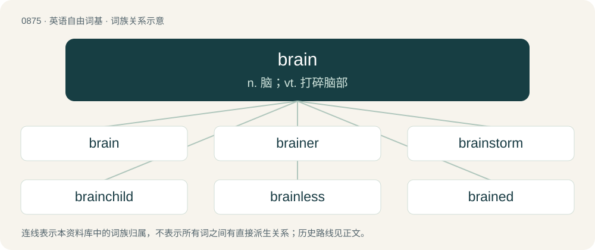

# 0947 · brain — n. 脑；vt. 打碎脑部

[总目录](../00_总目录_按常用程度.md)

**类型**：英语自由词基　｜　**来源语言**：见词源记录

## 核心含义与来源

- 核心含义：n. 脑；vt. 打碎脑部
- 英文含义：The control center of the central nervous system of an animal located in the skull, consisting of the cerebrum, cerebellum, and brainstem, which is responsible for perception, cognition, attention, memory, emotion, and action.
- 词形：brain

**来源记录 1**（名词；The control center of the central nervous system of an animal located in the skull, consisting of the cerebrum, cerebellum, and brainstem, which is responsible for perception, cognition, attention, memory, emotion, and action.）

Inherited from Middle English brayn, from Old English bræġn, from Proto-West Germanic \*bragn, from Proto-Germanic \*bragną, from Proto-Indo-European \*mrógʰ-n̥ ~ \*mrégʰ-n̥-s, from \*mregʰ- + \*-n̥. Cognate with Scots braine, brane (“brain”), North Frisian brayen, brein, Brain (“brain”), Saterland Frisian Brainge, Bräienge (“brain”), West Frisian brein (“brain”), Dutch brein (“brain”), Low German Brägen, Bregen (“brain”) (whence German Bregen (“animal brain”)), Ancient Greek βρεχμός (brekhmós, “front part of the skull, top of the head”).

## 词族图

## 单词速览（常用到不常用）

| 单词 | 音标 | 释义 |
|---|---|---|
| [brain](#w-1) | 英 /ˈbɹeɪ̯n/ | n. 脑；vt. 打碎脑部 |
| [brainer](#w-2) | /bɹeɪ.nə(ɹ)/ | 费脑筋的事情 |
| [brainstorm](#w-3) | 英 /ˈbɹeɪnstɔːm/；美 /ˈbɹeɪnstɔɹm/ | n. 灵机一动；v. 集体讨论 |
| [brainchild](#w-4) | 英 /ˈbɹeɪnt͡ʃaɪld/；美 /ˈbɹeɪnˌt͡ʃaɪld/ | n. 脑力劳动的产物 |
| [brainless](#w-5) | /ˈbreinlis/ | a. 无头脑的, 愚笨的 |
| [brained](#w-6) | /bɹeɪnd/ | a. 有头脑的, 有思想的 |
| [brainwash](#w-7) | /ˈbɹeɪnwɒʃ/ | n. 洗脑；vt. 对人洗脑 |
| [brainy](#w-8) | /ˈbɹeɪni/ | a. 脑筋好的, 聪明的 |
| [brainpower](#w-9) | 英 /ˈbɹeɪnˌpaʊə/；美 /ˈbɹeɪnˌpaʊ.ɚ/ | n. 智能, 智囊 |
| [brainwave](#w-10) | /ˈbreinweiv/ | n. 脑(电)波, 灵感 |
| [midbrain](#w-11) | /ˈmidbrein/ | n. 中脑；\[医\] 中脑 |
| [forebrain](#w-12) | /ˈfɒːbrein/ | n. 前脑；\[医\] 前脑 |

## 逐词详解

### 1. brain

**词性**：名词　｜　**音标**：英 /ˈbɹeɪ̯n/

**中文释义**：n. 脑；vt. 打碎脑部

**英文义项**：The control center of the central nervous system of an animal located in the skull, consisting of the cerebrum, cerebellum, and brainstem, which is responsible for perception, cognition, attention, memory, emotion, and action. / A part of the brain, especially associated with particular mental functions, abilities, etc.

**词源与演化**：

Inherited from Middle English brayn, from Old English bræġn, from Proto-West Germanic \*bragn, from Proto-Germanic \*bragną, from Proto-Indo-European \*mrógʰ-n̥ ~ \*mrégʰ-n̥-s, from \*mregʰ- + \*-n̥. Cognate with Scots braine, brane (“brain”), North Frisian brayen, brein, Brain (“brain”), Saterland Frisian Brainge, Bräienge (“brain”), West Frisian brein (“brain”), Dutch brein (“brain”), Low German Brägen, Bregen (“brain”) (whence German Bregen (“animal brain”)), Ancient Greek βρεχμός (brekhmós, “front part of the skull, top of the head”).

**例句**：

> The computer's brain is capable of millions of calculations a second.

该用例对应义项：By analogy with a human brain, the part of a machine or computer that performs calculations.

### 2. brainer

**词性**：名词　｜　**音标**：/bɹeɪ.nə(ɹ)/

**中文释义**：费脑筋的事情

**英文义项**：someone with a certain type of brain

**构词拆分**：brain + -er

**词源与演化**：

From brain + -er.

### 3. brainstorm

**词性**：动词　｜　**音标**：英 /ˈbɹeɪnstɔːm/；美 /ˈbɹeɪnstɔɹm/

**中文释义**：n. 灵机一动；v. 集体讨论

**英文义项**：To investigate something, or solve a problem using brainstorming. / To participate in a brainstorming session.

**构词拆分**：brain + storm

**词源与演化**：

From brain + storm. In the sense of "problem-solve", devised as a method of group creative problem-solving by advertising executive Alex F. Osborn and his employees, who coined the term based on the image of using "the brain to storm a problem". First use appears c. 1945. In the sense of "seizure, convulsion, brain activity", from the unrelated idea that it resembles a storm in the brain. First use appears c. 1861.

**例句**：

> I need you to brainstorm some suggestions for next week's activity schedule.

该用例对应义项：To think up (ideas); especially, to do so creatively.

### 4. brainchild

**词性**：名词　｜　**音标**：英 /ˈbɹeɪnt͡ʃaɪld/；美 /ˈbɹeɪnˌt͡ʃaɪld/

**中文释义**：n. 脑力劳动的产物

**英文义项**：A creation of one's brain; an original idea or innovation of a person or group of people, an organization, etc.

**构词拆分**：brain + child

**词源与演化**：

From brain + child.

**例句**：

> The entire project was the brainchild of a small group of visionaries.

该用例对应义项：A creation of one's brain; an original idea or innovation of a person or group of people, an organization, etc.

### 5. brainless

**词性**：形容词　｜　**音标**：/ˈbreinlis/

**中文释义**：a. 无头脑的, 愚笨的

**英文义项**：Having no brain. / Unintelligent, with little common sense.

**构词拆分**：brain + -less

**词源与演化**：

From Middle English braynles; equivalent to brain + -less.

**例句**：

> The modern theory of evolution, in all of its variants, appeals exclusively to brainless, blind processes.

### 6. brained

**词性**：形容词　｜　**音标**：/bɹeɪnd/

**中文释义**：a. 有头脑的, 有思想的

**英文义项**：Having a particular kind or number of brain.

**构词拆分**：brain + -ed

**词源与演化**：

From brain + -ed.

### 7. brainwash

**词性**：动词　｜　**音标**：/ˈbɹeɪnwɒʃ/

**中文释义**：n. 洗脑；vt. 对人洗脑

**英文义项**：To affect one's mind by using extreme mental pressure or any other mind-affecting process. (e.g. hypnosis) / To take from an electronically controlled machine its stored-up information; to erase a computer's programming. (1960)

**构词拆分**：brain + wash

**词源与演化**：

From brain + wash, a calque of Chinese 洗腦 /洗脑 (xǐnǎo), literally to wash the brain. Usage via U.S. military during the Korean War.

**例句**：

> The news media brainwashed many people.

该用例对应义项：To persuade completely and forcibly.

### 8. brainy

**词性**：形容词　｜　**音标**：/ˈbɹeɪni/

**中文释义**：a. 脑筋好的, 聪明的

**英文义项**：Very intellectually capable. / Of or relating to the brain.

**构词拆分**：brain + -y

**词源与演化**：

From Middle English brayny; equivalent to brain + -y.

**例句**：

> She's brainy as well as pretty.

该用例对应义项：Very intellectually capable.

### 9. brainpower

**词性**：名词　｜　**音标**：英 /ˈbɹeɪnˌpaʊə/；美 /ˈbɹeɪnˌpaʊ.ɚ/

**中文释义**：n. 智能, 智囊

**英文义项**：Mental ability; intelligence. / Intelligent people considered or regarded as a group.

**构词拆分**：brain + power

**词源与演化**：

From brain + power.

**例句**：

> I suspect the think tank lacks the brainpower to function effectively.

该用例对应义项：Intelligent people considered or regarded as a group.

### 10. brainwave

**词性**：名词　｜　**音标**：/ˈbreinweiv/

**中文释义**：n. 脑(电)波, 灵感

**英文义项**：Any of many rhythmic fluctuations of electric potential between parts of the brain, especially those seen on an electroencephalogram. / A sudden idea, understanding, or inspiration; a brainstorm.

**构词拆分**：brain + wave

**词源与演化**：

From brain + wave.

### 11. midbrain

**词性**：名词　｜　**音标**：/ˈmidbrein/

**中文释义**：n. 中脑；\[医\] 中脑

**英文义项**：A part of the brain located rostral to the pons and caudal to the thalamus and the basal ganglia, composed of the tectum (dorsal portion) and the tegmentum (ventral portion).

**构词拆分**：mid- + brain

**词源与演化**：

From mid- + brain.

### 12. forebrain

**词性**：名词　｜　**音标**：/ˈfɒːbrein/

**中文释义**：n. 前脑；\[医\] 前脑

**英文义项**：The anterior part of the brain, including the cerebrum, thalamus, and hypothalamus.

**构词拆分**：fore- + brain

**词源与演化**：

From fore- + brain.
