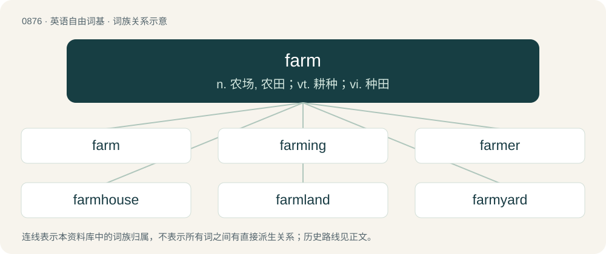

# 0948 · farm — n. 农场, 农田；vt. 耕种；vi. 种田

[总目录](../00_总目录_按常用程度.md)

**类型**：英语自由词基　｜　**来源语言**：见词源记录

## 核心含义与来源

- 核心含义：n. 农场, 农田；vt. 耕种；vi. 种田
- 英文含义：A place where agricultural and similar activities take place, especially the growing of crops or the raising of livestock.
- 词形：farm

**多个词源／构词路径**：同一拼写可能有不同来源；以下按词性和含义分别列出。

**来源记录 1**（名词；A place where agricultural and similar activities take place, especially the growing of crops or the raising of livestock.）

Inherited from Middle English ferme, farme (“rent, revenue, produce, factor, stewardship, meal, feast”), influenced by Anglo-Norman ferme (“rent, lease, farm”), from Medieval Latin ferma, firma. There is debate as to whether Medieval Latin acquired this term from Old English feorm (“rent, provision, supplies, feast”), from Proto-Germanic \*fermō, \*firhuma- (“means of living, subsistence”), from Proto-Germanic \*ferhwō (“life force, body, being”), from Proto-Indo-European \*perkʷ- (“life, force, strength, tree”); or from Latin firmus (“solid, secure”), from Proto-Italic \*fermos, from Proto-Indo-European \*dʰer-mo-s (“holding”), from the root \*dʰer- (“to hold”). If the former etymology is correct, the term is related to Old English feorh (“life, spirit”), Icelandic fjör (“life, vitality, vigour, animation”), Gothic 𐍆𐌰𐌹𐍂𐍈𐌿𐍃 (fairƕus, “the world”). Compare also Old English feormehām (“farm”), feormere (“purveyor, supplier, grocer”). Cognate with Scots ferm (“rent, farm”).

**来源记录 2**（动词；To work on a farm, especially in the growing and harvesting of crops.）

From Middle English fermen, from Anglo-Norman fermer (“to let out for a fixed payment, lease, rent”) ultimately from the same Old English source as Etymology 1. Compare Old English feormian (“to feed, supply with food, sustain”).

**来源记录 3**（动词；To cleanse; clean out; put in order; empty; empty out）

From Middle English fermen, from Old English feormian (“to clean, cleanse”), from Proto-West Germanic \*furbēn (“to clean, polish, buff”). Doublet of furbish.

## 词族图

## 单词速览（常用到不常用）

| 单词 | 音标 | 释义 |
|---|---|---|
| [farm](#w-1) | 英 /ˈfɑːm/；美 /ˈfɑɹm/ | n. 农场, 农田；vt. 耕种；vi. 种田 |
| [farming](#w-2) | 英 /ˈfɑːmɪŋ/；美 /ˈfɑɹmɪŋ/ | n. 农业, 耕作 |
| [farmer](#w-3) | 英 /ˈfɑː.mə/；美 /ˈfɑɹ.mɚ/ | n. 农夫, 农场主；\[法\] 农民, 农场主, 承包者 |
| [farmhouse](#w-4) | 英 /ˈfɑːmhaus/ | n. 农舍 |
| [farmland](#w-5) | 英 /ˈfɑːmlænd/；美 /ˈfɑːɹmlænd/ | n. 农田 |
| [farmyard](#w-6) | 美 /ˈfɑɹmˌjɑɹd/ | n. 农家庭院 |
| [farmstead](#w-7) | /ˈfɑːmsted/ | n. 农场及其建筑物 |
| [nonfarm](#w-8) | /ˈnɔnfɑːm/ | a. 非农场的,与农场无关的,非农业品的 |
| [farmhand](#w-9) | 英 /ˈfɑːmˌhænd/；美 /ˈfɑɹmˌhænd/ | n. 农场工人 |

## 逐词详解

### 1. farm

**词性**：名词　｜　**音标**：英 /ˈfɑːm/；美 /ˈfɑɹm/

**中文释义**：n. 农场, 农田；vt. 耕种；vi. 种田

**英文义项**：A place where agricultural and similar activities take place, especially the growing of crops or the raising of livestock. / A tract of land held on lease for the purpose of cultivation.

**词源与演化**：

Inherited from Middle English ferme, farme (“rent, revenue, produce, factor, stewardship, meal, feast”), influenced by Anglo-Norman ferme (“rent, lease, farm”), from Medieval Latin ferma, firma. There is debate as to whether Medieval Latin acquired this term from Old English feorm (“rent, provision, supplies, feast”), from Proto-Germanic \*fermō, \*firhuma- (“means of living, subsistence”), from Proto-Germanic \*ferhwō (“life force, body, being”), from Proto-Indo-European \*perkʷ- (“life, force, strength, tree”); or from Latin firmus (“solid, secure”), from Proto-Italic \*fermos, from Proto-Indo-European \*dʰer-mo-s (“holding”), from the root \*dʰer- (“to hold”). If the former etymology is correct, the term is related to Old English feorh (“life, spirit”), Icelandic fjör (“life, vitality, vigour, animation”), Gothic 𐍆𐌰𐌹𐍂𐍈𐌿𐍃 (fairƕus, “the world”). Compare also Old English feormehām (“farm”), feormere (“purveyor, supplier, grocer”). Cognate with Scots ferm (“rent, farm”).

**用法示例／搭配（非完整句）**：

> a render farm

该用例对应义项：A group of coordinated servers.

### 2. farming

**词性**：名词　｜　**音标**：英 /ˈfɑːmɪŋ/；美 /ˈfɑɹmɪŋ/

**中文释义**：n. 农业, 耕作

**英文义项**：The business of cultivating land, raising stock, etc. / A farming operation; a farm, or instance of farming on a piece of land.

**构词拆分**：From farm + -ing.

**词源与演化**：

From farm + -ing.

**例句**：

> Iran's agricultural sector has contributed to the preservation of traditional farming practices.

### 3. farmer

**词性**：名词　｜　**音标**：英 /ˈfɑː.mə/；美 /ˈfɑɹ.mɚ/

**中文释义**：n. 农夫, 农场主；\[法\] 农民, 农场主, 承包者

**英文义项**：A person who works the land and/or who keeps livestock; anyone engaged in agriculture on a farm. / More specifically, a farm owner, as distinguished from a farmworker or farmhand as a hired employee thereof.

**构词拆分**：farm + -er

**词源与演化**：

From Middle English fermour (“a steward, bailliff, collector of taxes”), from Old French fermier (“a farmer, a lessee, husbandman, bailliff”), from Medieval Latin firmarius (“one to whom land is rented, a collector of taxes, deputy”), from firma; equivalent to farm + -er. Compare Old English feormere (“a purveyor of a guild, a supplier of food, a grocer, farmer”). More at farm.

**例句**：

> A farmer between two lawyers is like a fish between two cats.

### 4. farmhouse

**词性**：名词　｜　**音标**：英 /ˈfɑːmhaus/

**中文释义**：n. 农舍

**英文义项**：A farmer's residence. / A house that was once a farmer's residence albeit today lived in by residents whose occupation is not farming.

**构词拆分**：farm + house

**词源与演化**：

From farm + house.

**例句**：

> They walked with him to an old wooden building near the farmhouse.

### 5. farmland

**词性**：名词　｜　**音标**：英 /ˈfɑːmlænd/；美 /ˈfɑːɹmlænd/

**中文释义**：n. 农田

**英文义项**：Land that is suitable for farming and agricultural production.

**构词拆分**：farm + land

**词源与演化**：

From farm + land.

**例句**：

> Algeria could have the most farmland than any country in North Africa.

### 6. farmyard

**词性**：名词　｜　**音标**：美 /ˈfɑɹmˌjɑɹd/

**中文释义**：n. 农家庭院

**英文义项**：The area of a farm, excluding the fields, usually surrounded by or adjacent to farm buildings.

**构词拆分**：farm + yard

**词源与演化**：

From farm + yard.

**例句**：

> Tony and his mother arrived at the farmhouse and walked through the farmyard.

### 7. farmstead

**词性**：名词　｜　**音标**：/ˈfɑːmsted/

**中文释义**：n. 农场及其建筑物

**英文义项**：The main building of a farm. / A farm, including its buildings.

**构词拆分**：farm + stead

**词源与演化**：

From farm + stead, modelled after homestead.

### 8. nonfarm

**词性**：形容词　｜　**音标**：/ˈnɔnfɑːm/

**中文释义**：a. 非农场的,与农场无关的,非农业品的

**英文义项**：Concerned with the economic activities of all businesses except agricultural ones.

**构词拆分**：From non- + farm.

**词源与演化**：

From non- + farm.

### 9. farmhand

**词性**：名词　｜　**音标**：英 /ˈfɑːmˌhænd/；美 /ˈfɑɹmˌhænd/

**中文释义**：n. 农场工人

**英文义项**：Synonym of farmworker. / A player in the minor leagues.

**构词拆分**：farm + hand

**词源与演化**：

From farm + hand.

**例句**：

> Matthew hired a new farmhand to help him care for his growing flock of sheep.
