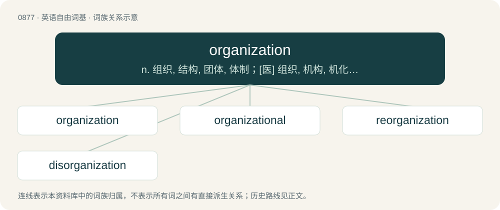

# 0949 · organization — n. 组织, 结构, 团体, 体制；\[医\] 组织, 机构, 机化(血栓或坏死组织)

[总目录](../00_总目录_按常用程度.md)

**类型**：英语自由词基　｜　**来源语言**：见词源记录

## 核心含义与来源

- 核心含义：n. 组织, 结构, 团体, 体制；\[医\] 组织, 机构, 机化(血栓或坏死组织)
- 英文含义：The quality of being organized.
- 词形：organization

**来源记录 1**（名词；The quality of being organized.）

Borrowed from Middle French organisation, from Medieval Latin organizātiō; by surface analysis, organize + -ation.

## 词族图

## 单词速览（常用到不常用）

| 单词 | 音标 | 释义 |
|---|---|---|
| [organization](#w-1) | 英 /ˌɔː.ɡə.naɪˈzeɪ.ʃən/；美 /ˌoɹ.ɡə.nɪˈzeɪ.ʃən/ | n. 组织, 结构, 团体, 体制；\[医\] 组织, 机构, 机化(血栓或坏死组织) |
| [organizational](#w-2) | /ˌɔː(ɹ)ɡənɪˈzeɪʃənəl/ | a. 组织的；\[法\] 组织的, 编制的, 机构的 |
| [reorganization](#w-3) | /ˈriː,ɔː^ənaiˈzeiʃən/ | n. 改组, 再编制, 改造；\[医\] 再机化, 组织再生 |
| [disorganization](#w-4) | 英 /dɪsˌɔː(ɹ).ɡənˌaɪˈzeɪ.ʃən/ | n. 组织的破坏, 解体, 瓦解；\[医\] 结构破坏 |

## 逐词详解

### 1. organization

**词性**：名词　｜　**音标**：英 /ˌɔː.ɡə.naɪˈzeɪ.ʃən/；美 /ˌoɹ.ɡə.nɪˈzeɪ.ʃən/

**中文释义**：n. 组织, 结构, 团体, 体制；\[医\] 组织, 机构, 机化(血栓或坏死组织)

**英文义项**：The quality of being organized. / The way in which something is organized, such as a book or an article.

**词源与演化**：

Borrowed from Middle French organisation, from Medieval Latin organizātiō; by surface analysis, organize + -ation.

**例句**：

> This painting shows little organization at first glance, but little by little the structure becomes clear.

该用例对应义项：The quality of being organized.

### 2. organizational

**词性**：形容词　｜　**音标**：/ˌɔː(ɹ)ɡənɪˈzeɪʃənəl/

**中文释义**：a. 组织的；\[法\] 组织的, 编制的, 机构的

**英文义项**：Of, relating to, or produced by an organization. / Relating to the action of organizing something.

**构词拆分**：From organization + -al.

**词源与演化**：

From organization + -al.

**例句**：

> They changed the company's organizational structure.

该用例对应义项：Of, relating to, or produced by an organization.

### 3. reorganization

**词性**：名词　｜　**音标**：/ˈriː,ɔː^ənaiˈzeiʃən/

**中文释义**：n. 改组, 再编制, 改造；\[医\] 再机化, 组织再生

**英文义项**：The act or process of rearranging. See reorganize. / The end result of such an act.

**构词拆分**：re- + organization

**词源与演化**：

From re- + organization.

**例句**：

> The government carried out a reorganization of scientific research activities in the 1990s.

### 4. disorganization

**词性**：名词　｜　**音标**：英 /dɪsˌɔː(ɹ).ɡənˌaɪˈzeɪ.ʃən/

**中文释义**：n. 组织的破坏, 解体, 瓦解；\[医\] 结构破坏

**英文义项**：The act of disorganizing; destruction of system. / The state of being disorganized

**构词拆分**：dis- + organization

**词源与演化**：

From French désorganiser. Equivalent to dis- + organization.

**用法示例／搭配（非完整句）**：

> the disorganization of the body, or of government

该用例对应义项：The state of being disorganized
