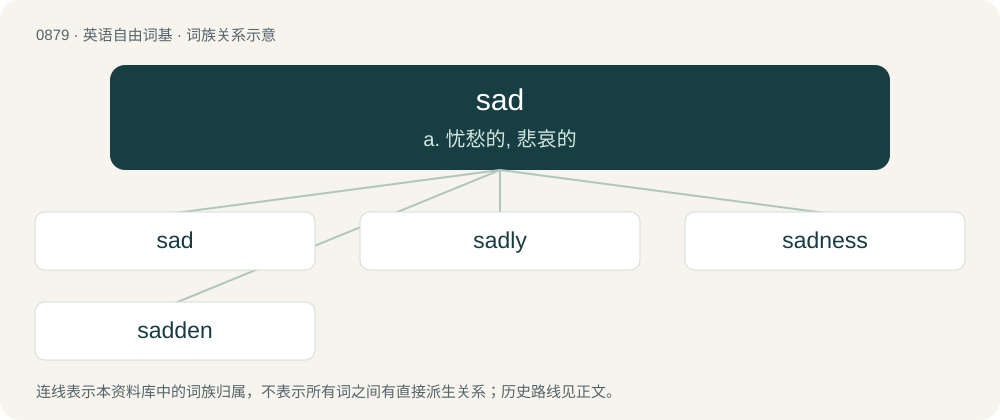

# 0951 · sad — a. 忧愁的, 悲哀的

[总目录](../00_总目录_按常用程度.md)

**类型**：英语自由词基　｜　**来源语言**：见词源记录

## 核心含义与来源

- 核心含义：a. 忧愁的, 悲哀的
- 英文含义：Feeling sorrow; sorrowful, mournful.
- 词形：sad

**来源记录 1**（形容词；Feeling sorrow; sorrowful, mournful.）

From Middle English sad, from Old English sæd (“satisfied, full, sated, unable to handle more, weary”), from Proto-West Germanic \*sad, from Proto-Germanic \*sadaz (“sated, satisfied”), from Proto-Indo-European \*seh₂- (“to satiate, satisfy”). Cognate to Saterland Frisian sääd, West Frisian sêd, Dutch zat, German Low German satt, German satt. The interjection sense is a reference to frequent usage of the word as an interjection in the tweets of Q22686, President of the United States (2017–2021; since 2025)); a Trumpism.

## 词族图

## 单词速览（常用到不常用）

| 单词 | 音标 | 释义 |
|---|---|---|
| [sad](#w-1) | /ˈsæd/ | a. 忧愁的, 悲哀的 |
| [sadly](#w-2) | /ˈsædli/ | adv. 悲痛地, 悲惨地, 悲伤地, 说来遗憾 |
| [sadness](#w-3) | /ˈsædnəs/ | n. 悲哀, 悲伤 |
| [sadden](#w-4) | /ˈsædən/ | vt. 使忧愁, 使悲哀；vi. 忧愁, 悲哀 |

## 逐词详解

### 1. sad

**词性**：形容词　｜　**音标**：/ˈsæd/

**中文释义**：a. 忧愁的, 悲哀的

**英文义项**：Feeling sorrow; sorrowful, mournful. / Appearing sorrowful.

**词源与演化**：

From Middle English sad, from Old English sæd (“satisfied, full, sated, unable to handle more, weary”), from Proto-West Germanic \*sad, from Proto-Germanic \*sadaz (“sated, satisfied”), from Proto-Indo-European \*seh₂- (“to satiate, satisfy”). Cognate to Saterland Frisian sääd, West Frisian sêd, Dutch zat, German Low German satt, German satt. The interjection sense is a reference to frequent usage of the word as an interjection in the tweets of Q22686, President of the United States (2017–2021; since 2025)); a Trumpism.

**例句**：

> You’d have to be really sad to wear a shirt like that.

该用例对应义项：Unfashionable; socially inadequate or undesirable.

### 2. sadly

**词性**：副词　｜　**音标**：/ˈsædli/

**中文释义**：adv. 悲痛地, 悲惨地, 悲伤地, 说来遗憾

**英文义项**：In a sad manner; sorrowfully. / Unfortunately, sad to say.

**构词拆分**：sad + -ly

**词源与演化**：

From Middle English sadly; equivalent to sad + -ly.

**例句**：

> If you think you’re getting out of this place alive, you are sadly mistaken, my friend.

该用例对应义项：Unfortunately, sad to say.

### 3. sadness

**词性**：名词　｜　**音标**：/ˈsædnəs/

**中文释义**：n. 悲哀, 悲伤

**英文义项**：The state or emotion of being sad. / An event in one's life that causes sadness.

**构词拆分**：sad + -ness

**词源与演化**：

From Middle English sadnesse, equivalent to sad + -ness.

**例句**：

> She has experienced many sadnesses in her forty years.

该用例对应义项：An event in one's life that causes sadness.

### 4. sadden

**词性**：动词　｜　**音标**：/ˈsædən/

**中文释义**：vt. 使忧愁, 使悲哀；vi. 忧愁, 悲哀

**英文义项**：To make sad or unhappy. / To become sad or unhappy.

**构词拆分**：sad + -en

**词源与演化**：

From Middle English saddenen, equivalent to sad + -en.

**例句**：

> It saddens me to think that I might have hurt someone.

该用例对应义项：To make sad or unhappy.
