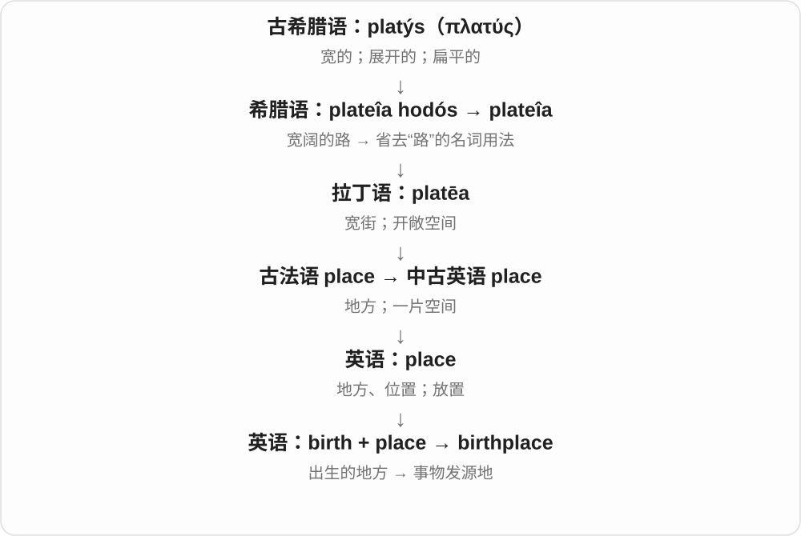

# 0952 · birth — 出生、复兴、日期与诞生石习俗

[逐词精讲目录](../00_逐词精讲目录.md) · [总目录](../00_总目录_按常用程度.md)

## 核心词根与来源

birth 与 bear 生育、承载同族，现代词形受北欧相关形式影响，不能把词尾随意说成今天可造任何名词的 -th。

**BIRTH：生命开始，也能借来形容新事物开始**

从已有 birth、childbirth 接过程 birthing，再把 birthdate、birthday 放在一起；rebirth 复兴，birthstone 属文化习俗。

- **基本出生与过程**：birth · childbirth · birthing · stillbirth
- **日期、地点与身份**：birthdate · birthday · birthplace · birthright
- **身体、统计与习俗**：birthmark · birthrate · birthstone
- **再次开始**：rebirth
- **birth 出生 → births**：births

## 词形与演化规律

birth → birthing、rebirth；birth + date/day/place/right/mark/rate/stone；child、still + birth。

birth 属于 bear 生育的日耳曼词族，现代复数 -s，结尾 /θs/；数出生事件，不能直接当作人数名词。

## 单词速览（按词族由简到繁）

同一基础词的相关扩展放在一起，先读基础形式，再读扩展；各组之间优先读常用的。具体词源关系见各词讲解。

| 单词 | 音标 | 核心意思 |
|---|---|---|
| [birth](#w-1) | 英 /bɜːθ/；美 /bɜːrθ/ | 出生；诞生；出身 |
| [birthday](#w-2) | 英 /ˈbɜːθdeɪ/；美 /ˈbɜːrθdeɪ/ | 生日 |
| [births](#w-14) | 英 /bɜːθs/；美 /bɜːrθs/ | 出生；诞生事件〔复数〕 |
| [birthplace](#w-5) | 英 /ˈbɜːθpleɪs/；美 /ˈbɜːrθpleɪs/ | 出生地；发源地 |
| [birthright](#w-6) | 英 /ˈbɜːθraɪt/；美 /ˈbɜːrθraɪt/ | 与生俱来的权利；长子继承权〔特定历史语境〕 |
| [birthing](#w-7) | 英 /ˈbɜːθɪŋ/；美 /ˈbɜːrθɪŋ/ | 生育、分娩；与分娩有关的 |
| [birthmark](#w-8) | 英 /ˈbɜːθmɑːk/；美 /ˈbɜːrθmɑːrk/ | 胎记 |
| [birthdate](#w-9) | 英 /ˈbɜːθdeɪt/；美 /ˈbɜːrθdeɪt/ | 出生日期 |
| [birthstone](#w-12) | 英 /ˈbɜːθstəʊn/；美 /ˈbɜːrθstoʊn/ | 诞生石；生日石 |
| [birthrate](#w-13) | 英 /ˈbɜːθreɪt/；美 /ˈbɜːrθreɪt/ | 出生率 |
| [childbirth](#w-3) | 英 /ˈtʃaɪldbɜːθ/；美 /ˈtʃaɪldbɜːrθ/ | 分娩；生孩子 |
| [rebirth](#w-4) | 英 /ˌriːˈbɜːθ/；美 /ˌriːˈbɜːrθ/ | 重生；复兴；宗教转生 |
| [stillbirth](#w-10) | 英 /ˈstɪlbɜːθ/；美 /ˈstɪlbɜːrθ/ | 死产 |

## 逐词讲解

### 1. birth — 出生；诞生；出身

**音标**：英 /bɜːθ/；美 /bɜːrθ/

**先抓住这个画面**

生命来到世上的那个过程；想法、组织的开始，也借用诞生来表达。

**怎么拆**

现代形式经中古英语 birthe，受到古诺斯语出生名词的影响，对应更早古英语 ġebyrd。远源属于 bear 承载、生育词族；不是现代把 bear 随意改成 bir 再加 th。

**怎么变成今天的意思**

**古诺斯语 burðr 等形式；相应古英语 ġebyrd**  
出生；二者都有更早的承载、生育词族背景

↓

**中古英语 birthe → 英语 birth**  
出生、诞生；与 bear 承载、生育有历史亲缘

give birth 生育；the birth of an idea 一个想法的诞生；from birth 自出生起。by birth 可说出身、出生所属背景。

**常见搭配与例句**

give birth to；at birth；from birth；the birth of a movement。

> The photograph was taken soon after the baby’s birth.

这张照片拍摄于宝宝出生后不久。

> The small meeting marked the birth of a new organization.

那次小型会议标志着一个新组织的诞生。

**别混淆**

birth 是出生这件事，born 常放在 be born 中描述某人出生；birthday 才是生日这个日期或周年。

### 2. birthday — 生日

**音标**：英 /ˈbɜːθdeɪ/；美 /ˈbɜːrθdeɪ/

**先抓住这个画面**

出生那天，在日历上每年回来一次。

**怎么拆**

birth 出生 + day 日，组合表示出生之日及其周年纪念日；英语早期已有相应组合。

**怎么变成今天的意思**

**英语 birth；day**  
出生；日

↓

**birthday**  
出生之日；每年纪念出生的日子

通常说生日，就是每年同一个月日到来的纪念日；date of birth 则在表格里要求你出生的年、月、日。a birthday party 是围绕这个日子举办的聚会。

**常见搭配与例句**

on your birthday；a birthday present；a birthday cake。

> Her birthday falls on a Sunday this year.

她今年的生日正好是星期日。

> I made a cake for my brother’s birthday.

我为弟弟的生日做了一个蛋糕。

**别混淆**

birthday 常问每年哪天过生日；date of birth 要完整出生日期。Happy birthday 是祝福，不是要求字面证明当天很快乐。

### 3. births — 出生；诞生事件〔复数〕

**音标**：英 /bɜːθs/；美 /bɜːrθs/

**先抓住这个画面**

一个新生命来到世上，是一次 birth；把这些出生事件一件件记录，就是 births。也可比喻新事物的诞生，但说出生统计时尤其常见。

**怎么拆**

birth + -s → births，末尾 /θs/。birth 的现代形式经北欧语等日耳曼材料承接生育名词，与 bear 生育同族；历史 -th 表动作、过程。

**怎么变成今天的意思**

**日耳曼 bear 生育词族 → 出生过程名 → birth**  
北欧语相关形式影响了现代英语形式

↓

**出生事件与新事物诞生义 + -s → births**  
现代复数常用于登记、统计和家族叙述

record births 是登记出生；births and deaths 是出生与死亡事件；the number of births 是出生次数、出生人数的统计表达。

**常见搭配与例句**

record births；births and deaths；the number of births。

> The old register lists births in the village.

旧登记册列出了村里的出生记录。

> The chart compares births and deaths over ten years.

图表比较了十年间的出生与死亡数量。

**别混淆**

births 数出生事件，babies 指婴儿。The records list births 是列出出生记录；不应把 births 在任何句子里都直接换成 babies。

### 4. birthplace — 出生地；发源地

**音标**：英 /ˈbɜːθpleɪs/；美 /ˈbɜːrθpleɪs/

**先抓住这个画面**

一个人开始生命的地方，也能比喻某种运动、思想或发明最初形成的地方。

**怎么拆**

birth 出生 + place 地方，英语复合词。

**怎么变成今天的意思**

人的 birthplace 不一定是后来长大的地方。比喻某城是艺术运动的 birthplace，强调它在起源中的地位。

**常见搭配与例句**

someone’s birthplace；the birthplace of an idea。

> She returned to her birthplace for the first time in thirty years.

三十年来，她第一次回到了出生地。

> The city is often described as the birthplace of the movement.

这座城市常被称为那场运动的发源地。

**别混淆**

birthplace 是出生地；hometown 通常是成长或视为家乡的城镇，二者可能不同。

### 5. birthright — 与生俱来的权利；长子继承权〔特定历史语境〕

**音标**：英 /ˈbɜːθraɪt/；美 /ˈbɜːrθraɪt/

**先抓住这个画面**

不是后来赢来的资格，而是因出生身份就被认为拥有。

**怎么拆**

birth（出生）+ right（权利），组合表示出生带来的权利；在某些历史叙事中可特指长子权利，不概括成各社会统一规则。

**怎么变成今天的意思**

**英语 birth；right**  
并列组合的两部分

↓

**birth + right → birthright**  
由出生身份带来的权利

a birthright 可用于伦理、政治论述，主张某种东西人人应有。历史或宗教文本里则可能说长子的一组特殊权利，需看制度背景。

**常见搭配与例句**

one’s birthright；a birthright to；claim something as a birthright。

> The speaker described education as every child’s birthright.

演讲者把教育称为每个孩子与生俱来的权利。

> The story centres on a dispute over the eldest son’s birthright.

故事围绕长子的继承权争议展开。

**别混淆**

birthright 与 citizenship 可相关，但公民身份有不同取得方式；不能由词源推出所有现实身份制度。

### 6. birthing — 生育、分娩；与分娩有关的

**音标**：英 /ˈbɜːθɪŋ/；美 /ˈbɜːrθɪŋ/

**先抓住这个画面**

把出生这件事看成正在进行的过程，常用来修饰场所、设施等。

**怎么拆**

birth 用作生育动词 + -ing，形成过程名词、修饰形式。不是 birth 名词只能加一个固定后缀变成生物学新概念。

**怎么变成今天的意思**

**古英语 gebyrd 与北欧 burðr、byrd 等同族形式 → 中古英语 birthe**  
生育、出生；与 bear 生育、承载同族

↓

**现代 birth**  
出生、诞生 → 新阶段的开始；相关日期与习俗

↓

**birth + -ing → birthing**  
生育动作、过程 → 分娩相关的

a birthing centre 分娩中心，a birthing pool 分娩池；具体机构服务由其实际安排决定。

**常见搭配与例句**

a birthing centre；a birthing room；a birthing pool。

> The hospital opened a new birthing centre.

医院新开了一处分娩中心。

> The brochure describes the facilities in the birthing rooms.

宣传册介绍了分娩室的设施。

**别混淆**

birth 出生事件，birthing 常聚焦分娩过程；childbirth 是已有的常用生育、分娩名词。

### 7. birthmark — 胎记

**音标**：英 /ˈbɜːθmɑːk/；美 /ˈbɜːrθmɑːrk/

**先抓住这个画面**

出生时或出生后不久出现的皮肤颜色、外观标记，名字抓住它与出生早期的联系。

**怎么拆**

birth 出生 + mark 标记，形成身体外观特征名；词源不说明每一种胎记的具体生物成因。

**怎么变成今天的意思**

**birth 出生；mark 标记**  
并列构词部分

↓

**birthmark**  
与出生早期相关的皮肤标记

a birthmark on the cheek 脸颊上的胎记；不同胎记的颜色、形状有差异。这里只解释词义。

**常见搭配与例句**

a birthmark on；a small birthmark；a distinctive birthmark。

> He has a small birthmark on his shoulder.

他肩上有一小块胎记。

> The portrait includes the woman’s distinctive birthmark.

画像保留了那位女性很有辨识度的胎记。

**别混淆**

birthmark 胎记，scar 疤痕常由损伤等留下；两个都可能是 mark，但来源不同。

### 8. birthdate — 出生日期

**音标**：英 /ˈbɜːθdeɪt/；美 /ˈbɜːrθdeɪt/

**先抓住这个画面**

问你是哪一年、哪一月、哪一天出生，常见于登记资料，而不是问今年什么时候办生日会。

**怎么拆**

birth + date 日期，组成记录出生日期的名词，也常写 date of birth。

**怎么变成今天的意思**

**古英语 gebyrd 与北欧 burðr、byrd 等同族形式 → 中古英语 birthe**  
生育、出生；与 bear 生育、承载同族

↓

**现代 birth**  
出生、诞生 → 新阶段的开始；相关日期与习俗

↓

**birth + date → birthdate**  
出生的日期 → 出生日期

enter your birthdate 填出生日期，verify a birthdate 核对出生日期；月日年顺序按表格要求。

**常见搭配与例句**

enter your birthdate；verify a birthdate；date of birth。

> Please enter your full birthdate on the form.

请在表格上填写完整出生日期。

> The records list different birthdates for the same person.

档案给同一个人列出了不同出生日期。

**别混淆**

birthdate 通常包括出生年份，birthday 日常常说每年纪念的月日；有些系统字段也用 birthday 存完整日期，仍看提示。

### 9. birthstone — 诞生石；生日石

**音标**：英 /ˈbɜːθstəʊn/；美 /ˈbɜːrθstoʊn/

**先抓住这个画面**

习俗或珠宝列表里，与某个出生月份相关联的宝石；不是婴儿出生时身体里的一块石头。

**怎么拆**

birth 出生 + stone 宝石，按出生月份与石头的文化联想命名。不同传统、列表可能不一致，不写一张表当全球唯一标准。

**怎么变成今天的意思**

**古英语 gebyrd 与北欧 burðr、byrd 等同族形式 → 中古英语 birthe**  
生育、出生；与 bear 生育、承载同族

↓

**现代 birth**  
出生、诞生 → 新阶段的开始；相关日期与习俗

↓

**birth + stone → birthstone**  
与出生月份关联的宝石 → 诞生石

a birthstone ring 诞生石戒指，her birthstone 她出生月份对应的宝石；名称表达习俗关系，不表示医疗作用。

**常见搭配与例句**

a birthstone ring；a birthstone necklace；a traditional birthstone。

> She received a ring set with her birthstone.

她收到了一枚镶着自己诞生石的戒指。

> The jeweller showed us several birthstone necklaces.

珠宝商给我们看了几条诞生石项链。

**别混淆**

birthstone 是习俗、饰品分类，birthmark 是胎记；两个词后部完全不同，不能只按 birth 猜身体器官。

### 10. birthrate — 出生率

**音标**：英 /ˈbɜːθreɪt/；美 /ˈbɜːrθreɪt/

**先抓住这个画面**

把出生人数放到一定人口和时间范围里比较，而不只看一共出生几个孩子。

**怎么拆**

birth 出生 + rate 比率；也常分写 birth rate。

**怎么变成今天的意思**

**birth 出生；rate 比率**  
并列构词部分

↓

**birthrate**  
一定人口、时期中的出生比例指标

a rising birthrate 上升的出生率，a declining birthrate 下降的出生率。阅读统计时还要看它使用的时间和人口口径。

**常见搭配与例句**

the national birthrate；a falling birthrate；changes in the birthrate。

> The chart compares birthrates in three regions.

图表比较了三个地区的出生率。

> The report examines the reasons for the falling birthrate.

报告探讨出生率下降的原因。

**别混淆**

birthrate 是出生率，不是总出生人数；也不应直接与 fertility rate 生育率当成处处完全相同的指标。

### 11. childbirth — 分娩；生孩子

**音标**：英 /ˈtʃaɪldbɜːθ/；美 /ˈtʃaɪldbɜːrθ/

**先抓住这个画面**

专门说把孩子生下来的过程，而不是每年庆祝的生日。

**怎么拆**

child 孩子 + birth 出生；中古英语已有相应复合词。

**怎么变成今天的意思**

**child 孩子；birth 出生**  
并列构词部分

↓

**childbirth**  
分娩这一过程

during childbirth 分娩期间，experiences of childbirth 分娩经历。通常不可数，不用 a childbirth 来说某人的生日。

**常见搭配与例句**

during childbirth；after childbirth；a book about childbirth。

> The book describes different personal experiences of childbirth.

这本书描述了不同个人的分娩经历。

> The documentary explores how families prepare for childbirth.

纪录片探讨家庭如何为孩子出生作准备。

**别混淆**

childbirth 强调分娩过程；birth 范围更广，还能说一个城市、想法的诞生；birthday 是生日。

### 12. rebirth — 重生；复兴；宗教转生

**音标**：英 /ˌriːˈbɜːθ/；美 /ˌriːˈbɜːrθ/

**先抓住这个画面**

像重新出生一样，原来衰落、停滞的东西又获得新的生命；宗教语境也可说转生。

**怎么拆**

re- 再次 + birth 出生。复兴是出生画面的比喻，宗教转生则依具体信仰背景理解。

**怎么变成今天的意思**

**古英语 gebyrd 与北欧 burðr、byrd 等同族形式 → 中古英语 birthe**  
生育、出生；与 bear 生育、承载同族

↓

**现代 birth**  
出生、诞生 → 新阶段的开始；相关日期与习俗

↓

**re- + birth → rebirth**  
再次诞生 → 重生、复兴

the rebirth of a city 城市复兴，a cultural rebirth 文化复兴，belief in rebirth 相信转生。

**常见搭配与例句**

the rebirth of；a cultural rebirth；a spiritual rebirth。

> The new theatre helped bring about a cultural rebirth in the town.

新剧院帮助小镇迎来文化复兴。

> The novel ends with a sense of hope and rebirth.

小说以希望与新生的感觉收尾。

**别混淆**

rebirth 强调像获得新生命，repair 只说修复；重修一座楼不一定要夸大成整座城市重生。

### 13. stillbirth — 死产

**音标**：英 /ˈstɪlbɜːθ/；美 /ˈstɪlbɜːrθ/

**先抓住这个画面**

把出生时孩子已没有生命这一痛苦事件作为名词来称呼。

**怎么拆**

still + birth（出生），与 stillborn 的形容词对应，但后半使用名词 birth，不是 born 随意改字母。

**怎么变成今天的意思**

**英语 still；birth**  
并列组合的材料

↓

**still + birth → stillbirth**  
出生时无生命的事件、情形

通常用于医疗、研究或个人经历叙述。这里只解释一般词义，不把不同地区的统计和医学分类界线写成统一标准。

**常见搭配与例句**

experience a stillbirth；stillbirth research；support after stillbirth。

> The organisation offers support after stillbirth.

这个组织为经历死产的人提供支持。

> The article discusses how families describe the loss following a stillbirth.

文章讨论家人如何描述死产带来的失落。

**别混淆**

stillbirth 是事件名词，stillborn 修饰婴儿等对象；miscarriage 另有相应医学用语与界定，不宜仅靠中文一个“流产”全混译。

## 这一组要分清什么

birthdate 通常含出生年份，birthday 常说每年生日；birthstone 文化习俗不等于 birthmark 胎记；rebirth 可比喻复兴。

## 串起来练习

The old theatre’s rebirth became part of the city’s story.

老剧院的复兴成为城市故事的一部分。
