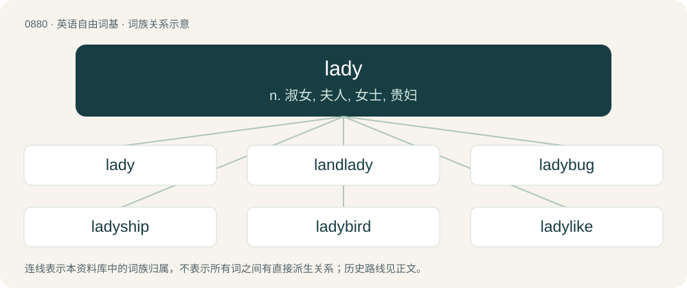

# 0953 · lady — n. 淑女, 夫人, 女士, 贵妇

[总目录](../00_总目录_按常用程度.md)

**类型**：英语自由词基　｜　**来源语言**：见词源记录

## 核心含义与来源

- 核心含义：n. 淑女, 夫人, 女士, 贵妇
- 英文含义：A woman of breeding or higher class, a woman of authority.
- 词形：lady

**来源记录 1**（名词；A woman of breeding or higher class, a woman of authority.）

From Middle English lady, laddy, lafdi, lavedi, from Old English hlǣfdīġe (“mistress of a household, wife of a lord, lady”, literally “bread-kneader”), from hlāf (“bread, loaf”) + dǣġe (“kneader”), related to Old English dǣġe (“maker of dough”) (whence dey (“dairymaid”)). Compare also lord. More at loaf, dairy, dough. Unrelated to lad.

## 词族图

## 单词速览（常用到不常用）

| 单词 | 音标 | 释义 |
|---|---|---|
| [lady](#w-1) | 英 /ˈleɪ.di/；美 /ˈleɪ.di/ | n. 淑女, 夫人, 女士, 贵妇 |
| [landlady](#w-2) | 英 /ˈlæn(d)ˌleɪ.di/ | n. 女房东, 女地主 |
| [ladybug](#w-3) | 英 /ˈleɪ.di.bʌɡ/ | n. 瓢虫 |
| [ladyship](#w-4) | 英 /ˈleɪ.di.ʃɪp/ | n. 贵妇身分, 夫人, 小姐 |
| [ladybird](#w-5) | 英 /ˈleɪ.di.bəːd/；美 /ˈleɪ.di.bɝd/ | n. 瓢虫 |
| [ladylike](#w-6) | /ˈleɪ.di.laɪ̯k/ | a. 娴淑的, 如淑女的, 高雅的 |
| [ladyboy](#w-7) | /ˈleɪdiˌbɔɪ/ | n. 具有女性性征的男子 |
| [milady](#w-8) | 英 /mɪˈleɪdi/ | n. 夫人, 时髦女人, 太太 |

## 逐词详解

### 1. lady

**词性**：名词　｜　**音标**：英 /ˈleɪ.di/；美 /ˈleɪ.di/

**中文释义**：n. 淑女, 夫人, 女士, 贵妇

**英文义项**：A woman of breeding or higher class, a woman of authority. / The feminine of lord, a lordess.

**词源与演化**：

From Middle English lady, laddy, lafdi, lavedi, from Old English hlǣfdīġe (“mistress of a household, wife of a lord, lady”, literally “bread-kneader”), from hlāf (“bread, loaf”) + dǣġe (“kneader”), related to Old English dǣġe (“maker of dough”) (whence dey (“dairymaid”)). Compare also lord. More at loaf, dairy, dough. Unrelated to lad.

**例句**：

> "I would like the dining room to be fully set by tonight; would you do so?" "Yes, my lady."

该用例对应义项：A woman of breeding or higher class, a woman of authority.

### 2. landlady

**词性**：名词　｜　**音标**：英 /ˈlæn(d)ˌleɪ.di/

**中文释义**：n. 女房东, 女地主

**英文义项**：A female landlord.

**构词拆分**：land + lady

**词源与演化**：

From land + lady.

**例句**：

> Mrs Hudson, the landlady, she’s giving me a special deal.

### 3. ladybug

**词性**：名词　｜　**音标**：英 /ˈleɪ.di.bʌɡ/

**中文释义**：n. 瓢虫

**英文义项**：Synonym of ladybird.

**构词拆分**：lady + bug

**词源与演化**：

From lady + bug, the “lady” here referring to Virgin Mary, the mother of Jesus. Compare German Marienkäfer, Danish mariehøne, Latvian mārīte, Macedonian бубамара (bubamara) and Spanish mariquita.

**例句**：

> I love how the French spell their word for ladybug.

### 4. ladyship

**词性**：名词　｜　**音标**：英 /ˈleɪ.di.ʃɪp/

**中文释义**：n. 贵妇身分, 夫人, 小姐

**英文义项**：Term of respect for a woman of the peerage without using her title. / Formal form of address for a lady judge (as opposed to the informal "judge").

**构词拆分**：lady + -ship

**词源与演化**：

From Middle English ladyschipe, ladyshipe; equivalent to lady + -ship.

**例句**：

> "Her ladyship will be unable to attend tonight," he said, with a wink because he hadn't said why.

该用例对应义项：Term of respect for a woman of the peerage without using her title.

### 5. ladybird

**词性**：名词　｜　**音标**：英 /ˈleɪ.di.bəːd/；美 /ˈleɪ.di.bɝd/

**中文释义**：n. 瓢虫

**英文义项**：Any of the Coccinellidae family of beetles, typically having a round shape and red or yellow spotted elytra.

**构词拆分**：lady + bird

**词源与演化**：

From lady + bird. Lady here refers to the Virgin Mary, the mother of Jesus. Compare German Marienkäfer (literally “Mary beetle or bug”), Danish mariehøne, Latvian mārīte, Macedonian бубамара (bubamara) and Spanish mariquita. Also compare damselfly.

**例句**：

> A bright red ladybird landed on my fingertip.

### 6. ladylike

**词性**：形容词　｜　**音标**：/ˈleɪ.di.laɪ̯k/

**中文释义**：a. 娴淑的, 如淑女的, 高雅的

**英文义项**：Of or related to the appearance or behaviour of a well-mannered woman.

**构词拆分**：lady + -like

**词源与演化**：

From lady + -like.

**例句**：

> How can I sound more ladylike?

### 7. ladyboy

**词性**：名词　｜　**音标**：/ˈleɪdiˌbɔɪ/

**中文释义**：n. 具有女性性征的男子

**英文义项**：A trans woman or transfeminine person in or from Asia, especially Thailand.

**构词拆分**：lady + boy

**词源与演化**：

From lady + boy.

**例句**：

> Gabor was dating a Thai ladyboy.

### 8. milady

**词性**：动词　｜　**音标**：英 /mɪˈleɪdi/

**中文释义**：n. 夫人, 时髦女人, 太太

**英文义项**：To address as “milady”.

**构词拆分**：my + lady

**词源与演化**：

Partly representing a colloquial pronunciation of my + lady, partly from French milady, from English my Lady. Compare milord.
