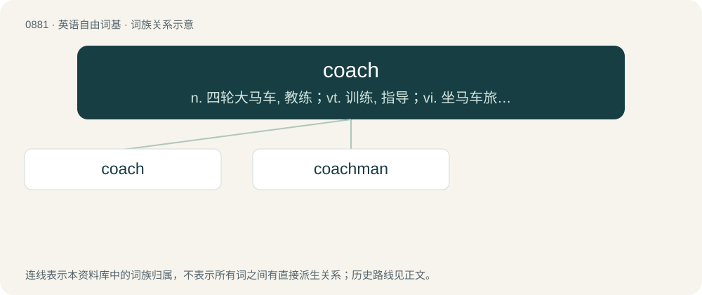

# 0954 · coach — n. 四轮大马车, 教练；vt. 训练, 指导；vi. 坐马车旅行, 作指导

[总目录](../00_总目录_按常用程度.md)

**类型**：英语自由词基　｜　**来源语言**：见词源记录

## 核心含义与来源

- 核心含义：n. 四轮大马车, 教练；vt. 训练, 指导；vi. 坐马车旅行, 作指导
- 英文含义：A wheeled vehicle, generally pulled by a horse.
- 词形：coach

**来源记录 1**（名词；A wheeled vehicle, generally pulled by a horse.）

Borrowed from Middle French coche, from German Kutsche, from Hungarian kocsi. According to historians, the coach was named after the small Hungarian town of Kocs, which made a livelihood from cart building and transport between Vienna and Budapest. The meaning “instructor/trainer” is from Oxford University slang (c. 1830) for a “tutor” who “carries” one through an exam; the athletic sense is from 1861.

## 词族图

## 单词速览（常用到不常用）

| 单词 | 音标 | 释义 |
|---|---|---|
| [coach](#w-1) | 英 /kəʊtʃ/；美 /koʊt͡ʃ/ | n. 四轮大马车, 教练；vt. 训练, 指导；vi. 坐马车旅行, 作指导 |
| [coachman](#w-2) | 英 /ˈkəʊt͡ʃmən/；美 /ˈkoʊt͡ʃmən/ | n. 马车夫 |

## 逐词详解

### 1. coach

**词性**：名词　｜　**音标**：英 /kəʊtʃ/；美 /koʊt͡ʃ/

**中文释义**：n. 四轮大马车, 教练；vt. 训练, 指导；vi. 坐马车旅行, 作指导

**英文义项**：A wheeled vehicle, generally pulled by a horse. / A passenger car, either drawn by a locomotive or part of a multiple unit.

**词源与演化**：

Borrowed from Middle French coche, from German Kutsche, from Hungarian kocsi. According to historians, the coach was named after the small Hungarian town of Kocs, which made a livelihood from cart building and transport between Vienna and Budapest. The meaning “instructor/trainer” is from Oxford University slang (c. 1830) for a “tutor” who “carries” one through an exam; the athletic sense is from 1861.

**例句**：

> We couldn't afford the good tickets, so we spent the flight crammed in coach.

该用例对应义项：The part of a commercial passenger airplane or train reserved for those paying the lower standard fares; the economy section.

### 2. coachman

**词性**：名词　｜　**音标**：英 /ˈkəʊt͡ʃmən/；美 /ˈkoʊt͡ʃmən/

**中文释义**：n. 马车夫

**英文义项**：A man who drives a horse-drawn coach: a male coach driver. / A fish in the genus Heniochus, especially Heniochus acuminatus or Heniochus diphreutes.

**构词拆分**：coach + -man

**词源与演化**：

From coach + -man.

**例句**：

> It was William, the coachman. He was shot through the heart.
