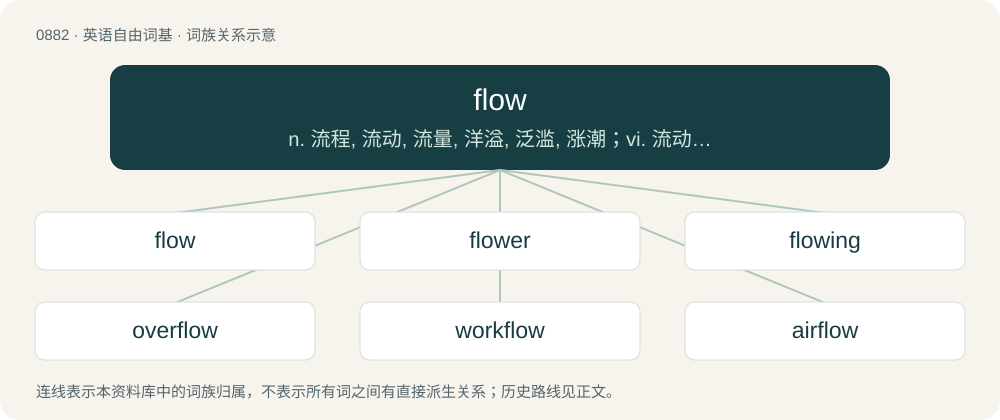

# 0955 · flow — n. 流程, 流动, 流量, 洋溢, 泛滥, 涨潮；vi. 流动, 流泄, 畅流, 川流不息, 飘扬, 涌出；vt. 使流动, 淹没, 流出

[总目录](../00_总目录_按常用程度.md)

**类型**：英语自由词基　｜　**来源语言**：见词源记录

## 核心含义与来源

- 核心含义：n. 流程, 流动, 流量, 洋溢, 泛滥, 涨潮；vi. 流动, 流泄, 畅流, 川流不息, 飘扬, 涌出；vt. 使流动, 淹没, 流出
- 英文含义：Movement in people or things characterized with a continuous motion, involving either a non solid mass or a multitude.
- 词形：flow

**多个词源／构词路径**：同一拼写可能有不同来源；以下按词性和含义分别列出。

**来源记录 1**（名词；Movement in people or things characterized with a continuous motion, involving either a non solid mass or a multitude.）

From Middle English flowe, from the verb (see below). The psychology sense “state of focus” was coined by Mihaly Csikszentmihalyi in 1975.

**来源记录 2**（动词；To move as a fluid from one position to another.）

From Middle English flowen, from Old English flōwan (“to flow”), from Proto-West Germanic \*flōan, from Proto-Germanic \*flōaną (“to flow”), from Proto-Indo-European \*plōw-, lengthened o-grade form of \*plew- (“to fly, flow, run”). Cognate with Saterland Frisian flouje (“to flow”), West Frisian floeie (“to flow”), Dutch vloeien (“to flow”), Norwegian flo (“to flow”). Compare also English float. Not cognate with Latin fluō despite similarity.

**来源记录 3**（名词；A bog or mire, especially a rough, waterlogged one.）

Uncertain. Perhaps from Old Norse flói (“a large bay, firth”), see floe. Compare Scots flow (“peat-bog, marsh”), Icelandic flói (“marshy ground”).

## 词族图

## 单词速览（常用到不常用）

| 单词 | 音标 | 释义 |
|---|---|---|
| [flow](#w-1) | 英 /ˈfləʊ̯/；美 /ˈfloʊ̯/ | n. 流程, 流动, 流量, 洋溢, 泛滥, 涨潮；vi. 流动, 流泄, 畅流, 川流不息, 飘扬, 涌出；vt. 使流动, 淹没, 流出 |
| [flower](#w-2) | 英 /ˈfləʊə/；美 /ˈfloʊɚ/ | 【英文】Something that flows, such as a river. |
| [flowing](#w-3) | 英 /ˈfləʊ.ɪŋ/；美 /ˈfloʊ.ɪŋ/ | a. 流动的, 如流的, 平滑的 |
| [overflow](#w-4) | /ˌəʊvəˈfləʊ/ | n. 溢值, 超值, 泛滥；v. (使)泛滥, (使)溢出, (使)充溢；\[计\] 上溢; 溢出 |
| [workflow](#w-5) | 英 /ˈwɜːkfləʊ/；美 /ˈwɝkfloʊ/ | 工作流程 |
| [airflow](#w-6) | /ˈєəfləu/ | n. 空气的流动, 气流 |
| [outflow](#w-7) | /ˈautfləu/ | n. 流出, 流出物；\[医\] 流出, 传出, 流出物 |
| [inflow](#w-8) | /ˈinfləu/ | n. 流入, 流入物 |
| [flowy](#w-9) | 英 /ˈfləʊi/；美 /ˈfloʊi/ | \[网络\] 流动 |

## 逐词详解

### 1. flow

**词性**：名词　｜　**音标**：英 /ˈfləʊ̯/；美 /ˈfloʊ̯/

**中文释义**：n. 流程, 流动, 流量, 洋溢, 泛滥, 涨潮；vi. 流动, 流泄, 畅流, 川流不息, 飘扬, 涌出；vt. 使流动, 淹没, 流出

**英文义项**：Movement in people or things characterized with a continuous motion, involving either a non solid mass or a multitude. / The movement of a real or figurative fluid.

**词源与演化**：

From Middle English flowe, from the verb (see below). The psychology sense “state of focus” was coined by Mihaly Csikszentmihalyi in 1975.

**例句**：

> The notion of flow is basic to the study of ordinary differential equations.

该用例对应义项：A formalization of the idea of the motion of particles in a fluid, as a group action of the real numbers on a set.

### 2. flower

**词性**：名词　｜　**音标**：英 /ˈfləʊə/；美 /ˈfloʊɚ/

**英文义项**：Something that flows, such as a river.

**构词拆分**：flow + -er

**词源与演化**：

From flow + -er.

### 3. flowing

**词性**：名词　｜　**音标**：英 /ˈfləʊ.ɪŋ/；美 /ˈfloʊ.ɪŋ/

**中文释义**：a. 流动的, 如流的, 平滑的

**英文义项**：The action of the verb to flow

**构词拆分**：flow + -ing

**词源与演化**：

From Middle English flowyng; equivalent to flow + -ing.

**用法示例／搭配（非完整句）**：

> the flowing of the river

该用例对应义项：The action of the verb to flow

### 4. overflow

**词性**：动词　｜　**音标**：/ˌəʊvəˈfləʊ/

**中文释义**：n. 溢值, 超值, 泛滥；v. (使)泛滥, (使)溢出, (使)充溢；\[计\] 上溢; 溢出

**英文义项**：To flow over the brim of (a container). / To cover with a liquid, literally or figuratively.

**构词拆分**：over- + flow

**词源与演化**：

From Middle English overflowen, from Old English oferflōwan, equivalent to over- + flow.

**例句**：

> The flash flood overflowed most of the parkland and some homes.

该用例对应义项：To cover with a liquid, literally or figuratively.

### 5. workflow

**词性**：名词　｜　**音标**：英 /ˈwɜːkfləʊ/；美 /ˈwɝkfloʊ/

**中文释义**：工作流程

**英文义项**：The flowrate at which a flow of work takes place. / A process or procedure by which tasks are completed. It may be defined by a flowchart with actors, actions, results, decisions, and action paths.

**构词拆分**：work + flow

**词源与演化**：

From work + flow.

**例句**：

> The team redesigned their workflow to improve efficiency.

该用例对应义项：The flowrate at which a flow of work takes place.

### 6. airflow

**词性**：名词　｜　**音标**：/ˈєəfləu/

**中文释义**：n. 空气的流动, 气流

**英文义项**：Any flow of air, especially the motion of air around a moving aircraft or aerofoil.

**构词拆分**：air + flow

**词源与演化**：

From air + flow.

**例句**：

> She adjusted the fan so that the airflow was directed right at her.

该用例对应义项：the flow of air

### 7. outflow

**词性**：名词　｜　**音标**：/ˈautfləu/

**中文释义**：n. 流出, 流出物；\[医\] 流出, 传出, 流出物

**英文义项**：The process of flowing out. / A fluid that flows out.

**构词拆分**：out- + flow

**词源与演化**：

From Middle English outflowen, from late Old English ūtflōwan (attested in the past tense as ūt flēow), equivalent to out- + flow. The noun is derived from the verb.

**例句**：

> A constant outflow of skilled workers can vitiate a region's economic growth.

### 8. inflow

**词性**：名词　｜　**音标**：/ˈinfləu/

**中文释义**：n. 流入, 流入物

**英文义项**：The act or process of flowing in or into. / Anything which flows in or into.

**构词拆分**：in- + flow

**词源与演化**：

From Middle English inflowen, equivalent to in- + flow.

**例句**：

> The inflow of air.

该用例对应义项：Anything which flows in or into.

### 9. flowy

**词性**：形容词　｜　**音标**：英 /ˈfləʊi/；美 /ˈfloʊi/

**中文释义**：\[网络\] 流动

**英文义项**：Flowing; able to flow.

**构词拆分**：flow + -y

**词源与演化**：

From flow + -y.
