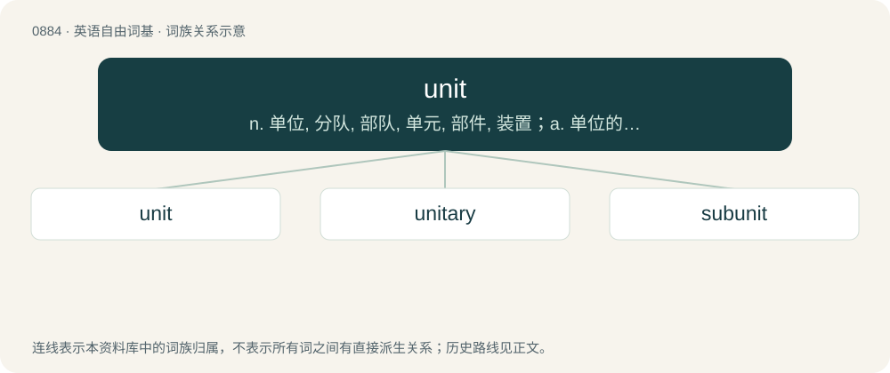

# 0957 · unit — n. 单位, 分队, 部队, 单元, 部件, 装置；a. 单位的, 单元的；\[计\] 单元常数; 部件

[总目录](../00_总目录_按常用程度.md)

**类型**：英语自由词基　｜　**来源语言**：见词源记录

## 核心含义与来源

- 核心含义：n. 单位, 分队, 部队, 单元, 部件, 装置；a. 单位的, 单元的；\[计\] 单元常数; 部件
- 英文含义：Oneness, singularity, seen as a component of a whole number; a magnitude of one.
- 词形：unit

**来源记录 1**（名词；Oneness, singularity, seen as a component of a whole number; a magnitude of one.）

Formerly unite, a later form of unity; see unity.

## 词族图

## 单词速览（常用到不常用）

| 单词 | 音标 | 释义 |
|---|---|---|
| [unit](#w-1) | /ˈjuː.nɪt/ | n. 单位, 分队, 部队, 单元, 部件, 装置；a. 单位的, 单元的；\[计\] 单元常数; 部件 |
| [unitary](#w-2) | 英 /ˈjuːnɪt(ə)ɹi/ | a. 单位的, 单一的, 归一的, 整体的；\[化\] 幺正; 幺正的 |
| [subunit](#w-3) | 英 /sʌbˈjuːnɪt/ | \[计\] 子单元, 子单位；\[化\] 亚基 |

## 逐词详解

### 1. unit

**词性**：名词　｜　**音标**：/ˈjuː.nɪt/

**中文释义**：n. 单位, 分队, 部队, 单元, 部件, 装置；a. 单位的, 单元的；\[计\] 单元常数; 部件

**英文义项**：Oneness, singularity, seen as a component of a whole number; a magnitude of one. / A standard measure of a quantity or magnitude.

**词源与演化**：

Formerly unite, a later form of unity; see unity.

**例句**：

> We shipped nearly twice as many units this month as last month.

该用例对应义项：An item which may be sold singly.

### 2. unitary

**词性**：形容词　｜　**音标**：英 /ˈjuːnɪt(ə)ɹi/

**中文释义**：a. 单位的, 单一的, 归一的, 整体的；\[化\] 幺正; 幺正的

**英文义项**：Having the quality of oneness. / That concentrates power in a single body, rather than sharing it with more local bodies.

**构词拆分**：unit + -ary

**词源与演化**：

From unit + -ary.

**用法示例／搭配（非完整句）**：

> a unitary authority

该用例对应义项：That concentrates power in a single body, rather than sharing it with more local bodies.

### 3. subunit

**词性**：名词　｜　**音标**：英 /sʌbˈjuːnɪt/

**中文释义**：\[计\] 子单元, 子单位；\[化\] 亚基

**英文义项**：Any subdivision of a larger unit. / A protein subunit.

**构词拆分**：sub- + unit

**词源与演化**：

From sub- + unit.
