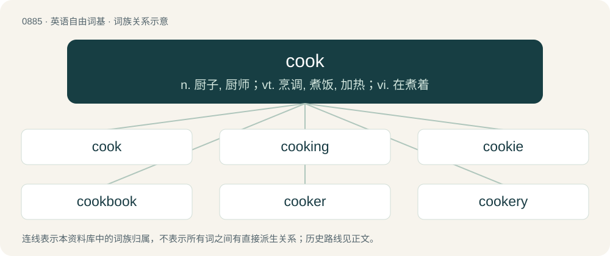

# 0958 · cook — n. 厨子, 厨师；vt. 烹调, 煮饭, 加热；vi. 在煮着

[总目录](../00_总目录_按常用程度.md)

**类型**：英语自由词基　｜　**来源语言**：见词源记录

## 核心含义与来源

- 核心含义：n. 厨子, 厨师；vt. 烹调, 煮饭, 加热；vi. 在煮着
- 英文含义：A person who prepares food.
- 词形：cook

**多个词源／构词路径**：同一拼写可能有不同来源；以下按词性和含义分别列出。

**来源记录 1**（名词；A person who prepares food.）

From Middle English cook, from Old English cōc (“a cook”), from Latin cocus, ultimately from Proto-Indo-European \*pekʷ- (“to cook, become ripe”). Cognates Cognate with Cimbrian khoch (“cook”), Dutch kok (“cook”), German Koch (“cook”), Luxembourgish Kach (“cook”), Danish kok (“cook”), Icelandic kokkur (“cook”), Norwegian Bokmål and Norwegian Nynorsk kokk (“cook”), Swedish kock (“cook”). Also compare Proto-West Germanic \*kokōn (“to cook”) (whence North Frisian kööge, kööki (“to cook, boil”), West Frisian koaitsje (“to cook”), Cimbrian khochan, khòchan (“to cook”), Dutch koken (“to cook”), German kochen (“to cook”), Limburgish kaoke, kauche (“to cook”), Luxembourgish kachen (“to cook”), Vilamovian kocha, koha (“to cook”), Yiddish קאָכן (kokhn, “to cook”)), from Late Latin cocō (“to cook”).

**来源记录 2**（动词；To prepare food for eating, typically by heating it, combining it with other ingredients, seasoning it, preparing it for serving, etc.）

From Middle English coken, from the noun cook. In the slang sense of "proceed with some plan", coined by American rapper from California Lil B in 2010 and popularized in viral tweets and TikToks in mid-2022.

## 词族图

## 单词速览（常用到不常用）

| 单词 | 音标 | 释义 |
|---|---|---|
| [cook](#w-1) | /kʊk/ | n. 厨子, 厨师；vt. 烹调, 煮饭, 加热；vi. 在煮着 |
| [cooking](#w-2) | 英 /ˈkʊkɪŋ/；/ˈkuːkɪŋ/ | n. 烹饪；\[化\] 熬炼; 热炼; 蒸煮 |
| [cookie](#w-3) | /ˈkʊki/ | 【英文】Affectionate name for a cook. |
| [cookbook](#w-4) | 英 /ˈkʊkˌbʊk/；/ˈkuːkˌbuːk/ | n. 食谱 |
| [cooker](#w-5) | 英 /ˈkʊkə/；美 /ˈkʊkɚ/ | n. 炊事用具, 炉灶, 锅, 炊具, 烹饪用水果, 窜改者, 伪造者；\[化\] 蒸锅 |
| [cookery](#w-6) | /ˈkʊk(ə)ɹi/ | n. 烹调法, 烹调术 |
| [cookware](#w-7) | /ˈkjkweə(r)/ | n. &lt;美&gt;\[总称\]烹饪用具,炊具 |
| [cookout](#w-8) | 美 /ˈkʊkaʊt/ | n. 在外面野餐的郊游 |
| [overcook](#w-9) | 美 /oʊ.vɚ.kʊk/ | vt 烹调过分的, 烹调过度的 |

## 逐词详解

### 1. cook

**词性**：名词　｜　**音标**：/kʊk/

**中文释义**：n. 厨子, 厨师；vt. 烹调, 煮饭, 加热；vi. 在煮着

**英文义项**：A person who prepares food. / The head cook of a manor house.

**词源与演化**：

From Middle English cook, from Old English cōc (“a cook”), from Latin cocus, ultimately from Proto-Indo-European \*pekʷ- (“to cook, become ripe”). Cognates Cognate with Cimbrian khoch (“cook”), Dutch kok (“cook”), German Koch (“cook”), Luxembourgish Kach (“cook”), Danish kok (“cook”), Icelandic kokkur (“cook”), Norwegian Bokmål and Norwegian Nynorsk kokk (“cook”), Swedish kock (“cook”). Also compare Proto-West Germanic \*kokōn (“to cook”) (whence North Frisian kööge, kööki (“to cook, boil”), West Frisian koaitsje (“to cook”), Cimbrian khochan, khòchan (“to cook”), Dutch koken (“to cook”), German kochen (“to cook”), Limburgish kaoke, kauche (“to cook”), Luxembourgish kachen (“to cook”), Vilamovian kocha, koha (“to cook”), Yiddish קאָכן (kokhn, “to cook”)), from Late Latin cocō (“to cook”).

**例句**：

> Police found two meth cooks working in the illicit lab.

该用例对应义项：One who manufactures certain illegal drugs, especially meth.

### 2. cooking

**词性**：名词　｜　**音标**：英 /ˈkʊkɪŋ/；/ˈkuːkɪŋ/

**中文释义**：n. 烹饪；\[化\] 熬炼; 热炼; 蒸煮

**英文义项**：The process of preparing food by using heat. / An instance of preparing food by using heat.

**构词拆分**：cook + -ing

**词源与演化**：

From cook + -ing. The noun and adjective follow from the verb. The use of the word cooking to describe cheap bitter was popularized by the title character of the BBC sitcom Oh No, It’s Selwyn Froggitt (1974-1978). It refers to cooking sherry, a kind of sherry used in cooking but not suitable for drinking on its own.

**例句**：

> My cooking isn't very good. I don't have any idea how to prepare a good meal.

该用例对应义项：One's ability to prepare food; cookery.

### 3. cookie

**词性**：名词　｜　**音标**：/ˈkʊki/

**英文义项**：Affectionate name for a cook.

**构词拆分**：From cook + -ie.

**词源与演化**：

From cook + -ie.

### 4. cookbook

**词性**：名词　｜　**音标**：英 /ˈkʊkˌbʊk/；/ˈkuːkˌbuːk/

**中文释义**：n. 食谱

**英文义项**：A book or an encyclopedia of recipes and cookery tips. / Any book or set of strategies and tips.

**构词拆分**：cook + book

**词源与演化**：

From cook + book; possibly also a calque of German Kochbuch, from kochen (“cook”) + Buch (“book”).

**例句**：

> Reading business biographies is interesting, but they are not cookbooks that can teach hacks how to be greats.

该用例对应义项：Any book or set of strategies and tips.

### 5. cooker

**词性**：名词　｜　**音标**：英 /ˈkʊkə/；美 /ˈkʊkɚ/

**中文释义**：n. 炊事用具, 炉灶, 锅, 炊具, 烹饪用水果, 窜改者, 伪造者；\[化\] 蒸锅

**英文义项**：A cookstove. / An appliance or utensil for cooking food.

**构词拆分**：cook + -er (agent noun suffix)

**词源与演化**：

From cook + -er (agent noun suffix) or + -er (patient suffix) (apple; one who is cooked).

**例句**：

> Tom always uses the rice cooker that he brought back from Japan.

### 6. cookery

**词性**：名词　｜　**音标**：/ˈkʊk(ə)ɹi/

**中文释义**：n. 烹调法, 烹调术

**英文义项**：The art and practice of preparing food for consumption, especially by the application of heat; cooking.

**构词拆分**：cook + -ery

**词源与演化**：

From Middle English cokerie, kokery, equivalent to cook + -ery.

**例句**：

> Henry was not very good at cookery and most of his meals ended up burned.

该用例对应义项：The art and practice of preparing food for consumption, especially by the application of heat; cooking.

### 7. cookware

**词性**：名词　｜　**音标**：/ˈkjkweə(r)/

**中文释义**：n. &lt;美&gt;\[总称\]烹饪用具,炊具

**英文义项**：The assorted objects, such as pots, pans, baking sheets, etc., used for cooking

**构词拆分**：cook + -ware

**词源与演化**：

From cook + -ware.

**例句**：

> Avoid using kitchen towels to handle hot cookware; use oven mitts instead.

### 8. cookout

**词性**：名词　｜　**音标**：美 /ˈkʊkaʊt/

**中文释义**：n. 在外面野餐的郊游

**英文义项**：A gathering for a meal that is cooked and eaten outside; either a domestic barbecue or a larger social event.

**构词拆分**：cook + out

**词源与演化**：

From cook + out.

**例句**：

> Tom hosted a cookout in his backyard.

### 9. overcook

**词性**：动词　｜　**音标**：美 /oʊ.vɚ.kʊk/

**中文释义**：vt 烹调过分的, 烹调过度的

**英文义项**：To cook for too long or at too high a temperature. / To do something to excess; to overdo; to ruin due to excessive effort.

**构词拆分**：over- + cook

**词源与演化**：

From over- + cook.

**例句**：

> The runner overcooked it on the first lap, and ended up finishing last.

该用例对应义项：To do something to excess; to overdo; to ruin due to excessive effort.
