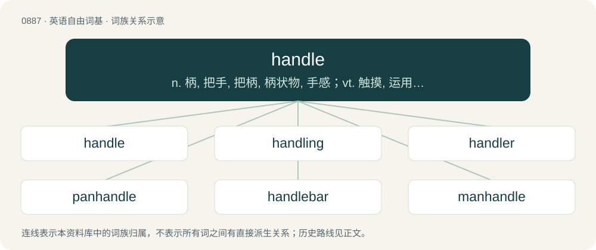

# 0959 · handle — n. 柄, 把手, 把柄, 柄状物, 手感；vt. 触摸, 运用, 买卖, 处理, 操作；vi. 搬运, 易于操纵

[总目录](../00_总目录_按常用程度.md)

**类型**：英语自由词基　｜　**来源语言**：见词源记录

## 核心含义与来源

- 核心含义：n. 柄, 把手, 把柄, 柄状物, 手感；vt. 触摸, 运用, 买卖, 处理, 操作；vi. 搬运, 易于操纵
- 英文含义：The part of an object which is (designed to be) held in the hand when used or moved.
- 词形：handle

**多个词源／构词路径**：同一拼写可能有不同来源；以下按词性和含义分别列出。

**来源记录 1**（名词；The part of an object which is (designed to be) held in the hand when used or moved.）

From Middle English handel, handle, from Old English handle (“handle”), from Proto-West Germanic \*handulā (“handle”). See verb below. Cognate with German Hantel (“dumbbell, barbell”), Danish handel (“handle”). Related to hand.

**来源记录 2**（动词；To touch; to feel or hold with the hand(s).）

From Middle English handlen, from Old English handlian (“to handle, feel, deal with, discuss”), from Proto-West Germanic \*handulōn, from Proto-Germanic \*handulōną (“to take, grip, feel”), equivalent to hand + -le. Cognate with West Frisian handelje, hanneljen, hanljen (“to handle, treat”), Dutch handelen (“to handle, deal, act, negotiate”), German handeln (“to act, trade, negotiate, behave”), Swedish handla (“to buy, trade, deal”), Icelandic höndla (“to handle”).

## 词族图

## 单词速览（常用到不常用）

| 单词 | 音标 | 释义 |
|---|---|---|
| [handle](#w-1) | /ˈhæn.d(ə)l/ | n. 柄, 把手, 把柄, 柄状物, 手感；vt. 触摸, 运用, 买卖, 处理, 操作；vi. 搬运, 易于操纵 |
| [handling](#w-2) | /ˈhændl̩ɪŋ/ | n. 处理；a. 操作的 |
| [handler](#w-3) | 英 /ˈhænd.lə/；美 /ˈhænd.lɚ/ | n. 处理者, 操作者, 拳击教练；\[经\] 管理者 |
| [panhandle](#w-4) | 英 /ˈpænˌhæn.dəl/ | n. 锅柄, 锅柄状地区, 狭长土地；v. 街头行乞, 讨钱 |
| [handlebar](#w-5) | 英 /ˈhændəlbɑː/；美 /ˈhændəlbɑːɹ/ | n. 手把, 八字胡 |
| [manhandle](#w-6) | /ˈmænˌhæn.dəl/ | vt. 人工推动, 粗暴地对付 |

## 逐词详解

### 1. handle

**词性**：名词　｜　**音标**：/ˈhæn.d(ə)l/

**中文释义**：n. 柄, 把手, 把柄, 柄状物, 手感；vt. 触摸, 运用, 买卖, 处理, 操作；vi. 搬运, 易于操纵

**英文义项**：The part of an object which is (designed to be) held in the hand when used or moved. / An instrument for effecting a purpose (either literally or figuratively); a tool, or an opportunity or pretext.

**词源与演化**：

From Middle English handel, handle, from Old English handle (“handle”), from Proto-West Germanic \*handulā (“handle”). See verb below. Cognate with German Hantel (“dumbbell, barbell”), Danish handel (“handle”). Related to hand.

**例句**：

> The successful businessman was knighted and acquired a handle to his name.

该用例对应义项：A title attached to one's name, such as Doctor or Colonel.

### 2. handling

**词性**：名词　｜　**音标**：/ˈhændl̩ɪŋ/

**中文释义**：n. 处理；a. 操作的

**英文义项**：A touching, controlling, managing, using, taking care of, etc., with the hand or hands, or as with the hands. / The mode of using the pencil or brush; style of touch.

**构词拆分**：handle + -ing

**词源与演化**：

From Middle English handlinge, hondlunge, from Old English handlung (“handling”), equivalent to handle + -ing. Cognate with Dutch handeling (“trade, operation, action”), German Handlung (“act, action”), Swedish handling (“act, deed, action”).

**用法示例／搭配（非完整句）**：

> baggage handling

该用例对应义项：A touching, controlling, managing, using, taking care of, etc., with the hand or hands, or as with the hands.

### 3. handler

**词性**：名词　｜　**音标**：英 /ˈhænd.lə/；美 /ˈhænd.lɚ/

**中文释义**：n. 处理者, 操作者, 拳击教练；\[经\] 管理者

**英文义项**：One who handles something (especially manually) or someone. / A controller, trainer, someone who handles a specified thing, animal or person (especially a prizefighter).

**构词拆分**：handle + -er

**词源与演化**：

From Middle English handler, handiller, equivalent to handle + -er.

**例句**：

> The spy's handler told him to approach the subject by posing as a dog handler.

该用例对应义项：A controller, trainer, someone who handles a specified thing, animal or person (especially a prizefighter).

### 4. panhandle

**词性**：名词　｜　**音标**：英 /ˈpænˌhæn.dəl/

**中文释义**：n. 锅柄, 锅柄状地区, 狭长土地；v. 街头行乞, 讨钱

**英文义项**：The handle of a pan. / An area within a nation or subnational division that appears to stick out or project when viewed on a map; an especially elongated salient.

**构词拆分**：pan + handle

**词源与演化**：

From pan + handle.

**例句**：

> Wheeling is located in the northern panhandle of West Virginia.

该用例对应义项：a relatively narrow strip of land projecting from some larger area

### 5. handlebar

**词性**：名词　｜　**音标**：英 /ˈhændəlbɑː/；美 /ˈhændəlbɑːɹ/

**中文释义**：n. 手把, 八字胡

**英文义项**：The bar used to steer a bicycle, motorbike, or similar vehicle using the hands. / Xanax.

**构词拆分**：handle + bar

**词源与演化**：

From handle + bar.

**例句**：

> If I could grow a mustache, it would definitely be a handlebar mustache.

### 6. manhandle

**词性**：动词　｜　**音标**：/ˈmænˌhæn.dəl/

**中文释义**：vt. 人工推动, 粗暴地对付

**英文义项**：To move something heavy by force of men, without aid of levers, pulleys, machine, or tackles. / To assault or beat up a person.

**构词拆分**：man (“male person”) + handle

**词源与演化**：

From Middle English manne-handlen, man handelen, equivalent to man (“male person”) + handle.
