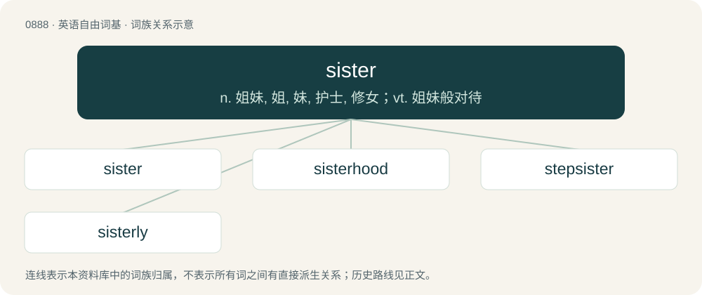

# 0960 · sister — n. 姐妹, 姐, 妹, 护士, 修女；vt. 姐妹般对待

[总目录](../00_总目录_按常用程度.md)

**类型**：英语自由词基　｜　**来源语言**：见词源记录

## 核心含义与来源

- 核心含义：n. 姐妹, 姐, 妹, 护士, 修女；vt. 姐妹般对待
- 英文含义：A daughter of the same parents as another person; a female sibling.
- 词形：sister

**来源记录 1**（名词；A daughter of the same parents as another person; a female sibling.）

Inherited from Middle English suster, from Old English sweostor, from Proto-West Germanic \*swester, from Proto-Germanic \*swestēr, from Proto-Indo-European \*swésōr. Doublet of soror. Cognate with Scots sister, syster (“sister”), West Frisian sus, suster (“sister”), Dutch zuster (“sister”), German Schwester (“sister”), Norwegian Bokmål søster (“sister”), Norwegian Nynorsk and Swedish syster (“sister”), Icelandic systir (“sister”), Gothic 𐍃𐍅𐌹𐍃𐍄𐌰𐍂 (swistar, “sister”), Latin soror (“sister”), Russian сестра́ (sestrá, “sister”), Lithuanian sesuo (“sister”), Albanian vajzë (“girl, maiden”), Sanskrit स्वसृ (svásṛ, “sister”), Persian خواهر (xâhar, “sister”). In standard English, the form with i is due to contamination with Old Norse systir (“sister”). The plural sistren is from Middle English sistren, a variant plural of sister, suster (“sister”); compare brethren. The sense for "Adelpha-genus butterfly" is a semantic loan from translingual Adelpha, itself from Ancient Greek ἀδελφή (adelphḗ, “sister”).

## 词族图

## 单词速览（常用到不常用）

| 单词 | 音标 | 释义 |
|---|---|---|
| [sister](#w-1) | 英 /ˈsɪs.tə(ɹ)/；美 /ˈsɪs.tɚ/ | n. 姐妹, 姐, 妹, 护士, 修女；vt. 姐妹般对待 |
| [sisterhood](#w-2) | 英 /ˈsɪstə.hʊd/；美 /ˈsɪstɚˌhʊd/ | n. 姊妹关系, 姊妹之谊, 妇女团体 |
| [stepsister](#w-3) | /ˈstepsistə/ | n. 异父(母)姊妹 |
| [sisterly](#w-4) | 英 /ˈsɪstəli/ | a. 姊妹一般的, 象姊妹的 |

## 逐词详解

### 1. sister

**词性**：名词　｜　**音标**：英 /ˈsɪs.tə(ɹ)/；美 /ˈsɪs.tɚ/

**中文释义**：n. 姐妹, 姐, 妹, 护士, 修女；vt. 姐妹般对待

**英文义项**：A daughter of the same parents as another person; a female sibling. / A female member of a religious order; especially one devoted to more active service; (informal) a nun.

**词源与演化**：

Inherited from Middle English suster, from Old English sweostor, from Proto-West Germanic \*swester, from Proto-Germanic \*swestēr, from Proto-Indo-European \*swésōr. Doublet of soror. Cognate with Scots sister, syster (“sister”), West Frisian sus, suster (“sister”), Dutch zuster (“sister”), German Schwester (“sister”), Norwegian Bokmål søster (“sister”), Norwegian Nynorsk and Swedish syster (“sister”), Icelandic systir (“sister”), Gothic 𐍃𐍅𐌹𐍃𐍄𐌰𐍂 (swistar, “sister”), Latin soror (“sister”), Russian сестра́ (sestrá, “sister”), Lithuanian sesuo (“sister”), Albanian vajzë (“girl, maiden”), Sanskrit स्वसृ (svásṛ, “sister”), Persian خواهر (xâhar, “sister”). In standard English, the form with i is due to contamination with Old Norse systir (“sister”). The plural sistren is from Middle English sistren, a variant plural of sister, suster (“sister”); compare brethren. The sense for "Adelpha-genus butterfly" is a semantic loan from translingual Adelpha, itself from Ancient Greek ἀδελφή (adelphḗ, “sister”).

**例句**：

> Connie was very close to her friend Judy and considered her to be her sister.

该用例对应义项：Any woman or girl with whom a bond is felt through the same biological sex, gender or common membership in a community, race, profession, religion, organization, or ism.

### 2. sisterhood

**词性**：名词　｜　**音标**：英 /ˈsɪstə.hʊd/；美 /ˈsɪstɚˌhʊd/

**中文释义**：n. 姊妹关系, 姊妹之谊, 妇女团体

**英文义项**：The state, or kinship of being sisters. / The quality of being sisterly; sisterly companionship; especially, the sense that women have of being in solidarity with one another.

**构词拆分**：sister + -hood

**词源与演化**：

From Middle English susterhede; equivalent to sister + -hood (with a modification in the suffix).

### 3. stepsister

**词性**：名词　｜　**音标**：/ˈstepsistə/

**中文释义**：n. 异父(母)姊妹

**英文义项**：The daughter of one's stepparent by a previous relationship. / The stepdaughter of one's parent which is not one's half-sister.

**构词拆分**：step- + sister

**词源与演化**：

From step- + sister.

**例句**：

> I get on well with my stepsister but not with my stepmother.

### 4. sisterly

**词性**：形容词　｜　**音标**：英 /ˈsɪstəli/

**中文释义**：a. 姊妹一般的, 象姊妹的

**英文义项**：Of or characteristic of sisters.

**构词拆分**：sister + -ly

**词源与演化**：

From sister + -ly (adjectival suffix).

**例句**：

> Sisterly love is among the strongest of all.
