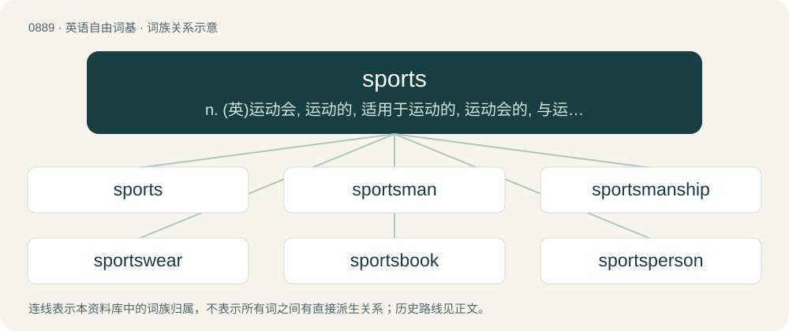

# 0961 · sports — n. (英)运动会, 运动的, 适用于运动的, 运动会的, 与运动会有关的

[总目录](../00_总目录_按常用程度.md)

**类型**：英语自由词基　｜　**来源语言**：见词源记录

## 核心含义与来源

- 核心含义：n. (英)运动会, 运动的, 适用于运动的, 运动会的, 与运动会有关的
- 英文含义：Synonym of sport (“the class of physical activies; athletics”).
- 词形：sports

**来源记录 1**（名词；Synonym of sport (“the class of physical activies; athletics”).）

From sport + -s.

## 词族图

## 单词速览（常用到不常用）

| 单词 | 音标 | 释义 |
|---|---|---|
| [sports](#w-1) | /spɔːɹts/ | n. (英)运动会, 运动的, 适用于运动的, 运动会的, 与运动会有关的 |
| [sportsman](#w-2) | /ˈspɒːtsmən/ | n. 运动员, 冒险家 |
| [sportsmanship](#w-3) | /ˈspɒːtsmənʃip/ | n. 运动员精神 |
| [sportswear](#w-4) | /ˈspɒːtswєə/ | n. 运动装, 休闲服 |
| [sportsbook](#w-5) |  | 【英文】A place where a gambler can bet on various sports competitions; the company that runs it; the website that is its online presence. (Most such companies offer online betting, subject to geofencing by state.) |
| [sportsperson](#w-6) | 英 /spɔːtspɜːsən/；美 /spɔɹtspɝsən/ | n. 运动员 |

## 逐词详解

### 1. sports

**词性**：名词　｜　**音标**：/spɔːɹts/

**中文释义**：n. (英)运动会, 运动的, 适用于运动的, 运动会的, 与运动会有关的

**英文义项**：Synonym of sport (“the class of physical activies; athletics”).

**构词拆分**：sport + -s

**词源与演化**：

From sport + -s.

**例句**：

> If it were not for sports, how dull school life would be!

### 2. sportsman

**词性**：名词　｜　**音标**：/ˈspɒːtsmən/

**中文释义**：n. 运动员, 冒险家

**英文义项**：A man who engages in sports; an athlete. / A man who engages in country sports, such as hunting or fishing.

**构词拆分**：sports + -man

**词源与演化**：

From sports + -man.

**例句**：

> Poor eyesight is a handicap to a sportsman.

### 3. sportsmanship

**词性**：名词　｜　**音标**：/ˈspɒːtsmənʃip/

**中文释义**：n. 运动员精神

**英文义项**：The good attitude/behaviour displayed by players of a game; fairness, determination, magnanimity, courtesy towards opponents, and winning or losing gracefully. / The behaviour exhibited in playing sports, either good or bad.

**构词拆分**：From sports + -manship.

**词源与演化**：

From sports + -manship.

**例句**：

> James showed good sportsmanship in consoling Shankar after his wicket fell.

该用例对应义项：The behaviour exhibited in playing sports, either good or bad.

### 4. sportswear

**词性**：名词　｜　**音标**：/ˈspɒːtswєə/

**中文释义**：n. 运动装, 休闲服

**英文义项**：Casual clothing that is comfortable to wear when exercising or partaking in sport; activewear.

**构词拆分**：sports + -wear

**词源与演化**：

From sports + -wear.

**例句**：

> Sportswear is frequently worn as everyday wear by many college students.

### 5. sportsbook

**词性**：名词

**英文义项**：A place where a gambler can bet on various sports competitions; the company that runs it; the website that is its online presence. (Most such companies offer online betting, subject to geofencing by state.)

**构词拆分**：sports + book

**词源与演化**：

From sports + book.

### 6. sportsperson

**词性**：名词　｜　**音标**：英 /spɔːtspɜːsən/；美 /spɔɹtspɝsən/

**中文释义**：n. 运动员

**英文义项**：Someone who plays sport, regardless of gender.

**构词拆分**：sports + -person

**词源与演化**：

From sports + -person.
