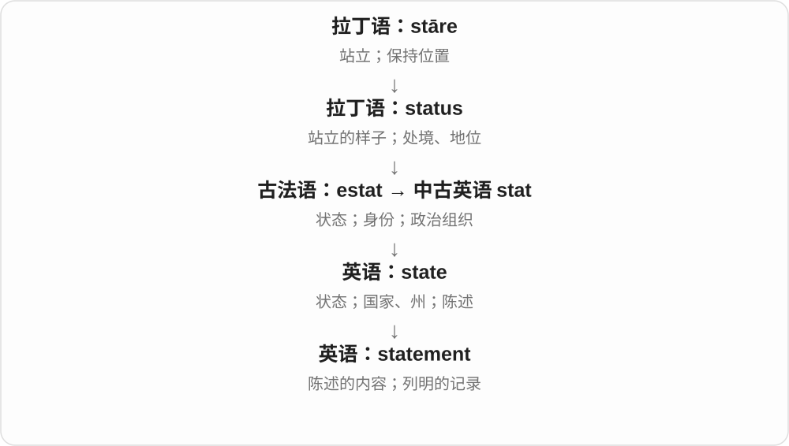

# 0962 · statement — 陈述如何改变分量：说轻、说重、再说

[逐词精讲目录](../00_逐词精讲目录.md) · [总目录](../00_总目录_按常用程度.md)

## 核心词根与来源

这一页延伸既有 state 陈述词族。前缀说明表述与实际的关系，不是把每个词重新拆成站立来死译。

**STATEMENT：说出来的内容，可以不足、过量或再表述**

先读已有 statement，再连续对照 understatement、overstatement、restatement。

- **基本陈述**：statement
- **分量与重复**：understatement · overstatement · restatement
- **statement → statements：说出的内容与文字记录**：statement · statements

## 词形与演化规律

state + -ment；under-/over-/re- + statement；也有相应动词 + -ment 的分析。

state 陈述加 ment，现代可数不同说法、正式声明或报表记录。

## 单词速览（按词族由简到繁）

同一基础词的相关扩展放在一起，先读基础形式，再读扩展；各组之间优先读常用的。具体词源关系见各词讲解。

| 单词 | 音标 | 核心意思 |
|---|---|---|
| [statement](#w-1) | /ˈsteɪtmənt/ | 声明；陈述；账单、对账单 |
| [statements](#w-5) | /ˈsteɪtmənts/ | 说法、陈述；声明；账单、报表；程序语句〔复数〕 |
| [understatement](#w-2) | 英 /ˌʌndəˈsteɪtmənt/；美 /ˌʌndərˈsteɪtmənt/ | 轻描淡写；保守、低于实际的说法 |
| [overstatement](#w-3) | 英 /ˌəʊvəˈsteɪtmənt/；美 /ˌoʊvərˈsteɪtmənt/ | 夸大；超过实际的陈述 |
| [restatement](#w-4) | /ˌriːˈsteɪtmənt/ | 重新表述；重申；重新编报的陈述 |

## 逐词讲解

### 1. statement — 声明；陈述；账单、对账单

**音标**：/ˈsteɪtmənt/

**先抓住这个画面**

把要表达的内容正式摆出来，形成一段可以引用、核对的话，就是 statement。银行把账目列出来，也叫 statement。

**怎么拆**

state（陈述）+ -ment（行为或结果）。

**怎么变成今天的意思**

它从“说清楚一件事”扩展到书面的正式记录。衣着作 statement 时，是通过外观表达鲜明态度，不一定说出一句话。

**常见搭配与例句**

issue a statement；a witness statement；a bank statement；make a statement。

> The company issued a statement about the delay.

公司就延误发表了一份声明。

> I checked the charge against my bank statement.

我对照银行对账单核查了这笔收费。

**别混淆**

sentence 是语法上的一句话；statement 是一次陈述或所表达的内容，可能长达几段。

### 2. statements — 说法、陈述；声明；账单、报表；程序语句〔复数〕

**音标**：/ˈsteɪtmənts/

**先抓住这个画面**

把内容明确说出来或写下来，就得到一条 statement；正式声明、账户往来记录、程序中的一条指令，各自在陈述、列明的用途上发展。

**怎么拆**

statement + -s，/t/ 后读 /s/。state 陈述 + -ment 行为或结果 → statement；再加普通复数。不同领域把说出、列明的结果固定成专门名称。

**怎么变成今天的意思**

**state + -ment → statement**  
陈述动作 → 说出的内容、写下的说明

↓

**专门用法发展；statement + -s → statements**  
多个说法、声明、报表或程序语句

official statements 正式声明；bank statements 银行账户对账单；false statements 虚假陈述；program statements 程序语句。

**常见搭配与例句**

statements made at the meeting；statements printed each month。

> The report compares statements made by several witnesses.

报告比较了几位证人的陈述。

> She keeps her bank statements in a folder.

她把银行对账单放在一个文件夹里。

**别混淆**

statement 不自动保证内容真实，事实判断还看证据。bank statements 是列明账户往来的记录，不能只译成银行发布的声明。

### 3. understatement — 轻描淡写；保守、低于实际的说法

**音标**：英 /ˌʌndəˈsteɪtmənt/；美 /ˌʌndərˈsteɪtmənt/

**先抓住这个画面**

已经累得站不住，却说有点累；说出口的分量比真实情况轻。

**怎么拆**

可按 under- 不足 + statement 分析，也对应 understate + -ment。它既可指修辞上的有意说轻，也可指实际陈述不足，不能一律当故意撒谎。

**怎么变成今天的意思**

**state〔陈述〕+ -ment → statement**  
把事情说出来的陈述、说法

↓

**under-/over-/re- 与 statement 组合**  
说轻、说过头、重新表达

↓

**under- + statement → understatement**  
说得低于实际；轻描淡写

To say I was tired would be an understatement. 说我累了都算轻的。常用 understatement 强调实际程度远超那个形容词。

**常见搭配与例句**

a huge understatement；a masterpiece of understatement；would be an understatement。

> Calling the journey difficult would be an understatement.

说这趟旅程艰难，都算轻描淡写。

> Her calm description was a remarkable piece of understatement.

她平静的描述把事情说得格外轻。

**别混淆**

understatement 说轻；overstatement 说过头。underestimate 是估计偏低，未必已经向别人作了陈述。

### 4. overstatement — 夸大；超过实际的陈述

**音标**：英 /ˌəʊvəˈsteɪtmənt/；美 /ˌoʊvərˈsteɪtmənt/

**先抓住这个画面**

东西有点好，却说成全世界最好；陈述往实际之上抬得过高。

**怎么拆**

overstate + -ment，也可看成 over- 过量 + statement。名词指夸大这个做法或具体那句话。

**怎么变成今天的意思**

**state〔陈述〕+ -ment → statement**  
把事情说出来的陈述、说法

↓

**under-/over-/re- 与 statement 组合**  
说轻、说过头、重新表达

↓

**overstate + -ment／over- + statement → overstatement**  
说过头、超过实际的表述

an overstatement of the benefits 夸大好处，without overstatement 不夸张地说。可谈数字、效果，也可谈人的评价。

**常见搭配与例句**

an overstatement of；a serious overstatement；without overstatement。

> Calling it a complete failure is an overstatement.

说它彻底失败，有些夸大。

> The report contains an overstatement of the likely benefits.

报告夸大了可能带来的好处。

**别混淆**

overstatement 是说过头；overestimate 是估计偏高。一个估计如果被公开说出，也可能同时属于两者。

### 5. restatement — 重新表述；重申；重新编报的陈述

**音标**：/ˌriːˈsteɪtmənt/

**先抓住这个画面**

意思再说一遍，可能换个更清楚的表达，也可能更正之前写下的内容。

**怎么拆**

re- 再次 + statement，也对应 restate + -ment。re- 说明重新做，不自动保证逐字重复或内容完全不变。

**怎么变成今天的意思**

**state〔陈述〕+ -ment → statement**  
把事情说出来的陈述、说法

↓

**under-/over-/re- 与 statement 组合**  
说轻、说过头、重新表达

↓

**re- + statement → restatement**  
再次陈述；重述、重申或更正后陈述

a restatement of the main idea 重新表述主旨，a restatement of policy 重申政策；财务语境也可指重编、更正报表。

**常见搭配与例句**

a restatement of；a clear restatement；a financial restatement。

> The final paragraph is a clear restatement of the main idea.

最后一段清楚地重述了主旨。

> The company announced a restatement of its earlier figures.

公司宣布重新编报此前公布的数据。

**别混淆**

restatement 可换说法或更正，quotation 原话引用强调保留原来措辞。重述主旨不必把每个字照抄。

## 这一组要分清什么

understatement 说轻、overstatement 夸大；restatement 重述不必逐字照抄；estimate 估计与 state 陈述角度不同。

## 串起来练习

Calling the delay inconvenient was an understatement, so she gave a clearer restatement.

说延误只是不方便太轻了，于是她重新作了更清楚的表述。
