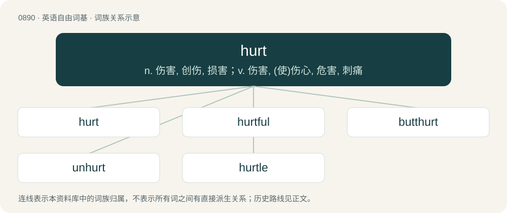

# 0963 · hurt — n. 伤害, 创伤, 损害；v. 伤害, (使)伤心, 危害, 刺痛

[总目录](../00_总目录_按常用程度.md)

**类型**：英语自由词基　｜　**来源语言**：见词源记录

## 核心含义与来源

- 核心含义：n. 伤害, 创伤, 损害；v. 伤害, (使)伤心, 危害, 刺痛
- 英文含义：To cause (a person or animal) physical pain and/or injury.
- 词形：hurt

**多个词源／构词路径**：同一拼写可能有不同来源；以下按词性和含义分别列出。

**来源记录 1**（动词；To cause (a person or animal) physical pain and/or injury.）

From Middle English hurten, hirten, hertan (“to injure, scathe, knock together”), from Old Northern French hurter ("to ram into, strike, collide with"; &gt; Modern French heurter), perhaps from Frankish \*hūrt (“a battering ram”), cognate with Welsh hwrdd (“ram”) and Cornish hordh (“ram”). Compare Proto-Germanic \*hrūtaną, \*hreutaną (“to fall, beat”), from Proto-Indo-European \*krew- (“to fall, beat, smash, strike, break”); however, the earliest instances of the verb in Middle English are as old as those found in Old French, which leads to the possibility that the Middle English word may instead be a reflex of an unrecorded Old English \*hyrtan, which later merged with the Old French verb. Germanic cognates include Dutch horten (“to push against, strike”), Middle Low German hurten (“to run at, collide with”), Middle High German hurten (“to push, bump, attack, storm, invade”), Old Norse hrútr (“battering ram”). Alternate etymology traces Old Northern French hurter rather to Old Norse hrútr (“ram (male sheep)”), lengthened-grade variant of hjǫrtr (“stag”), from Proto-Germanic \*herutuz, \*herutaz (“hart, male deer”), which would relate it to English hart (“male deer”). See hart.

**来源记录 2**（名词；A roundel azure (blue circular spot).）

Unclear. Suggestions include: from its resemblance to a blue hurtleberry, or from French heurt (a blow, leaving a blue bruise), the latter of which would make it a doublet of hurt Etymology 1; compare the theories about golpe (“purple roundel”)).

## 词族图

## 单词速览（常用到不常用）

| 单词 | 音标 | 释义 |
|---|---|---|
| [hurt](#w-1) | 英 /hɜːt/；美 /hɝt/ | n. 伤害, 创伤, 损害；v. 伤害, (使)伤心, 危害, 刺痛 |
| [hurtful](#w-2) | 英 /ˈhɜːtfʊl/；美 /ˈhɜɹtfʊl/ | a. 造成损害的, 伤感情的, 伤害的 |
| [butthurt](#w-3) | 英 /ˈbʌtˌhɜːt/；美 /ˈbʌtˌhɝt/ | 【英文】A feeling of offense caused by a perceived insult or injustice. |
| [unhurt](#w-4) | /ˈʌnˈhəːt/ | a. 没有受害的, 没有负伤的 |
| [hurtle](#w-5) | 英 /ˈhɜːtl̩/；美 /ˈhɜɹt(ə)l/ | vi. 猛冲, 碰撞, 突进；vt. 猛撞, 猛投；n. 投掷, 碰撞, 碰撞声 |

## 逐词详解

### 1. hurt

**词性**：动词　｜　**音标**：英 /hɜːt/；美 /hɝt/

**中文释义**：n. 伤害, 创伤, 损害；v. 伤害, (使)伤心, 危害, 刺痛

**英文义项**：To cause (a person or animal) physical pain and/or injury. / To cause (somebody) emotional pain.

**词源与演化**：

From Middle English hurten, hirten, hertan (“to injure, scathe, knock together”), from Old Northern French hurter ("to ram into, strike, collide with"; &gt; Modern French heurter), perhaps from Frankish \*hūrt (“a battering ram”), cognate with Welsh hwrdd (“ram”) and Cornish hordh (“ram”). Compare Proto-Germanic \*hrūtaną, \*hreutaną (“to fall, beat”), from Proto-Indo-European \*krew- (“to fall, beat, smash, strike, break”); however, the earliest instances of the verb in Middle English are as old as those found in Old French, which leads to the possibility that the Middle English word may instead be a reflex of an unrecorded Old English \*hyrtan, which later merged with the Old French verb. Germanic cognates include Dutch horten (“to push against, strike”), Middle Low German hurten (“to run at, collide with”), Middle High German hurten (“to push, bump, attack, storm, invade”), Old Norse hrútr (“battering ram”). Alternate etymology traces Old Northern French hurter rather to Old Norse hrútr (“ram (male sheep)”), lengthened-grade variant of hjǫrtr (“stag”), from Proto-Germanic \*herutuz, \*herutaz (“hart, male deer”), which would relate it to English hart (“male deer”). See hart.

**例句**：

> It wouldn't hurt to check the weather forecast and find out if it's going to rain.

该用例对应义项：To damage, harm, impair, undermine, impede.

### 2. hurtful

**词性**：形容词　｜　**音标**：英 /ˈhɜːtfʊl/；美 /ˈhɜɹtfʊl/

**中文释义**：a. 造成损害的, 伤感情的, 伤害的

**英文义项**：Tending to impair or damage; injurious; occasioning loss or injury. / Tending to hurt someone's feelings; insulting; lacerating.

**构词拆分**：hurt + -ful

**词源与演化**：

From hurt + -ful.

**例句**：

> Her hurtful unconsidered words.

该用例对应义项：causing hurt

### 3. butthurt

**词性**：名词　｜　**音标**：英 /ˈbʌtˌhɜːt/；美 /ˈbʌtˌhɝt/

**英文义项**：A feeling of offense caused by a perceived insult or injustice.

**构词拆分**：butt + hurt

**词源与演化**：

From butt + hurt. First use appears c. 1996 in the Usenet group alt.graffiti. See cite below.

**例句**：

> He's just full of butthurt because he wasn't allowed to join the society.

该用例对应义项：A feeling of offense caused by a perceived insult or injustice.

### 4. unhurt

**词性**：形容词　｜　**音标**：/ˈʌnˈhəːt/

**中文释义**：a. 没有受害的, 没有负伤的

**英文义项**：Not hurt; unharmed or unscathed

**构词拆分**：un- + hurt

**词源与演化**：

From Middle English unhert, un-hurt, unhurt, unhurte, equivalent to un- + hurt.

**例句**：

> Despite the dramatic accident, the passengers were unhurt and walked out unharmed.

### 5. hurtle

**词性**：动词　｜　**音标**：英 /ˈhɜːtl̩/；美 /ˈhɜɹt(ə)l/

**中文释义**：vi. 猛冲, 碰撞, 突进；vt. 猛撞, 猛投；n. 投掷, 碰撞, 碰撞声

**英文义项**：To move rapidly, violently, or without control, especially in a noisy manner.

**构词拆分**：hurt (“(obsolete) to knock; to strike”) + -le (frequentative suffix)

**词源与演化**：

The verb is derived from Middle English hurtelen, hurtlen (“to cast, hurl, throw; to charge at; to clash in combat, fight; to collide; to injure; to knock down; to propel, push, thrust; to rush; to stumble”) \[and other forms\], from hurten (“to injure, wound, hurt (physically or figuratively); to damage, impair; to hurt one’s feelings, humiliate; to receive an injury; to collide into; to propel, push, thrust; to stumble”) (see further at English hurt (verb)) + -el-, -elen (frequentative suffix). The English word is analysable as hurt (“(obsolete) to knock; to strike”) + -le (frequentative suffix). The noun is derived from the verb.

**例句**：

> The chimp's eyes narrowed, ready to hurtle the stone at the slightest provocation.
