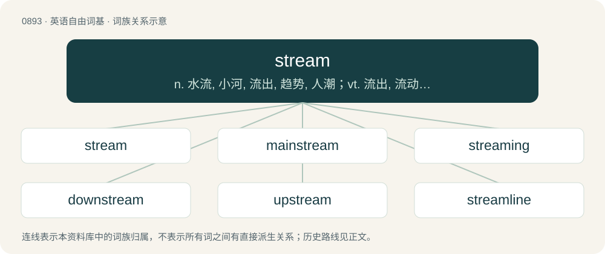

# 0965 · stream — n. 水流, 小河, 流出, 趋势, 人潮；vt. 流出, 流动, 展开；vi. 流, 涌, 飘扬

[总目录](../00_总目录_按常用程度.md)

**类型**：英语自由词基　｜　**来源语言**：见词源记录

## 核心含义与来源

- 核心含义：n. 水流, 小河, 流出, 趋势, 人潮；vt. 流出, 流动, 展开；vi. 流, 涌, 飘扬
- 英文含义：A small river; a large creek; a body of moving water confined by banks.
- 词形：stream

**来源记录 1**（名词；A small river; a large creek; a body of moving water confined by banks.）

From Middle English streem, strem, from Old English strēam, from Proto-West Germanic \*straum, from Proto-Germanic \*straumaz (“stream”), from Proto-Indo-European \*srowmos (“river”), from Proto-Indo-European \*srew- (“to flow”). Doublet of rheum. Cognate with Scots strem, streme, streym (“stream, river”), North Frisian Stroom, struum (“stream”), West Frisian stream (“stream”), Low German Stroom (“stream”), Dutch stroom (“current, flow, stream”), German Strom (“current, stream”), Danish and Norwegian Bokmål strøm (“current, stream, flow”), Norwegian Nynorsk straum (“current, stream, flow”), Swedish ström (“current, stream, flow”), Faroese streymur (“stream”), Icelandic straumur (“current, stream, torrent, flood”), Ancient Greek ῥεῦμα (rheûma, “stream, flow”), Lithuanian srovė (“current, stream”) Polish strumień (“stream”), Welsh ffrwd (“stream, current”), Scottish Gaelic sruth (“stream”).

## 词族图

## 单词速览（常用到不常用）

| 单词 | 音标 | 释义 |
|---|---|---|
| [stream](#w-1) | /ˈstɹiːm/ | n. 水流, 小河, 流出, 趋势, 人潮；vt. 流出, 流动, 展开；vi. 流, 涌, 飘扬 |
| [mainstream](#w-2) | 英 /ˈmeɪn.stɹiːm/；美 /ˈmeɪn.stɹim/ | n. 主流 |
| [streaming](#w-3) | /ˈstɹiːmɪŋ/ | \[电\] 流 |
| [downstream](#w-4) | /ˌdaʊnˈstɹiːm/ | adv. 下游地；a. 下游的 |
| [upstream](#w-5) | /ʌpˈstɹiːm/ | adv. 向上游, 逆流地；a. 向上游的, 逆流而上的 |
| [streamline](#w-6) | /ˈstriːmlaɪn/ | n. 流线, 流线型；vt. 使成流线型, 使合理化 |
| [bloodstream](#w-7) | 英 /ˈblʌd.stɹɪim/ | n. 血流 |
| [streamer](#w-8) | /ˈstɹiːmɚ/ | n. 横幅, 饰带, 流光, 通栏标题 |
| [livestream](#w-9) |  | 【英文】To broadcast as a live stream. |
| [midstream](#w-10) | /ˈmidstriːm/ | n. 河流正中, 中流 |
| [airstream](#w-11) | /ˈeəstriːm/ | n. 气流 |

## 逐词详解

### 1. stream

**词性**：名词　｜　**音标**：/ˈstɹiːm/

**中文释义**：n. 水流, 小河, 流出, 趋势, 人潮；vt. 流出, 流动, 展开；vi. 流, 涌, 飘扬

**英文义项**：A small river; a large creek; a body of moving water confined by banks. / All moving waters.

**词源与演化**：

From Middle English streem, strem, from Old English strēam, from Proto-West Germanic \*straum, from Proto-Germanic \*straumaz (“stream”), from Proto-Indo-European \*srowmos (“river”), from Proto-Indo-European \*srew- (“to flow”). Doublet of rheum. Cognate with Scots strem, streme, streym (“stream, river”), North Frisian Stroom, struum (“stream”), West Frisian stream (“stream”), Low German Stroom (“stream”), Dutch stroom (“current, flow, stream”), German Strom (“current, stream”), Danish and Norwegian Bokmål strøm (“current, stream, flow”), Norwegian Nynorsk straum (“current, stream, flow”), Swedish ström (“current, stream, flow”), Faroese streymur (“stream”), Icelandic straumur (“current, stream, torrent, flood”), Ancient Greek ῥεῦμα (rheûma, “stream, flow”), Lithuanian srovė (“current, stream”) Polish strumień (“stream”), Welsh ffrwd (“stream, current”), Scottish Gaelic sruth (“stream”).

**例句**：

> Not to switch streams, but we really need to focus on talking about the economy right now...

该用例对应义项：A train of thought or flow in a conversation or discussion.

### 2. mainstream

**词性**：形容词　｜　**音标**：英 /ˈmeɪn.stɹiːm/；美 /ˈmeɪn.stɹim/

**中文释义**：n. 主流

**英文义项**：Used or accepted broadly rather than by small portions of population, market, scientific community, etc.

**构词拆分**：main + stream

**词源与演化**：

From main + stream. Cognate with Icelandic meginstraumur (“a main current, mainstream”).

**例句**：

> They often carry stories you won't find in the mainstream media.

该用例对应义项：Used or accepted broadly rather than by small portions of population, market, scientific community, etc.

### 3. streaming

**词性**：形容词　｜　**音标**：/ˈstɹiːmɪŋ/

**中文释义**：\[电\] 流

**英文义项**：Flowing or moving in continuous succession, like fluid in a stream.

**构词拆分**：stream + -ing

**词源与演化**：

From Middle English stremyng, stremynge, stremande, equivalent to stream + -ing.

**例句**：

> Tears were streaming down Dmitri's face as he ran through the field.

### 4. downstream

**词性**：形容词　｜　**音标**：/ˌdaʊnˈstɹiːm/

**中文释义**：adv. 下游地；a. 下游的

**英文义项**：Toward the lower part of a stream; with the current (of a river, brook, or other flow of fluid). / Occurring later than something else; (also, usually, especially) influenced by something else; being a consequence of something else.

**构词拆分**：down- + stream

**词源与演化**：

From down- + stream.

**例句**：

> Input validation is downstream of input entry in the runtime process.

该用例对应义项：Occurring later than something else; (also, usually, especially) influenced by something else; being a consequence of something else.

### 5. upstream

**词性**：形容词　｜　**音标**：/ʌpˈstɹiːm/

**中文释义**：adv. 向上游, 逆流地；a. 向上游的, 逆流而上的

**英文义项**：In a direction against the flow of a current or stream of fluid (typically water); upriver. / Occurring earlier than something else; (also, usually, especially) being an influence on something else; causing a consequence for something else.

**构词拆分**：up- + stream

**词源与演化**：

From up- + stream.

**例句**：

> Input entry is upstream of input validation in the runtime process.

该用例对应义项：Occurring earlier than something else; (also, usually, especially) being an influence on something else; causing a consequence for something else.

### 6. streamline

**词性**：名词　｜　**音标**：/ˈstriːmlaɪn/

**中文释义**：n. 流线, 流线型；vt. 使成流线型, 使合理化

**英文义项**：A line that is tangent to the velocity of flow of a fluid; equivalent to the path of a specific particle in that flow. / On a weather chart, a line that is tangent to the flow of the wind.

**构词拆分**：stream + line

**词源与演化**：

From stream + line.

**例句**：

> The mayor of New York made an effort to streamline municipal government.

### 7. bloodstream

**词性**：名词　｜　**音标**：英 /ˈblʌd.stɹɪim/

**中文释义**：n. 血流

**英文义项**：The flow of blood through the circulatory system of an animal

**构词拆分**：blood + stream

**词源与演化**：

From blood + stream.

**例句**：

> The drug quickly entered the bloodstream.

该用例对应义项：The flow of blood through the circulatory system of an animal

### 8. streamer

**词性**：名词　｜　**音标**：/ˈstɹiːmɚ/

**中文释义**：n. 横幅, 饰带, 流光, 通栏标题

**英文义项**：A long, narrow flag, or piece of material used or seen as a decoration. / Strips of paper or other material used as confetti.

**构词拆分**：stream + -er

**词源与演化**：

From Middle English stremer, stremere, equivalent to stream + -er.

**用法示例／搭配（非完整句）**：

> Most streamers are on Twitch

该用例对应义项：A person who streams activities on their computer (especially video gaming) to a live online audience.

### 9. livestream

**词性**：动词

**英文义项**：To broadcast as a live stream. / To receive and watch as a live stream.

**构词拆分**：live + stream

**词源与演化**：

From live + stream.

**例句**：

> I'm planning to livestream the football game this weekend.

该用例对应义项：To receive and watch as a live stream.

### 10. midstream

**词性**：名词　｜　**音标**：/ˈmidstriːm/

**中文释义**：n. 河流正中, 中流

**英文义项**：The middle of a stream or river.

**构词拆分**：mid- + stream

**词源与演化**：

From mid- + stream.

### 11. airstream

**词性**：名词　｜　**音标**：/ˈeəstriːm/

**中文释义**：n. 气流

**英文义项**：A flow or current of air. / The flow of air around an object.

**构词拆分**：air + stream

**词源与演化**：

From air + stream.

**例句**：

> Maintaining a clean airstream around the car is important for good fuel economy.

该用例对应义项：The flow of air around an object.
