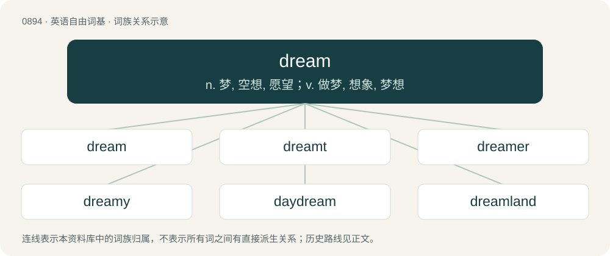

# 0967 · dream — n. 梦, 空想, 愿望；v. 做梦, 想象, 梦想

[总目录](../00_总目录_按常用程度.md)

**类型**：英语自由词基　｜　**来源语言**：见词源记录

## 核心含义与来源

- 核心含义：n. 梦, 空想, 愿望；v. 做梦, 想象, 梦想
- 英文含义：Imaginary events seen in the mind while sleeping.
- 词形：dream

**来源记录 1**（名词；Imaginary events seen in the mind while sleeping.）

From Middle English dream, dreem, dreeme, drem, dreme, dræm, from Old English drēam, drēm, drīm (“joy; melody, music; frenzy”), from Proto-West Germanic \*draum, from Proto-Germanic \*draumaz (“dream”), from earlier \*draugmaz, from Proto-Indo-European \*dʰrowgʰ-mos, from \*dʰrewgʰ- (“to deceive”). The sense of "dream", though not attested in Old English, may still have been present (compare Old Saxon drōm (“bustle, revelry, jubilation", also "dream”)), and was undoubtedly reinforced later in Middle English by Old Norse draumr (“dream”), from same Proto-Germanic root. Cognates Cognate with Scots dreme (“dream”), Saterland Frisian Droom (“dream”), West Frisian dream (“dream”), Dutch droom (“dream”), German Traum (“dream”), Limburgish Droum (“dream”), Luxembourgish Dram (“dream”), Yiddish טרוים (troym, “dream”), Danish and Norwegian Bokmål drøm (“dream”), Faroese dreymur (“dream”), Icelandic draumur (“dream”), Norwegian Nynorsk draum, drøm (“dream”), Swedish dröm (“dream”); also Breton drouk (“bad; evil”), Cornish drog (“bad; evil; invalid; nasty; wicked; wrong”), Irish droch- (“bad; ill-”), Manx drogh (“bad; evil”), Scottish Gaelic droch (“bad”), Welsh drwg (“bad; naughty”), Avestan 𐬛𐬭𐬎𐬲𐬀𐬌𐬙𐬌 (družaⁱti, “to deceive, mislead”), Bactrian λρωγο (lrōgo, “lie; falsehood”), Baluchi دروگ (darog, “lie; falsehood”), Central Kurdish درۆ (dro, “lie”), Northern Kurdish derew (“lie”), Pashto دروغ (droğ, “lie; falsehood”), Persian دُروغ (doruġ / durōġ, “lie; falsehood”), Sanskrit द्रुह्यति (druhyati, “to hurt; to bear malice or hatred; to be a foe or rival”). The verb is from Middle English dreamen, dreme, dremen, dreomen, possibly (see below) from Old English drēman, drīeman, drȳman (“to rejoice; to play an instrument joyously; to sing a song joyfully”), from Proto-West Germanic \*draumijan, from Proto-Germanic \*draumijaną (“to be dream”), from the noun. Cognates Cognate with North Frisian drem, driime (“to dream”), Saterland Frisian drööme (“to dream”), West Frisian dreame, dreamje (“to dream”), Bavarian dramma, trama (“to dream”), Central Franconian drööme (“to dream”), Cimbrian truamen (“to dream”), Dutch dromen (“to dream”), German träumen (“to dream”), Low German draimen (“to dream”), Luxembourgish dreemen (“to dream”), Yiddish טרוימען (troymen, “to dream”), Danish and Norwegian Bokmål drømme (“to dream”), Faroese droyma (“to dream”), Icelandic dreyma (“to dream”), Norwegian Nynorsk drømma, drømme, drøyma, drøyme (“to dream”), Swedish drömma (“to dream, muse”). more details The derivation from Old English drēam is controversial, since the word itself is only attested in writing in its meaning of “joy, mirth, musical sound”. Possibly there was a separate word drēam meaning “images seen while sleeping”, which was avoided in literature due to potential confusion with the “joy” sense. Otherwise, the modern sense must have been borrowed from another Germanic language, most probably Old Norse. Since this is the common sense in all Germanic languages outside the British isles, a spontaneous development from “joy, mirth” to “dream” in Middle English is hardly conceivable. In Old Saxon, the cognate drōm did mean “dream”, but was a rare word. Attested words for “sleeping vision” in Old English, both of which appeared in The Dream of the Rood, were mǣting (Middle English mæte, mete), from an unclear source, and swefn (Modern English sweven), from Proto-Germanic \*swefnaz, from Proto-Indo-European \*swepno-, \*swep-; compare Ancient Greek ὕπνος (húpnos, “sleep”).

## 词族图

## 单词速览（常用到不常用）

| 单词 | 音标 | 释义 |
|---|---|---|
| [dream](#w-1) | 英 /ˈdɹiːm/；美 /ˈdɹim/ | n. 梦, 空想, 愿望；v. 做梦, 想象, 梦想 |
| [dreamt](#w-2) | /dɹɛmt/ | dream的过去式和过去分词 |
| [dreamer](#w-3) | 英 /ˈdɹiːmə/；美 /ˈdɹimɚ/ | n. 做梦的人, 梦想者 |
| [dreamy](#w-4) | 英 /ˈdɹiː.mi/ | a. 空幻的, 梦想的 |
| [daydream](#w-5) | /ˈdeɪdɹiːm/ | n. 白日梦；vi. 做白日梦 |
| [dreamland](#w-6) | /ˈdriːmlænd/ | n. 梦境, 梦乡, 睡眠 |
| [dreamlike](#w-7) | 美 /ˈdɹimlaɪk/ | a. 梦一般的, 梦幻的 |
| [dreamworld](#w-8) | /ˈdriːmwɜːld/ | n. 梦样世界, 幻想世界; 梦境 |
| [dreamcatcher](#w-9) |  | 捕梦网（最初由美洲土著制作的一种带装饰网兜的圆环, 据信能给主人带来好梦） |
| [dreamscape](#w-10) | /ˈdriːmskeip/ | 幻景 |
| [dreamboat](#w-11) | 英 /ˈdɹiːmbəʊt/；美 /ˈdɹimˌboʊt/ | n. 梦中人 |

## 逐词详解

### 1. dream

**词性**：名词　｜　**音标**：英 /ˈdɹiːm/；美 /ˈdɹim/

**中文释义**：n. 梦, 空想, 愿望；v. 做梦, 想象, 梦想

**英文义项**：Imaginary events seen in the mind while sleeping. / A hope or wish.

**词源与演化**：

From Middle English dream, dreem, dreeme, drem, dreme, dræm, from Old English drēam, drēm, drīm (“joy; melody, music; frenzy”), from Proto-West Germanic \*draum, from Proto-Germanic \*draumaz (“dream”), from earlier \*draugmaz, from Proto-Indo-European \*dʰrowgʰ-mos, from \*dʰrewgʰ- (“to deceive”). The sense of "dream", though not attested in Old English, may still have been present (compare Old Saxon drōm (“bustle, revelry, jubilation", also "dream”)), and was undoubtedly reinforced later in Middle English by Old Norse draumr (“dream”), from same Proto-Germanic root. Cognates Cognate with Scots dreme (“dream”), Saterland Frisian Droom (“dream”), West Frisian dream (“dream”), Dutch droom (“dream”), German Traum (“dream”), Limburgish Droum (“dream”), Luxembourgish Dram (“dream”), Yiddish טרוים (troym, “dream”), Danish and Norwegian Bokmål drøm (“dream”), Faroese dreymur (“dream”), Icelandic draumur (“dream”), Norwegian Nynorsk draum, drøm (“dream”), Swedish dröm (“dream”); also Breton drouk (“bad; evil”), Cornish drog (“bad; evil; invalid; nasty; wicked; wrong”), Irish droch- (“bad; ill-”), Manx drogh (“bad; evil”), Scottish Gaelic droch (“bad”), Welsh drwg (“bad; naughty”), Avestan 𐬛𐬭𐬎𐬲𐬀𐬌𐬙𐬌 (družaⁱti, “to deceive, mislead”), Bactrian λρωγο (lrōgo, “lie; falsehood”), Baluchi دروگ (darog, “lie; falsehood”), Central Kurdish درۆ (dro, “lie”), Northern Kurdish derew (“lie”), Pashto دروغ (droğ, “lie; falsehood”), Persian دُروغ (doruġ / durōġ, “lie; falsehood”), Sanskrit द्रुह्यति (druhyati, “to hurt; to bear malice or hatred; to be a foe or rival”). The verb is from Middle English dreamen, dreme, dremen, dreomen, possibly (see below) from Old English drēman, drīeman, drȳman (“to rejoice; to play an instrument joyously; to sing a song joyfully”), from Proto-West Germanic \*draumijan, from Proto-Germanic \*draumijaną (“to be dream”), from the noun. Cognates Cognate with North Frisian drem, driime (“to dream”), Saterland Frisian drööme (“to dream”), West Frisian dreame, dreamje (“to dream”), Bavarian dramma, trama (“to dream”), Central Franconian drööme (“to dream”), Cimbrian truamen (“to dream”), Dutch dromen (“to dream”), German träumen (“to dream”), Low German draimen (“to dream”), Luxembourgish dreemen (“to dream”), Yiddish טרוימען (troymen, “to dream”), Danish and Norwegian Bokmål drømme (“to dream”), Faroese droyma (“to dream”), Icelandic dreyma (“to dream”), Norwegian Nynorsk drømma, drømme, drøyma, drøyme (“to dream”), Swedish drömma (“to dream, muse”). more details The derivation from Old English drēam is controversial, since the word itself is only attested in writing in its meaning of “joy, mirth, musical sound”. Possibly there was a separate word drēam meaning “images seen while sleeping”, which was avoided in literature due to potential confusion with the “joy” sense. Otherwise, the modern sense must have been borrowed from another Germanic language, most probably Old Norse. Since this is the common sense in all Germanic languages outside the British isles, a spontaneous development from “joy, mirth” to “dream” in Middle English is hardly conceivable. In Old Saxon, the cognate drōm did mean “dream”, but was a rare word. Attested words for “sleeping vision” in Old English, both of which appeared in The Dream of the Rood, were mǣting (Middle English mæte, mete), from an unclear source, and swefn (Modern English sweven), from Proto-Germanic \*swefnaz, from Proto-Indo-European \*swepno-, \*swep-; compare Ancient Greek ὕπνος (húpnos, “sleep”).

**例句**：

> This year I fulfilled a lifelong dream of visiting the South Pacific.

该用例对应义项：A hope or wish.

### 2. dreamt

**词性**：形容词　｜　**音标**：/dɹɛmt/

**中文释义**：dream的过去式和过去分词

**英文义项**：Imagined or only extant in a dream or dreams.

**构词拆分**：dream + -t

**词源与演化**：

From dream + -t.

**例句**：

> When I was in primary school, I dreamt of becoming a pilot.

### 3. dreamer

**词性**：名词　｜　**音标**：英 /ˈdɹiːmə/；美 /ˈdɹimɚ/

**中文释义**：n. 做梦的人, 梦想者

**英文义项**：One who dreams. / Someone whose beliefs are far from realistic.

**构词拆分**：dream + -er

**词源与演化**：

From Middle English dremer, dremere, dremare, equivalent to dream + -er. Cognate with West Frisian dreamer (“dreamer”), Saterland Frisian Dröömer (“dreamer”), Dutch dromer (“dreamer”), German Träumer (“dreamer”), Danish drømmer (“dreamer”), Swedish drömmare (“dreamer”).

**例句**：

> The real dreamer is he who dreams of the impossible.

### 4. dreamy

**词性**：形容词　｜　**音标**：英 /ˈdɹiː.mi/

**中文释义**：a. 空幻的, 梦想的

**英文义项**：As in a dream; resembling a dream. / Sexy; handsome; attractive.

**构词拆分**：dream + -y

**词源与演化**：

From dream + -y.

**例句**：

> I love the doctor in that American TV show: he is so dreamy!

该用例对应义项：Sexy; handsome; attractive.

### 5. daydream

**词性**：动词　｜　**音标**：/ˈdeɪdɹiːm/

**中文释义**：n. 白日梦；vi. 做白日梦

**英文义项**：To have such a series of thoughts; to woolgather.

**构词拆分**：day + dream

**词源与演化**：

From day + dream. Compare West Frisian deidream (“daydream”), Dutch dagdroom (“daydream”), German Tagtraum (“daydream”), Swedish dagdröm (“daydream”), Icelandic dagdraumur (“daydream”).

**例句**：

> Stop daydreaming and get back to work!

该用例对应义项：To have such a series of thoughts; to woolgather.

### 6. dreamland

**词性**：名词　｜　**音标**：/ˈdriːmlænd/

**中文释义**：n. 梦境, 梦乡, 睡眠

**英文义项**：An imaginary world experienced while dreaming. / An imagined world that is ideal yet unrealistic; a fantasy.

**构词拆分**：dream + -land

**词源与演化**：

From dream + -land.

**例句**：

> I desire to spend the whole day in dreamland.

### 7. dreamlike

**词性**：形容词　｜　**音标**：美 /ˈdɹimlaɪk/

**中文释义**：a. 梦一般的, 梦幻的

**英文义项**：Like something from a dream; having a sense of vagueness, insubstantiality, or incongruousness.

**构词拆分**：dream + -like

**词源与演化**：

From dream + -like.

**例句**：

> Her kiss sent me into a dreamlike state of bliss.

该用例对应义项：Like something from a dream; having a sense of vagueness, insubstantiality, or incongruousness.

### 8. dreamworld

**词性**：名词　｜　**音标**：/ˈdriːmwɜːld/

**中文释义**：n. 梦样世界, 幻想世界; 梦境

**英文义项**：An imaginary world, such as experienced while dreaming. / Synonym of dreamland (“ideal but unrealistic fantasy world”).

**构词拆分**：dream + world

**词源与演化**：

From dream + world. Compare West Frisian dreamwrâld (“dreamworld”), Dutch droomwereld, dromenwereld (“dreamworld”), German Traumwelt (“dreamworld”), Danish drømmeverden (“dreamworld”), Swedish drömvärld (“dreamworld”).

### 9. dreamcatcher

**词性**：名词

**中文释义**：捕梦网（最初由美洲土著制作的一种带装饰网兜的圆环, 据信能给主人带来好梦）

**英文义项**：A decorative Native American object in the form of a hoop and net with attachments such as feathers, traditionally believed by the Ojibwa to “filter out” bad dreams.

**构词拆分**：dream + catcher

**词源与演化**：

From dream + catcher.

**例句**：

> You can use a dreamcatcher to catch your nightmares.

### 10. dreamscape

**词性**：名词　｜　**音标**：/ˈdriːmskeip/

**中文释义**：幻景

**英文义项**：The landscape within a dream.

**构词拆分**：dream + -scape

**词源与演化**：

From dream + -scape.

### 11. dreamboat

**词性**：名词　｜　**音标**：英 /ˈdɹiːmbəʊt/；美 /ˈdɹimˌboʊt/

**中文释义**：n. 梦中人

**英文义项**：An exceptionally good-looking and sexually attractive person, particularly a man.

**构词拆分**：dream + boat

**词源与演化**：

From dream + boat, probably suggesting a person “carrying” or embodying the dreams of another; the term appeared in some 1930s and 1940s love songs, referring to a metaphorical boat carrying a lover’s dreams, such as “When My Dream Boat Comes Home” (1936) written by the Canadian-American bandleader Guy Lombardo (1902–1977) and “Someone’s Rocking My Dreamboat” (1941) by the American songwriters Otis (1898–1970) and Leon René (1902–1982), and Emerson Scott.

**例句**：

> My new fella is such a dreamboat. He can dance, can sing, and is the captain of the school hockey team.

该用例对应义项：An exceptionally good-looking and sexually attractive person, particularly a man.
