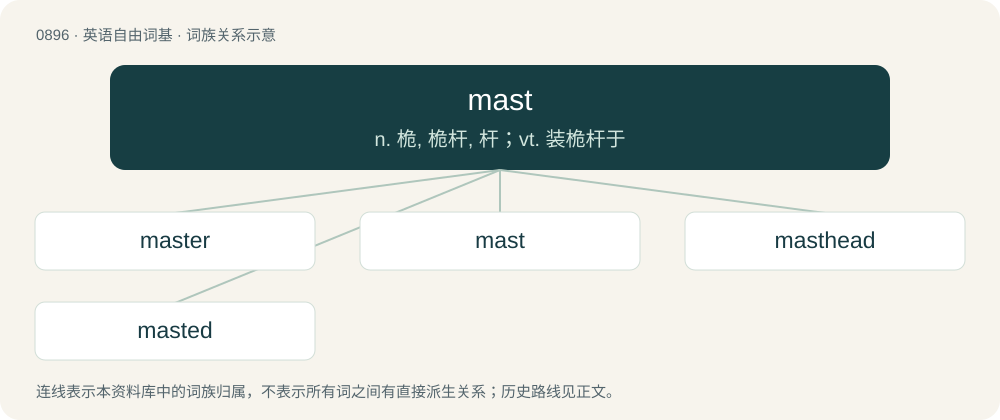

# 0970 · mast — n. 桅, 桅杆, 杆；vt. 装桅杆于

[总目录](../00_总目录_按常用程度.md)

**类型**：英语自由词基　｜　**来源语言**：见词源记录

## 核心含义与来源

- 核心含义：n. 桅, 桅杆, 杆；vt. 装桅杆于
- 英文含义：A tall, slim post or tower, usually tapering upward, used to support, for example, sails or observation platforms on a ship, the main rotor of a helicopter, flags, floodlights, meteorological instruments, or communications equipment, such as an aerial, usually supported by guy-wires (except in the case of a helicopter).
- 词形：mast

**多个词源／构词路径**：同一拼写可能有不同来源；以下按词性和含义分别列出。

**来源记录 1**（名词；A tall, slim post or tower, usually tapering upward, used to support, for example, sails or observation platforms on a ship, the main rotor of a helicopter, flags, floodlights, meteorological instruments, or communications equipment, such as an aerial, usually supported by guy-wires (except in the case of a helicopter).）

From Middle English mast, from Old English mæst (“mast”), from Proto-West Germanic \*mast, from Proto-Germanic \*mastaz (“mast, sail-pole”), from Proto-Indo-European \*mazdos (“pole, mast”). Cognate with Dutch mast, German Mast, and via Indo-European with Latin mālus, Russian мост (most, “bridge”), Irish adhmad.

**来源记录 2**（名词；The fruit of forest-trees (beech, oak, chestnut, pecan, etc.), especially if having fallen from the tree, used as fodder for pigs and other animals.）

From Old English mæst (“fallen nuts, food for swine”) and mæstan (“to fatten”), from West Germanic; probably related to meat.

**来源记录 3**（名词；The anabolic steroid drostanolone propionate, also known as Masteron）

Clipping of Masteron.

## 词族图

## 单词速览（常用到不常用）

| 单词 | 音标 | 释义 |
|---|---|---|
| [master](#w-1) | 英 /ˈmɑːstə/；美 /ˈmæstɚ/ | 【英文】A vessel having a specified number of masts. |
| [mast](#w-2) | 英 /mɑːst/；美 /mæst/ | n. 桅, 桅杆, 杆；vt. 装桅杆于 |
| [masthead](#w-3) | /ˈmɑːsthed/ | n. 桅顶, 刊头, 报刊名称；vt. 升于桅顶, 爬到桅顶 |
| [masted](#w-4) | /ˈmɑːstid/ | a. 有桅的；…桅的 |

## 逐词详解

### 1. master

**词性**：名词　｜　**音标**：英 /ˈmɑːstə/；美 /ˈmæstɚ/

**英文义项**：A vessel having a specified number of masts.

**构词拆分**：mast + -er

**词源与演化**：

From mast + -er.

**用法示例／搭配（非完整句）**：

> a two-master

该用例对应义项：A vessel having a specified number of masts.

### 2. mast

**词性**：名词　｜　**音标**：英 /mɑːst/；美 /mæst/

**中文释义**：n. 桅, 桅杆, 杆；vt. 装桅杆于

**英文义项**：A tall, slim post or tower, usually tapering upward, used to support, for example, sails or observation platforms on a ship, the main rotor of a helicopter, flags, floodlights, meteorological instruments, or communications equipment, such as an aerial, usually supported by guy-wires (except in the case of a helicopter). / A non-judicial punishment ("NJP"); a disciplinary hearing under which a commanding officer studies and disposes of cases involving those under his command.

**词源与演化**：

From Middle English mast, from Old English mæst (“mast”), from Proto-West Germanic \*mast, from Proto-Germanic \*mastaz (“mast, sail-pole”), from Proto-Indo-European \*mazdos (“pole, mast”). Cognate with Dutch mast, German Mast, and via Indo-European with Latin mālus, Russian мост (most, “bridge”), Irish adhmad.

**例句**：

> As a mark of respect, the flag was lowered to half mast.

### 3. masthead

**词性**：名词　｜　**音标**：/ˈmɑːsthed/

**中文释义**：n. 桅顶, 刊头, 报刊名称；vt. 升于桅顶, 爬到桅顶

**英文义项**：The top of a mast. / The list of a newspaper's or another periodical's main staff, contributing writers, publisher, circulation, advertising rates etc.

**构词拆分**：mast + head

**词源与演化**：

From mast + head.

### 4. masted

**词性**：形容词　｜　**音标**：/ˈmɑːstid/

**中文释义**：a. 有桅的；…桅的

**英文义项**：Having (the specified kind or number of) masts.

**构词拆分**：From mast + -ed.

**词源与演化**：

From mast + -ed.

**例句**：

> It was a three-masted sailing ship.

该用例对应义项：Having (the specified kind or number of) masts.
